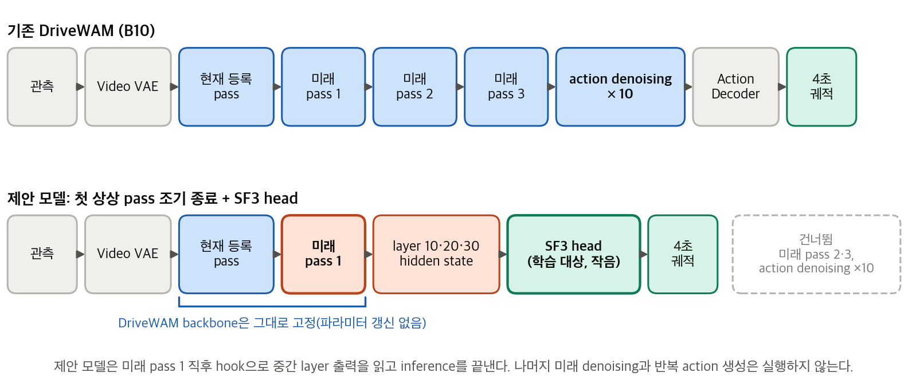
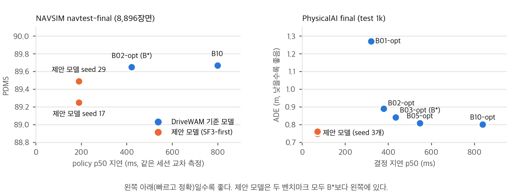

# DriveWAM Lightweight Action Readout

**고정된 주행 World-Action Model이 미래를 한 번 상상한 시점의 표현에서 action을 읽는 경량 head 연구**

[English README](README.md) · [연구설명 보고서 (PDF)](docs/report/DriveWAM_Lightweight_Action_Readout_연구설명.pdf) · [통합 연구 기록](docs/통합_연구기록.md) · [실험 근거](evidence/)

저자: **송용휘 (YongHwi Song)**, 충북대학교 학부 · [홈페이지](https://thddydgnl.github.io/) · 연구 기간: 2026-09-15 ~ 2026-10-08

---

## 한눈에 보기

[DriveWAM](https://github.com/chenshi3/DriveWAM)은 video diffusion transformer(Wan2.2-TI2V-5B) 기반의 6.24B 파라미터 주행 World-Action Model이다. 미래 영상 latent를 먼저 *상상*한 뒤, 같은 5B backbone을 **10회 더 실행**해 4초 action chunk를 denoising한다. 이 action denoising이 전체 지연에서 가장 큰 단일 항목이다.

이 연구의 질문은 다음과 같다. **backbone을 재학습하지 않고, DriveWAM이 미래를 한 번 상상한 순간 내부에 생긴 표현만으로 작은 head가 궤적을 직접 읽어낼 수 있는가?**

- 공개 checkpoint를 그대로 고정하고, **첫 번째 미래 denoising pass 중** transformer block 10·20·30의 hidden state를 hook으로 읽어, 약 1,000만 파라미터의 head(**SF3**, State-Fusion 3-level)로 4초 궤적을 회귀한다. 추론은 그 pass 직후 끝난다. 남은 미래 denoising과 action denoising 10회는 모두 건너뛴다.
- NAVSIM v1.1(장면 단위 계획, 규칙 기반 PDMS)과 NVIDIA PhysicalAI-AV(기억·언어 안내가 있는 연속 주행, ADE/FDE) 두 벤치마크에서 **사전등록한 protocol**로 평가했다.
- 비교 대상은 공식 DriveWAM(**B10**)만이 아니다. dev 세트에서 사전에 정한 품질 기준을 지키는 가장 빠른 저-step action denoising 변형 **B\***와 비교한다. "그냥 step 수를 줄이면 되지 않나"에 대한 공정한 기준이다.

### 핵심 결과 (잠금 final 세트, 1회 평가)

| | NAVSIM `navtest-final` (8,896장면) | PhysicalAI-AV 공식 test 1k |
|---|---|---|
| 공식 DriveWAM (B10) | PDMS 89.67, policy p50 797.9 ms | ADE 0.802 m / FDE 2.384 m, 결정 p50 837.8 ms |
| B\* (품질을 지키는 가장 빠른 저-step 기준) | B02-opt (action 2 step), 420.7 ms | B03-opt (action 3 step), 434.0 ms |
| **제안 모델 (SF3-first)** 품질 | PDMS 89.25 / 89.49 (seed 2개) | ADE 0.750 / 0.748 / 0.762 m, FDE 2.244 / 2.244 / 2.287 m (seed 3개) |
| **제안 모델 (SF3-first)** 결정 지연 | **189.0 ms** (B\*보다 2.2배, B10보다 4.2배 빠름) | **70.9 ms** (B\*보다 6.1배, B10보다 11.8배 빠름) |
| 사전등록 판정 | **근소 미통과**: seed 17의 DAC 조건을 한 장면 차이로 초과 (0.51 > 0.50) | **통과**: seed 3개 × 기준 7개 |



*위: 기존 DriveWAM. 아래: 제안 경로는 미래 pass 1 직후 block 10·20·30을 SF3 head로 읽고 추론을 끝낸다. backbone 파라미터는 갱신하지 않는다.*



*왼쪽 아래(빠르고 정확)일수록 좋다. 제안 모델은 두 벤치마크 모두 B\*보다 왼쪽에 있고 품질은 그 근처다.*

---

## 핵심 발견

1. **상상 한 번이 중요하다.** 순수 noise 미래 token이 관측 cache를 한 번 읽은 *first* 표현은 관측만 처리한 *current* 표현보다 훨씬 유용했다(NAVSIM +3.3 PDMS, PhysicalAI ADE −0.11 m). 상상을 끝까지 마친 *terminal* 표현은 readout에 추가 이득이 없었다(ΔADE +0.008 ~ +0.014 m, CI가 0 포함). 첫 pass에서 조기 종료할 수 있는 근거다.
2. **action 생성기를 줄이는 것보다 없애는 것이 낫다.** B\*는 action step을 2~3으로 줄여 이미 DriveWAM 지연을 절반으로 만든다. 제안 모델은 남은 미래 pass와 action denoising 전체를 생략하므로 B\*보다 다시 2.2배(NAVSIM), 6.1배(PhysicalAI) 빠르다.
3. **head 학습 데이터 규모가 결과를 결정했다.** 같은 구조에서 라벨만 늘리자 NAVSIM의 B10 대비 격차가 4k → 20k → 92.6k 장면에서 −4.2 → −1.3 → −0.4 PDMS로 줄었다. PhysicalAI에서도 4k head는 꼬리 오차 기준에 미달했고 20k head는 통과했다. 작은 head-train으로 "world 표현에는 action 정보가 없다"고 결론 내렸다면 틀렸을 것이다.
4. **기억과 언어 안내도 도움이 되지만 상상보다 작다.** 연속 주행 설정에서 과거 chunk 기억을 빼면 ADE +0.02~0.04 m, VLM 안내 문장을 빼면 +0.03~0.045 m 나빠진다. 둘 다 상상 효과(+0.11 m)보다 작다.
5. **직접 겪고 기록한 방법론적 함정.** (a) 공개 NAVSIM backbone은 navtrain 장면을 기억하고 있다. navtrain 내부 검증에서 B10의 4초 ADE는 0.076 m인데 처음 보는 navtest에서는 0.598 m다. 그래서 모든 결론을 처음 보는 navtest와 잠금 final로 옮겼다. (b) PhysicalAI 공식 single-seed protocol은 seed에 민감하다. B10 dev ADE가 seed 0~3에서 0.821~0.930으로 달랐고 공식 seed 0이 가장 유리했다. (c) 결정적 회귀기와 확률적 생성기를 평균 오차 지표로 비교하는 것은 공정하지 않다. B10 표본 4개 평균과 비교하면 제안 모델은 ADE 대등, FDE는 약 0.1 m 나쁘다. **따라서 "제안 모델이 DriveWAM보다 정확하다"고 주장하지 않는다.** 주장은 "평균 예측 수준의 품질을 한 번의 forward로, 훨씬 낮은 지연에 낸다"이다.

---

## 방법 요약

**고정 backbone과 표현 추출.** NAVSIM용·PhysicalAI용 공식 DriveWAM checkpoint를 수정 없이 쓴다. 공식 추론 루프를 단계별로 재구현해(원본과 비트 단위 일치 확인) forward hook으로 block 출력을 읽는다. hook은 출력을 바꾸지 않는다.

**표현을 읽는 세 시점** (같은 head를 시점별로 따로 학습):

| 시점 | backbone이 그때까지 한 일 | 비용 |
|---|---|---|
| `current` | 관측 프레임 등록. 상상 없음 | 가장 쌈 |
| **`first`** | 순수 noise 미래 token에 대한 첫 미래 pass (첫 상상) | **제안 모델이 쓰는 표현** |
| `terminal` | 미래 latent 갱신 3회를 모두 마친 뒤 | 미래 생성 전체 필요 |

**SF3 head** (`scripts/lightweight_heads.py`, `heads_v3.py`, `pai_heads.py`), 학습 파라미터 약 998만 개(backbone의 0.16%):

- level별(block 10·20·30, 112 token × 3072): LayerNorm → Linear 3072→512 → 학습 query 16개 × 8-head attention → 학습된 가중 합 → LayerNorm.
- ego MLP(NAVSIM: 과거 4 pose + 속도·가속도 + command, 20차원; PhysicalAI: 속도·가속도·곡률 5차원) → 128차원.
- 융합: concat(1,664) → Linear 512 + GELU → residual MLP 512→1024→512.
- 출력: driving state + step별 시간 임베딩 → LayerNorm → MLP → step별 정규화 (Δx, Δy, Δθ), 출력층 FP32. K = 8 pose @ 2 Hz(NAVSIM) 또는 40 step @ 10 Hz(PhysicalAI). 1%/99% 분위수 정규화, 누적합으로 pose 복원.
- 손실: 위치 Huber + 0.2 × (1 − cos Δθ) + 0.1 × 정규화 delta Huber.
- 학습 protocol(v2 이후 고정): 40 epoch, AdamW 3e-4, wd 0.01, batch 32, warm-up 5% + cosine, **마지막 checkpoint 사용(평가 세트로 선택하지 않음)**, 배포와 같은 batch 1 예측.

**비교 기준.** B10(공식)과 출력에 영향 없는 마지막 action cache pass를 생략하고 step 수를 줄인 *opt* 변형 B10/B05/B03/B02/B01-opt(raw와 비트 단위 동일 확인). **B\*** = dev 품질 규칙을 통과한 opt 변형 중 가장 빠른 것. 참고: ego-only head, 등속(CV).

**통계.** 군집 단위 paired bootstrap 2,000회(NAVSIM: 로그, PhysicalAI: NVIDIA chunk). 지연: 같은 세션에서 장면/clip마다 모델 순서를 바꿔 3회 교차 측정. 공유 호스트라 절대 시간이 날마다 달라 판정은 비율로 한다.

**결과를 보기 전에 끝낸 비트 단위 검증.** rollout 재구현 = 원본(B10, B05); opt = raw; 공유 다중 기준 rollout = 개별 실행; hook 비간섭; 조기 종료 feature = 전체 실행 중 feature; 온라인(backbone + head) = 오프라인(캐시 feature) 예측; clip당 forward 횟수(B10 87회, 제안 모델 17회).

---

## 실험 설정

| | NAVSIM v1.1 | PhysicalAI-AV |
|---|---|---|
| 데이터 | OpenScene revision `a76f840b` | NVIDIA revision `33f9bf44`, 전방 카메라, 24,000 clip 중 23,994 처리 |
| 단위 | 장면 1개 → 4초 궤적 1개 | clip 1개(1 fps 21 frame) → 연속 5 chunk × 4초, teacher forcing |
| head-train | navtrain head-train 4k → 20k → 92,599장면(1,072 로그) | DriveWAM 공개 train 4k ⊂ 20k clip |
| dev / final | navtest-dev 34 로그 / 3,250장면; **잠금** navtest-final 102 로그 / 8,896장면 | val 1,000 clip(해시 순위); 공식 test 1k |
| 지표 | 공식 PDMS(+ NC, DAC, EP, ADE4) | 공식 ADE / FDE(+ chunk FDE > 2 m 비율) |
| B\*·제안 모델 품질 규칙 | B10·B\* 대비 PDMS CI 하한 ≥ −2.0, NC·DAC 평균 악화 ≤ 0.5, p50 ≤ 0.8 × B\*, seed 2개 모두 | ΔADE CI 상한 ≤ +0.05 m, ΔFDE CI 상한 ≤ +0.15 m, FDE>2m 비율 증가 ≤ 1%p, p50 ≤ 0.8 × B\*, p95 악화 없음, seed 3개 모두 |
| 하드웨어 | RTX A5000 24 GB × 2, 공유 호스트(다른 사용자 부하 load avg 12~60) | 동일 |

PhysicalAI dev의 안내 문장은 DriveWAM 파이프라인대로 Qwen3-VL-8B로 다시 생성했다(평균 27.8단어, 공식 test 문장 28.0단어).

---

## 연구 진행 과정

| 날짜 (2026) | 단계 | 결과 |
|---|---|---|
| 09-15 → 09-30 | 계획, 외부 코드 검수(20항목), 환경·데이터 고정 | commit/revision과 SHA-256 고정, 원본 대비 입력 누출 없음 확인 |
| 10-01 | dev 256장면 기준 측정, head 12종 pilot, feature 교체 control | B05는 같은 PDMS에 지연 −26%; 다른 장면 feature를 넣으면 PDMS 35~41로 붕괴(feature가 신호를 담고 있음) |
| 10-02 | **backbone의 navtrain 기억 발견**; head protocol v2로 수정; 교차 지연 측정으로 전환; NAVSIM 사전등록 작성 | navtest-dev: B\* = B02-opt; 4k head 전부 −3.6~−7.7 PDMS; first ≈ terminal ≫ current |
| 10-03 | 3차(FP32 출력, anchor head, 4k → 20k); 4차(92.6k) | 20k에서 격차 −1.3, 92.6k에서 −0.4 PDMS; anchor head는 학습 장면 암기 |
| 10-03 | NAVSIM final(1회, 사용자 승인 예외로 기록) | 근소 미통과 |
| 10-04 | PhysicalAI 확장: parity gate → dev 기준 → head(4k, 20k) → 지연 → dev 판정 → final(1회) → 진단 → 결정성 대조 | 통과; first ≫ current, first ≈ terminal; 기억·언어 효과 정량화 |
| 10-05 → 10-08 | 통합 기록, 15쪽 연구설명 보고서, 논문 작성 | — |

---

## 저장소 구성

```
.
├── README.md / README.ko.md
├── docs/
│   ├── README.md                       NAVSIM 진행 기록 (원래 research_plan/README.md)
│   ├── 통합_연구기록.md                 두 벤치마크의 과정·결과·해석·한계를 한 문서로
│   ├── 실행계획서.md                    상세 실행 계획서
│   ├── 사전등록_navtest-dev_2026-10-02.md     NAVSIM 사전등록 + 변경 기록
│   ├── 사전등록_PhysicalAI_2026-10-04.md      PhysicalAI 사전등록 + 변경 기록
│   ├── PhysicalAI_확장_실행계획서.md      PhysicalAI 확장 계획
│   ├── PhysicalAI_결과보고서.md           PhysicalAI 결과 보고서
│   ├── 외부코드_검수보고서.md             외부 코드 검수 20항목
│   ├── DriveWAM_Lightweight_Action_Readout_Research_Idea.md   최초 연구 기획서
│   ├── WAM-AD_투고계획.md                 투고처 검토 메모
│   ├── report/                          15쪽 연구설명 보고서(PDF/DOCX), 그림, 그림·문서 생성 스크립트
│   └── paper/                           논문 PDF (추가 예정)
├── scripts/                             실험 코드 전체 (아래 표)
├── configs/
│   ├── SOURCE_LOCK.json                 외부 코드 commit, 모델 revision, 파일 hash 고정 목록
│   ├── requirements-model.candidate.txt GPU 서버에서 검증한 직접 의존성
│   └── pai_jobs.json, pai_jobs_diag.json   PhysicalAI job queue 정의
├── evidence/                            원시 결과: JSON/CSV/JSONL 보고서, split, 로그, 장면별 예측
├── CITATION.cff · LICENSE
└── vendor/                              (로컬 전용, git 제외) 검수용 외부 저장소 사본
```

### 코드 지도 (`scripts/`)

| 모듈 | 역할 |
|---|---|
| `world_feature_tap.py` | 영상 block forward hook; `current` / `first` / `terminal` 단계; KV cache 정리를 포함한 조기 종료 |
| `lightweight_heads.py` | `QueryPooler`, `EgoEncoder`, 궤적 decoder, 손실; pilot에 쓴 head 변형 전부 |
| `heads_v3.py` | FP32 출력의 SF3 trunk; 3차의 회귀(R)·anchor(A) head |
| `pai_heads.py` | PhysicalAI SF3 head: 40 step 출력, 분위수 정규화, chunk 좌표계 ↔ clip 좌표계 회전 |
| `pai_common.py` | PhysicalAI 런타임: 단계별 rollout(기준, opt, 조기 종료), prompt cache, feature tap |
| `pai_vlm_patch.py` | torch 2.9에서 느린 bf16 Conv3d patch-embed 우회(Qwen3-VL) |
| `navsim_action_opt.py`, `baseline_common.py`, `navsim_current_dataset.py` | NAVSIM opt 기준, 고정 모델 초기화, rollout batch 구성 |
| `head_policy_runtime.py` | final 평가에 쓴 batch-1 온라인 정책(backbone + head) |
| `remote_*_pipeline.sh`, `remote_pai_gate.sh`, `remote_pai_worker.py` | 파이프라인 드라이버: pilot, navtest-dev, 3·4차, NAVSIM final, PhysicalAI job queue |
| `remote_*_infer.py` / `_score.py` / `_analyze.py` | 단계별 추론, 공식 채점, paired bootstrap 분석 |
| `remote_*latency*.py` | 같은 세션 교차 지연 측정 |
| `make_pai_report.py` | 분석 JSON에서 `evidence/physicalai_2026-10-04/tables.md` 생성 |
| `remote_env.sh`, `remote_bootstrap.py`, `remote_prepare.py` | 서버 환경(모델용·공식 채점용 venv 2개 분리) |

### 수치별 근거 위치

| 결과 | 근거 |
|---|---|
| NAVSIM dev 기준 측정(256장면) | `evidence/baselines_devval256_2026-10-01/`, `opt_devval256_2026-10-01/` |
| NAVSIM pilot head, feature 교체 control | `evidence/head_pilot_2026-10-01/`, `heads_online_devval256_2026-10-01*/`, `world_features_pilot_2026-10-01/` |
| NAVSIM navtest-dev(B\*, 시점, 깊이) | `evidence/navtest_dev_2026-10-02/` |
| NAVSIM 규모 곡선(20k, 92.6k) | `evidence/round3_2026-10-03/`, `evidence/round4_2026-10-03/` |
| NAVSIM final | `evidence/navtest_final_2026-10-03/` |
| PhysicalAI(parity, dev/final 분석, 진단, 결정성 대조) | `evidence/physicalai_2026-10-04/reports/*.json`, `tables.md` |
| 환경·데이터 고정 | `evidence/remote_environment_2026-09-30/`, `evidence/navsim_data_2026-09-30/` |
| 디스크 정리 기록(서버에서 지운 것) | `evidence/disk_cleanup_2026-10-05/` |

---

## 재현 관련 안내

이 저장소는 실험의 **완전한 기록**이지, 바로 실행되는 패키지가 아니다. 실행 전에 아래를 읽어야 한다.

- **포함하지 않은 것(용량·라이선스):** 모델 가중치(`*.safetensors`, 학습한 head 포함), 221 MB pilot evidence 아카이브, NAVSIM/PhysicalAI 데이터, 외부 저장소 검수 사본. 다시 받는 데 필요한 정보는 [`configs/SOURCE_LOCK.json`](configs/SOURCE_LOCK.json)에 고정돼 있다: DriveWAM `abbefb40`, Light-WAM `db7d05e7`, navsim `3e8291bf`, lingbot-va `7c6ffa9b`; HF `chenchenshi/DriveWAM` revision `c4fb6d2c`; OpenScene `a76f840b`; PhysicalAI-AV `33f9bf44`.
- **스크립트가 가정하는 서버 구조:** `$LITE_ROOT = ~/DriveWAM_Lightweight_Action_Readout` 아래 `work/DriveWAM/src`(고정 commit), `upstream/navsim-v1.1`, `data/`, `runs/`, `caches/`, `reports/`, `scripts/`(이 폴더), 그리고 `scripts/remote_env.sh model|scorer`로 활성화하는 venv 2개. 공식 NAVSIM 채점기는 별도 CPU 환경에 둬야 한다(numpy 1.23 + OpenBLAS Haswell 커널 고정; `remote_env.sh` 주석 참고).
- **환경:** torch 2.9.0 + cu126, flash-attn 2.8.3, diffusers 0.36.0, transformers 4.55.2. 전체 resolved 목록은 `evidence/remote_environment_2026-09-30/locks/`.
- **실행 순서:** NAVSIM은 `remote_pilot_pipeline.sh` → `remote_navtest_dev_pipeline.sh` → `remote_round3_pipeline.sh` → `remote_round4_pipeline.sh` → `remote_final_pipeline.sh`. PhysicalAI는 `remote_pai_gate.sh`(parity) 후 `remote_pai_worker.py`가 `configs/pai_jobs.json` / `pai_jobs_diag.json`을 소비. 표는 `make_pai_report.py`.
- **문서에 기록한 함정:** torch 2.9 + cuDNN 9.10에서 bf16 Conv3d patch-embed가 1회 약 10초(`pai_vlm_patch.py` 사용); 원본 PhysicalAI 평가기는 문장 임베딩을 GPU에 무기한 캐시(여기서는 clip마다 비움, 값 동일); head 예측은 batch 1과 FP32 출력층 필수(bf16 출력은 batch 크기에 따라 cm 단위로 결과가 바뀜).
- **서버 상태:** 2026-10-05에 디스크 확보를 위해 NAVSIM 중간 feature와 전처리본을 삭제했다. NAVSIM 재학습에는 재추출이 필요하다. 기록은 `evidence/disk_cleanup_2026-10-05/log.jsonl`.

---

## 한계

- world model은 DriveWAM 1종이고 open-loop·비반응 채점이다. 폐루프 안전성은 검증하지 않았다.
- NAVSIM final은 근소 미통과이며, dev에서 한 장면 차이로 미달한 상태에서 실행한 예외다(기록됨).
- PhysicalAI dev는 무작위 val 부분집합이고 공식 test는 VLM 선별 장면이다. B10 ADE는 둘에서 비슷했다(0.821 vs 0.802).
- PhysicalAI의 chunk 좌표계 출력 회전은 결과 전에 정했지만 결과를 크게 좌우한다(없으면 ADE +0.26 m).
- 결정적 head 대 확률적 생성기 비교는 평균 오차 지표에서 head에 유리하다(발견 5c). 다봉 분포·안전 지표 비교가 필요하다.
- action 생성기의 1단계 증류와는 비교하지 않았다(범위 제외).
- 지연은 공유 호스트의 A5000 1장에서 잰 비율이다. VAE와 문장 인코더 비용은 모든 방법에 공통이라 제외했다.
- 가설 H2(여러 깊이 > 단일 깊이)는 방향은 일관하나 한 seed에서만 유의해 보류했다.

---

## 문서 안내

전체 흐름은 [`docs/통합_연구기록.md`](docs/통합_연구기록.md)에서 시작하고, 벤치마크별 세부는 [`docs/PhysicalAI_결과보고서.md`](docs/PhysicalAI_결과보고서.md)와 [`docs/README.md`](docs/README.md)를 본다. 사전등록 문서에는 결과를 보기 전에 고정한 규칙과 모든 변경 사항이 시각과 함께 기록돼 있다.

15쪽 연구설명 보고서 [`docs/report/DriveWAM_Lightweight_Action_Readout_연구설명.pdf`](docs/report/DriveWAM_Lightweight_Action_Readout_연구설명.pdf)(그림 1~9는 `docs/report/figures/`)가 논문의 바탕이다. 논문 PDF는 `docs/paper/`에 추가할 예정이다.

## 인용

```bibtex
@misc{song2026drivewamreadout,
  author = {Song, YongHwi},
  title  = {DriveWAM Lightweight Action Readout: reading driving actions from a frozen world-action model's first imagination pass},
  year   = {2026},
  url    = {https://github.com/thddydgnl/drivewam-lightweight-action-readout}
}
```

## 감사와 라이선스

[DriveWAM](https://github.com/chenshi3/DriveWAM)(Apache-2.0), [NAVSIM](https://github.com/autonomousvision/navsim)(Apache-2.0), [Light-WAM](https://github.com/L1ziang/Light-WAM)(MIT), [lingbot-va](https://github.com/robbyant/lingbot-va)(Apache-2.0)의 공개 코드·checkpoint와 NVIDIA PhysicalAI-AV 데이터셋 위에서 수행했다. 이들의 코드와 가중치는 이 저장소에 재배포하지 않는다. 이 저장소의 코드와 문서는 [MIT License](LICENSE)로 공개한다.
