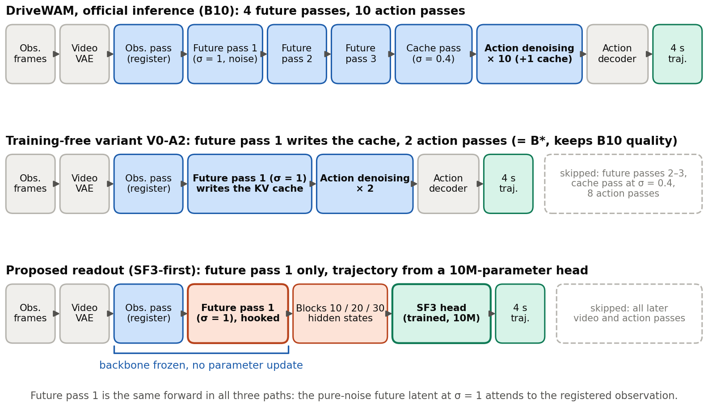
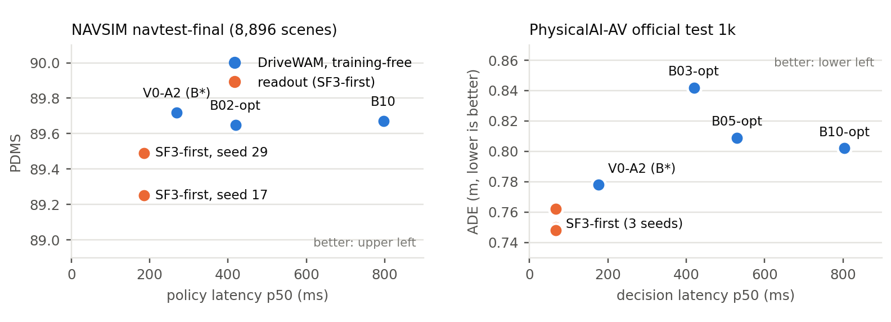
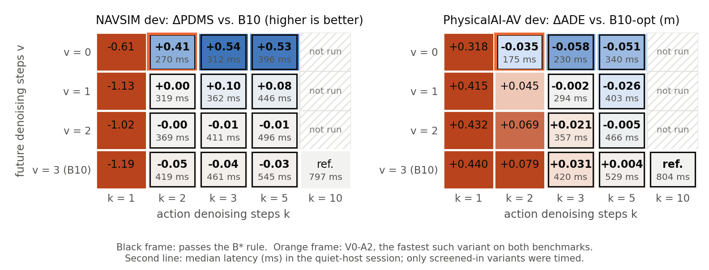

# DriveWAM Lightweight Action Readout

**Reading driving actions from a frozen World-Action Model's first imagination pass**

[한국어 README](README.ko.md) · [Technical report (KO, PDF)](docs/report/DriveWAM_Lightweight_Action_Readout_연구설명.pdf) · [Integrated research log (KO)](docs/통합_연구기록.md) · [Evidence](evidence/)

Author: **YongHwi Song (송용휘)**, B.S. candidate, Chungbuk National University · [homepage](https://thddydgnl.github.io/) · Research period: 2026-09-15 to 2026-11-01

---

## TL;DR

[DriveWAM](https://github.com/chenshi3/DriveWAM) is a 6.24B-parameter driving World-Action Model built on a video diffusion transformer (Wan2.2-TI2V-5B). It first *imagines* future video latents and then runs the same 5B backbone **10 more times** to denoise a 4-second action chunk. Action denoising is the single largest latency term in the pipeline.

This project asks: **without retraining the backbone, can a small head read the trajectory directly from the representation DriveWAM forms the moment it imagines the future once?**

- We keep the official checkpoints frozen, hook the hidden states of transformer blocks 10/20/30 **during the first future-denoising pass**, and regress the 4-second trajectory with a ~10M-parameter head (**SF3**, State-Fusion over 3 levels). Inference stops right after that pass. The remaining future denoising and all 10 action-denoising passes are skipped.
- Evaluation followed protocols written down in advance on two benchmarks: NAVSIM v1.1 (single-scene planning, PDM score) and NVIDIA PhysicalAI-AV (continuous driving with memory and language guidance, ADE/FDE).
- The proposed readout is compared not only against official DriveWAM (**B10**) but against **B\***, the fastest reduced-step variant of DriveWAM's own sampler that still meets a quality bar fixed in advance on the dev set. This is the fair baseline: "just use fewer steps". The October rounds searched only the number of action-denoising steps; the follow-up round of 2026-11-01 extended the search to the number of future-denoising steps (a grid `V{v}-A{k}`, v = 0–3 future steps × k = 1/2/3/5 action steps), and **B\* became V0-A2 on both benchmarks**: future pass 1 only (the pure-noise latent, written into the cache) plus two action-denoising passes.
- The follow-up round also trained the comparison heads at full scale (20k-clip `current` and ego-only heads on PhysicalAI), measured the sensitivity to the noise of the first pass, re-measured every latency on an idle host, and ran V0-A2 once on each locked final set. The numbers below are from that round unless marked; the October numbers are kept in the research log and in `evidence/`.

### Headline results (locked final sets, evaluated once)

| | NAVSIM `navtest-final` (8,896 scenes) | PhysicalAI-AV official test 1k |
|---|---|---|
| Official DriveWAM (B10) | PDMS 89.67, policy p50 796.9 ms | ADE 0.802 m / FDE 2.384 m, decision p50 803.9 ms (B10-opt) |
| **B\* = V0-A2** (training-free: future pass 1 only + 2 action steps) | PDMS 89.72 (+0.05 [−0.11, +0.20] vs B10), **269.6 ms** | ADE 0.778 m / FDE 2.170 m, **175.4 ms** |
| Earlier B\* (October, action steps only) | B02-opt: PDMS 89.65, 419.1 ms | B03-opt: ADE 0.842 m / FDE 2.362 m, 419.5 ms |
| **Proposed (SF3-first)** quality | PDMS 89.25 / 89.49 (2 seeds): −0.42 / −0.17 vs B10, −0.47 / −0.22 vs V0-A2 | ADE 0.750 / 0.748 / 0.762 m, FDE 2.244 / 2.244 / 2.287 m (3 seeds): ADE −0.016 to −0.030 m and FDE +0.07 to +0.12 m vs V0-A2 |
| **Proposed (SF3-first)** latency | policy p50 **186.3 ms** (0.69× V0-A2, 0.23× B10) | decision p50 **67.4 ms** (0.38× V0-A2, 0.08× B10-opt); per chunk incl. registration of the recorded chunk: 183.2 vs 290.6 (V0-A2) vs 919.2 ms (B10-opt) |
| Verdict under the criteria fixed in advance | seed 29 within every margin; seed 17 exceeds the DAC margin vs both B10 and V0-A2 (0.506 > 0.5, one scene) | seeds 17 and 29 within every margin; seed 43 exceeds the FDE margin vs V0-A2 (+0.117 m, CI upper 0.163 > 0.15); all three seeds within the margins vs B10-opt |

Latencies are medians from one session per benchmark on an idle RTX A5000 (2026-11-01, load average 1.2). The October sessions on a shared host gave 189.0 / 70.9 ms for the readout and ratios of 0.449 / 0.163 to the earlier B\*; same-session ratios agree with the idle-host session within 1%.



*Top: official DriveWAM. Middle: the training-free variant V0-A2 (B\*). Bottom: the proposed path stops after future pass 1 and reads blocks 10/20/30 with the SF3 head. Future pass 1 is the same forward in all three paths; the backbone is never updated.*



*Quality versus median latency on the locked final sets (idle-host session). Blue: DriveWAM with the official and reduced-step schedules, including V0-A2; orange: the proposed readout, one point per seed.*

---

## Key findings

1. **One future pass is what matters.** Hidden states from the *first* future-denoising pass (pure-noise future tokens that have attended once to the observation cache) beat states from the observation-only pass (*current*) by a wide margin: +3.3 PDMS on NAVSIM (4k heads) and −0.10 m ADE on PhysicalAI with the full 20k heads (current 0.860–0.868 m vs first 0.757–0.767 m). Completing the future denoising (*terminal*) adds nothing measurable (ΔADE +0.008 to +0.014 m, CI includes 0). On PhysicalAI an ego-only head reaches 0.873 m, so the observation pass adds only about 0.01 m beyond the ego state while the first future pass adds 0.11 m.
2. **DriveWAM's own action generation does not need the denoised future either.** Across the 17-variant grid, shortening the future denoising at a fixed number of action steps never hurts and often helps, monotonically on both benchmarks (with 3 action steps: −0.04 → −0.01 → +0.10 → +0.54 PDMS vs B10 for 3 → 0 future steps; +0.031 → +0.021 → −0.002 → −0.058 m ADE vs B10-opt). V0-A2 keeps the official quality at 0.34× (NAVSIM) and 0.22× (PhysicalAI) of B10's latency, a training-free 3.0× / 4.6× speed-up. One action step is never enough.
3. **Removing the action generator is the fastest point, at a quality cost that depends on the metric.** The readout replaces the two action passes of V0-A2 with the head: 1.45× (NAVSIM) and 2.6× (PhysicalAI) faster than V0-A2, 4.3× and 11.9× faster than B10. It costs 0.2–0.5 PDMS on NAVSIM (drivable-area compliance and ego progress; the collision term improves), has the lowest ADE of all methods on PhysicalAI, and a higher FDE than V0-A2 (+0.07–0.12 m).
4. **Head training data scale decides the outcome.** Same architecture, more labels: NAVSIM gap to B10 went −4.2 → −1.3 → −0.4 PDMS with 4k → 20k → 92.6k scenes. On PhysicalAI the 4k head failed the FDE > 2 m rate criterion (2 m is near the median chunk FDE, so this is a body-of-distribution rate, not a tail) and the 20k head passed. Concluding "world-model states contain no action information" from a small head-train set would have been wrong.
5. **Memory and language guidance help, but less than the first future pass.** In the continuous setting, removing past-chunk memory costs +0.02–0.04 m ADE and removing the VLM guidance sentence costs +0.03–0.045 m. Both are smaller than the phase effect (+0.11 m). The route command inside the guidance sentence is derived by the DriveWAM preprocessing from the recorded future ego pose, as is the NAVSIM driving command; every method receives it.
6. **Methodological traps we hit and documented.** (a) The public NAVSIM backbone has memorised navtrain scenes: B10's 4-s ADE is 0.076 m on navtrain-internal validation vs 0.598 m on unseen navtest, so all conclusions were moved to unseen navtest and a locked final split. (b) The official single-seed PhysicalAI protocol is seed-sensitive: B10 dev ADE ranges 0.821–0.930 over seeds 0–3, and the official seed 0 is the luckiest. (c) A deterministic regressor vs a stochastic generator is not a fair accuracy comparison on mean-error metrics: against a 4-sample B10 average the proposed model is on par in ADE and 0.08–0.12 m worse in FDE. (d) The readout is deterministic only for a fixed first-pass noise: with other noise seeds its PDMS moves by at most 0.2 on NAVSIM (trajectories 0.14 m RMS, the same as B10's 0.13 m) and its ADE rises by 0.045–0.067 m on PhysicalAI, the same size as B10-opt's own seed sensitivity (0.048–0.061 m); at matched seeds the readout stays 0.06 m ahead of B10-opt. **We therefore do not claim the readout is more accurate than DriveWAM, nor that it matches V0-A2 in quality.** The claim is: the action information is available after one future pass, both DriveWAM's own action generation and a small head can use it, and the head is the cheaper of the two at a measurable quality cost.



*The training-free grid on the dev sets: paired difference to the official schedule per cell, median latency where the variant passed the quality rule (black frame), V0-A2 in orange.*

---

## Method in brief

**Frozen backbone and taps.** Official DriveWAM checkpoints for NAVSIM and PhysicalAI are used unmodified. The official inference loop is re-implemented step by step (verified bitwise against upstream) and forward hooks read block outputs without altering them.

**Three readout timings** (same head, trained separately for each):

| Timing | What the backbone has done so far | Cost |
|---|---|---|
| `current` | registered the observation frames; no future pass yet | cheapest |
| **`first`** | future pass 1 over pure-noise future tokens (σ = 1); the same forward that V0-A2 writes into the cache | **what the proposed model uses** |
| `terminal` | the cache pass after the three denoising passes (σ = 0.4 latent) | requires full future generation |

**SF3 head** (`scripts/lightweight_heads.py`, `heads_v3.py`, `pai_heads.py`), ~9.98M trainable parameters (0.16% of the backbone):

- Per level (blocks 10/20/30; 112 tokens × 3072): LayerNorm → Linear 3072→512 → 16 learned queries × 8-head attention → learned weighted sum → LayerNorm.
- Ego MLP (NAVSIM: 4 past poses + velocity/acceleration + command, 20-d; PhysicalAI: velocity/acceleration/curvature, 5-d) → 128-d.
- Fusion: concat (1,664) → Linear 512 + GELU → residual MLP 512→1024→512.
- Output: driving state + per-step time embedding → LayerNorm → MLP → normalised (Δx, Δy, Δθ) per step, FP32 output layer; K = 8 poses @ 2 Hz (NAVSIM) or 40 steps @ 10 Hz (PhysicalAI). Quantile (1%/99%) normalisation, cumulative sum to poses.
- Loss: Huber on positions + 0.2 × (1 − cos Δθ) + 0.1 × Huber on normalised deltas.
- Training protocol (frozen from v2 on): 40 epochs, AdamW 3e-4, wd 0.01, batch 32, 5% warm-up + cosine, **last checkpoint, no selection on the evaluation set**, batch-1 prediction as in deployment.

**Baselines.** B10 (official) and the training-free grid `V{v}-A{k}`: v ∈ {0, 1, 2, 3} future-denoising steps × k ∈ {1, 2, 3, 5} action-denoising steps, all skipping the output-irrelevant final action cache pass (verified bitwise identical to raw at equal step count). The v = 3 column is the *opt* family B05/B03/B02/B01-opt, and B10-opt is v = 3, k = 10. With v = 0 the pure-noise latent is passed once at σ = 1 and written into the cache. The action variants of one v come from a shared rollout, verified bitwise against separate runs. **B\*** = fastest variant that meets the dev-set quality rule: V0-A2 on both benchmarks (B02-opt / B03-opt in October, when only k was searched). Reference: ego-only head, constant-velocity.

**Statistics.** Cluster-paired bootstrap, 2,000 resamples (NAVSIM: per log; PhysicalAI: per NVIDIA chunk). Latency: three interleaved passes in the same session, models alternated per scene/clip. The headline numbers come from one session per benchmark on an idle host (2026-11-01, load average 1.2, run-to-run variation of the median below 0.12%); the October sessions ran on a shared host whose absolute times drifted by up to 30%, so they are compared by same-session ratios only. The timed span differs by benchmark. NAVSIM *policy latency* covers one policy call, from the camera frame in host memory to the trajectory, including VAE encoding and the observation pass (route-command text embeddings are precomputed). PhysicalAI *decision latency* runs from the end of registering the recorded history until the action chunk is ready (VAE latents and guidance-sentence embeddings are precomputed and not timed).

**Bitwise verification before any result was read.** Rollout re-implementation = upstream (B10, B05); opt = raw; shared multi-baseline rollout = individual runs; hooks do not perturb outputs; early-exit features = features captured during a full run; online (backbone + head) = offline (cached features) predictions; forward counts per clip (B10 87, proposed 17); grid shared rollouts = separate runs (first 4 scenes/clips of every shard); regenerated NAVSIM inputs reproduce the stored B02-opt and readout trajectories within 1e-5.

---

## Experimental setup

| | NAVSIM v1.1 | PhysicalAI-AV |
|---|---|---|
| Data | OpenScene revision `a76f840b` | NVIDIA revision `33f9bf44`, front camera, 23,994 / 24,000 clips processed |
| Unit | one scene → one 4-s trajectory | one clip (21 frames @ 1 fps) → 5 consecutive 4-s chunks, teacher forcing |
| Head-train | navtrain head-train 4k → 20k → 92,599 scenes (1,072 logs) | DriveWAM public train 4k ⊂ 20k clips |
| Dev / final | navtest-dev 34 logs / 3,250 scenes; **locked** navtest-final 102 logs / 8,896 scenes | val 1,000 clips (hash-ranked); official test 1k |
| Metrics | official PDMS (+ NC, DAC, EP, ADE4) | official ADE / FDE (+ chunk FDE > 2 m rate) |
| Quality rule for B\* and the proposed model | PDMS CI lower bound ≥ −2.0 vs B10 and B\*, NC/DAC mean degradation ≤ 0.5, p50 ≤ 0.8 × B\*, both seeds | ΔADE CI upper ≤ +0.05 m, ΔFDE CI upper ≤ +0.15 m, FDE>2m rate increase ≤ 1 pp, p50 ≤ 0.8 × B\*, no p95 regression, all 3 seeds |
| Hardware | 2 × RTX A5000 24 GB; October runs on a shared host (load avg 12–60 from other tenants), latency session of 2026-11-01 on the idle host (load avg 1.2) | same |

Guidance sentences for the PhysicalAI dev set were regenerated with the DriveWAM pipeline (Qwen3-VL-8B; mean 27.8 words vs 28.0 in the official test prompts).

---

## Research timeline

| Date (2026) | Step | Outcome |
|---|---|---|
| 09-15 → 09-30 | Plan, source audit (20 items), environment & data locks | Pinned commits/revisions with SHA-256; no input leakage vs upstream |
| 10-01 | Baselines on 256 dev scenes; 12-head pilot; feature-swap control | B05 −26% latency at equal PDMS; swapping in another scene's features collapses PDMS to 35–41 (features carry the signal) |
| 10-02 | **Found backbone memorisation of navtrain**; fixed head protocol (v2); switched to interleaved latency; wrote NAVSIM pre-registration | navtest-dev: B\* = B02-opt; all 4k heads −3.6 to −7.7 PDMS; first ≈ terminal ≫ current |
| 10-03 | Round 3 (FP32 output, anchor head, 4k → 20k); Round 4 (92.6k) | 20k closes gap to −1.3; 92.6k to −0.4 PDMS; anchor head memorises training scenes |
| 10-03 | NAVSIM final (one run, recorded as a user-approved exception) | Near miss (§ above) |
| 10-04 | PhysicalAI extension: parity gate → dev baselines → heads (4k, 20k) → latency → dev verdict → final (one run) → diagnostics → determinism control | Pass; first ≫ current, first ≈ terminal; memory/language effects quantified |
| 10-05 → 10-08 | Integrated log, 15-page technical report | — |
| 10-15 → 10-21 | TMLR manuscript draft (v1) and JKAIA 2026 poster (2 pp) | `docs/paper/` |
| 10-31 | Internal review of the manuscript (major revision: B\* searched only over action steps, phase study only with 4k heads, first-pass noise fixed); follow-up round written down in advance | `docs/paper/REVIEW_internal_2026-10-31.md`, `docs/사전등록_보완실험_2026-11-01.md` |
| 11-01 | Follow-up round: training-free grid on both benchmarks, 20k `current` / ego-only heads (PhysicalAI), first-pass noise seeds, idle-host latency session, V0-A2 once on each final set | **B\* = V0-A2**; readout 0.69× / 0.38× of it; first ≫ current ≈ ego-only at 20k; verdicts: NAVSIM seed 17 DAC, PhysicalAI seed 43 FDE vs V0-A2 |
| 11-01 | Manuscript v2 (claim-centric rewrite with the follow-up results) | `docs/paper/tmlr/TMLR_draft_v2.pdf` |

---

## Repository layout

```
.
├── README.md / README.ko.md
├── docs/
│   ├── README.md                       NAVSIM progress record (KO; was research_plan/README.md)
│   ├── 통합_연구기록.md                 integrated log of both benchmarks: process, results, limits (KO)
│   ├── 실행계획서.md                    detailed execution plan (KO)
│   ├── 사전등록_navtest-dev_2026-10-02.md     NAVSIM pre-registration + change log (KO)
│   ├── 사전등록_PhysicalAI_2026-10-04.md      PhysicalAI pre-registration + change log (KO)
│   ├── 사전등록_보완실험_2026-11-01.md        follow-up round written down in advance: grid, 20k heads, noise seeds (KO)
│   ├── PhysicalAI_확장_실행계획서.md      PhysicalAI extension plan (KO)
│   ├── PhysicalAI_결과보고서.md           PhysicalAI results report (KO)
│   ├── 외부코드_검수보고서.md             upstream code audit, 20 items (KO)
│   ├── DriveWAM_Lightweight_Action_Readout_Research_Idea.md   original research proposal (KO)
│   ├── WAM-AD_투고계획.md                 venue planning notes (KO)
│   ├── report/                          15-page technical report (PDF/DOCX), figures, figure/doc build scripts
│   └── paper/                           TMLR manuscript v2, JKAIA 2026 poster, figures, build scripts, internal review
├── scripts/                             all experiment code (see below)
├── configs/
│   ├── SOURCE_LOCK.json                 pinned upstream commits, model revisions, file hashes
│   ├── requirements-model.candidate.txt direct dependencies validated on the GPU host
│   ├── pai_jobs.json, pai_jobs_diag.json   PhysicalAI job-queue definitions
│   └── r5_jobs.json                     follow-up round job queue (2026-11-01)
├── evidence/                            raw results: JSON/CSV/JSONL reports, splits, logs, per-scene predictions
├── CITATION.cff · LICENSE
└── vendor/                              (local only, git-ignored) audited copies of upstream repos
```

### Code map (`scripts/`)

| Module | Role |
|---|---|
| `world_feature_tap.py` | Forward hooks on video blocks; `current` / `first` / `terminal` phases; early exit with KV-cache cleanup |
| `lightweight_heads.py` | `QueryPooler`, `EgoEncoder`, trajectory decoder, loss; all head variants used in the pilot |
| `heads_v3.py` | SF3 trunk with FP32 output; regression (R) and anchor (A) heads from round 3 |
| `pai_heads.py` | PhysicalAI SF3 head: 40-step output, quantile normalisation, chunk-frame ↔ clip-frame rotation |
| `pai_common.py` | PhysicalAI runtime: step-by-step rollout (baselines, opt, early exit), prompt cache, feature taps |
| `pai_vlm_patch.py` | Qwen3-VL patch-embed workaround for slow bf16 Conv3d on torch 2.9 |
| `navsim_action_opt.py`, `baseline_common.py`, `navsim_current_dataset.py` | NAVSIM opt baselines, frozen-model init, rollout batch construction |
| `head_policy_runtime.py` | Batch-1 online policy (backbone + head) used for the final evaluations |
| `remote_*_pipeline.sh`, `remote_pai_gate.sh`, `remote_pai_worker.py` | Pipeline drivers: pilot, navtest-dev, rounds 3/4, NAVSIM final, PhysicalAI job queue |
| `remote_*_infer.py` / `_score.py` / `_analyze.py` | Inference, official scoring, paired-bootstrap analysis per stage |
| `remote_*latency*.py` | Interleaved same-session latency measurement |
| `navsim_grid.py`, `remote_r5_*.py` / `.sh`, `remote_navtest_regen_inputs.py` | Follow-up round: training-free grid (one shared rollout per v), noise-seed runs, idle-host latency session, B\* re-selection and final re-verdicts (`remote_r5_analyze.py`), NAVSIM input regeneration |
| `make_pai_report.py` | Builds `evidence/physicalai_2026-10-04/tables.md` from the analysis JSONs |
| `remote_env.sh`, `remote_bootstrap.py`, `remote_prepare.py` | Server environment (two isolated venvs: model and official scorer) |

### Where each number comes from

| Result | Evidence |
|---|---|
| NAVSIM dev baselines (256 scenes) | `evidence/baselines_devval256_2026-10-01/`, `opt_devval256_2026-10-01/` |
| NAVSIM pilot heads, feature-swap control | `evidence/head_pilot_2026-10-01/`, `heads_online_devval256_2026-10-01*/`, `world_features_pilot_2026-10-01/` |
| NAVSIM navtest-dev (B\*, timing, depth) | `evidence/navtest_dev_2026-10-02/` |
| NAVSIM scale curve (20k, 92.6k) | `evidence/round3_2026-10-03/`, `evidence/round4_2026-10-03/` |
| NAVSIM final | `evidence/navtest_final_2026-10-03/` |
| PhysicalAI (parity, dev/final analysis, diagnostics, determinism control) | `evidence/physicalai_2026-10-04/reports/*.json`, `tables.md` |
| Follow-up round: grid screening, B\* re-selection, final re-verdicts, 20k phase heads, noise seeds, latency | `evidence/r5_2026-11-01/reports/r5-*.json`, `runs/` |
| Environment and data locks | `evidence/remote_environment_2026-09-30/`, `evidence/navsim_data_2026-09-30/` |
| Disk clean-up record (what was deleted on the server) | `evidence/disk_cleanup_2026-10-05/` |

---

## Reproducibility notes

This repository is a **complete record** of the experiments, not a turnkey package. Please read this before trying to run anything.

- **Not included (size or licence):** model weights (`*.safetensors`, including trained heads), the 221 MB pilot evidence tarball, NAVSIM/PhysicalAI data, and the audited copies of upstream repositories. Everything needed to re-obtain them is pinned in [`configs/SOURCE_LOCK.json`](configs/SOURCE_LOCK.json): DriveWAM `abbefb40`, Light-WAM `db7d05e7`, navsim `3e8291bf`, lingbot-va `7c6ffa9b`; HF `chenchenshi/DriveWAM` revision `c4fb6d2c`; OpenScene `a76f840b`; PhysicalAI-AV `33f9bf44`.
- **Server layout assumed by the scripts:** `$LITE_ROOT = ~/DriveWAM_Lightweight_Action_Readout` with `work/DriveWAM/src` (pinned commit), `upstream/navsim-v1.1`, `data/`, `runs/`, `caches/`, `reports/`, `scripts/` (this folder), and two virtual environments activated by `scripts/remote_env.sh model|scorer`. The official NAVSIM scorer must live in a separate CPU environment (numpy 1.23 + OpenBLAS pinned to the Haswell kernel; see the comment in `remote_env.sh`).
- **Environment:** torch 2.9.0 + cu126, flash-attn 2.8.3, diffusers 0.36.0, transformers 4.55.2; full resolved lists in `evidence/remote_environment_2026-09-30/locks/`.
- **Order of operations:** `remote_pilot_pipeline.sh` → `remote_navtest_dev_pipeline.sh` → `remote_round3_pipeline.sh` → `remote_round4_pipeline.sh` → `remote_final_pipeline.sh` for NAVSIM; `remote_pai_gate.sh` (parity) then `remote_pai_worker.py` consuming `configs/pai_jobs.json` / `pai_jobs_diag.json` for PhysicalAI; `make_pai_report.py` for tables; the follow-up round is `remote_r5_final.sh` and `remote_r5_latency_session.sh` with `configs/r5_jobs.json`.
- **Known gotchas recorded in the docs:** bf16 Conv3d patch-embed is ~10 s/call on torch 2.9 + cuDNN 9.10 (use `pai_vlm_patch.py`); the upstream PhysicalAI evaluator caches prompt embeddings on GPU indefinitely (cleared per clip here, values identical); head predictions must use batch 1 and an FP32 output layer (bf16 output changed results at the cm level with batch size).
- **Server-side state:** NAVSIM intermediate features and preprocessed inputs were deleted on 2026-10-05 to free disk (log in `evidence/disk_cleanup_2026-10-05/log.jsonl`). For the follow-up round the navtest inputs were regenerated from the same sensor blobs and verified against the stored trajectories (manifests in `evidence/r5_2026-11-01/splits/`); NAVSIM head retraining still requires re-extraction of the hidden states.

---

## Limitations

- One world model (DriveWAM); open-loop, non-reactive scoring. Closed-loop safety is untested.
- Under the criteria fixed in advance, NAVSIM seed 17 exceeds the DAC margin by one scene and PhysicalAI seed 43 exceeds the FDE margin against V0-A2; the NAVSIM final run was made after the dev set had missed by one scene (recorded as an exception).
- NAVSIM heads are trained on navtrain scenes that the backbone has memorised, so their training states are not those of unseen scenes; the cost of this mismatch is unknown.
- The readout is deterministic only for a fixed first-pass noise (finding 6d).
- PhysicalAI dev is a random val subset while the official test is VLM-curated; B10 ADE was similar on both (0.821 vs 0.802).
- The chunk-frame output rotation on PhysicalAI was decided before results but strongly affects them (without it, ADE +0.26 m).
- Deterministic head vs stochastic generator is favourable to the head on mean-error metrics (see finding 5c). Multimodal or safety-oriented metrics are needed.
- No comparison against one-step distillation of the action generator (scoped out).
- Latency is measured on one A5000 (headline numbers from an idle-host session, October sessions on a shared host), and the timed span differs by benchmark (see *Statistics*). NAVSIM includes VAE encoding and the observation pass, which all methods share, so its speed-up ratios are conservative; PhysicalAI excludes them.
- Hypothesis H2 (multi-level > single-level) is directionally consistent but significant in only one seed; left open.

---

## Documents

All research documents are in Korean. Start with [`docs/통합_연구기록.md`](docs/통합_연구기록.md) for the complete story, then [`docs/PhysicalAI_결과보고서.md`](docs/PhysicalAI_결과보고서.md) and [`docs/README.md`](docs/README.md) for benchmark-level detail. The pre-registration files record every rule that was fixed before results were read and every deviation with its timestamp.

The 15-page technical report [`docs/report/DriveWAM_Lightweight_Action_Readout_연구설명.pdf`](docs/report/DriveWAM_Lightweight_Action_Readout_연구설명.pdf) (figures 1–9 in `docs/report/figures/`) describes the October rounds. The TMLR manuscript (v2, 2026-11-01, with the follow-up round) is [`docs/paper/tmlr/TMLR_draft_v2.pdf`](docs/paper/tmlr/TMLR_draft_v2.pdf); [`docs/paper/README.md`](docs/paper/README.md) describes the paper folder (JKAIA 2026 poster draft, figures, revision log).

## Citation

```bibtex
@misc{song2026drivewamreadout,
  author = {Song, YongHwi},
  title  = {DriveWAM Lightweight Action Readout: reading driving actions from a frozen world-action model's first imagination pass},
  year   = {2026},
  url    = {https://github.com/thddydgnl/drivewam-lightweight-action-readout}
}
```

## Acknowledgements and licences

Built on the public code and checkpoints of [DriveWAM](https://github.com/chenshi3/DriveWAM) (Apache-2.0), [NAVSIM](https://github.com/autonomousvision/navsim) (Apache-2.0), [Light-WAM](https://github.com/L1ziang/Light-WAM) (MIT), [lingbot-va](https://github.com/robbyant/lingbot-va) (Apache-2.0), and the NVIDIA PhysicalAI-AV dataset. None of their code or weights is redistributed here. Code and documents in this repository are released under the [MIT License](LICENSE).
