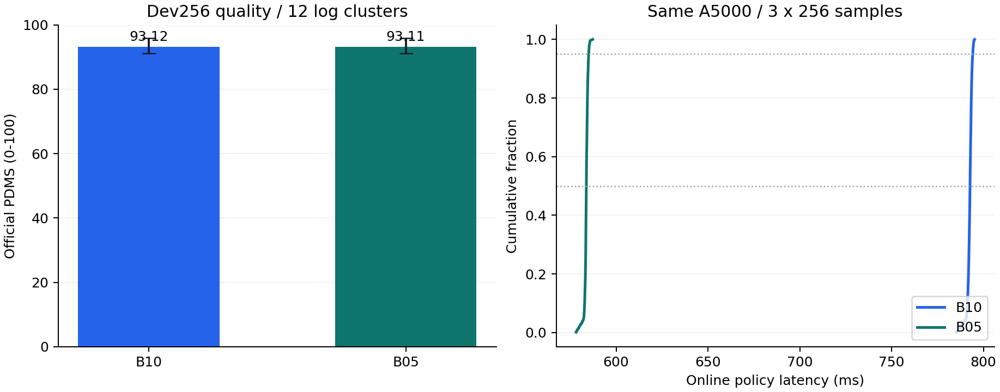

> **저장소 재배치 안내 (2026-10-09):** 이 문서들은 원래 `research_plan/` 폴더에서 작성됐다. GitHub 공개를 위해 문서는 `docs/`, 실행 스크립트는 `scripts/`, 고정 목록·요구사항은 `configs/`, 실험 근거는 저장소 최상위 `evidence/`로 옮겼다. 본문에서 `research_plan/evidence/...`로 적힌 경로는 `evidence/...`로, `research_plan/remote_*.py`는 `scripts/remote_*.py`로 읽으면 된다. 외부 코드 사본(`source_audit/`)은 용량 때문에 저장소에 포함하지 않았고, 대신 [SOURCE_LOCK.json](../configs/SOURCE_LOCK.json)의 commit·hash와 GitHub 고정 commit 링크를 쓴다.

# DriveWAM 연구 실행 계획 패키지

**최신(2026-10-04):** NAVSIM navtest-final은 근소 미달이었다(학생 −0.17 ~ −0.42 PDMS, 지연 0.449 × B\*). PhysicalAI-AV 확장 final은 **통과**했다(학생 ADE 0.748–0.762m vs B10 0.802m, 결정 지연 0.163 × B\*). 아래 각 절과 [PhysicalAI 결과보고서](PhysicalAI_결과보고서.md)를 참고한다.

**2026-09-15 작성 / 2026-10-02 navtest-dev 결과 반영.** 10/1에 navtrain 내부 pilot(opt 기준, head 12종, feature control)을 수행했다. 10/2에는 백본 기억 문제를 확인하고, [사전등록](사전등록_navtest-dev_2026-10-02.md)한 navtest-dev에서 다시 평가했다. 결과: B\*=B02-opt. 모든 direct head가 품질 기준에 미달했다(최고 SF3-terminal, B10 대비 −3.6 / −4.7점). 잠금 navtest-final은 사용하지 않았다. 아래 "navtest-dev 결과"가 현재 기준이다.

중심 질문은 **이미 학습된 주행 WAM의 backbone을 재학습하지 않고, 어느 시점·깊이의 표현으로 반복 action denoising을 대체할 수 있는가**입니다.

## 주요 문서

- [상세 실행 계획서](실행계획서.md): 자원 배치, 환경, 데이터, 단계별 구현, 학습, 실험표, 평가, 일정, 실패 대응.
- [연구 아이디어](DriveWAM_Lightweight_Action_Readout_Research_Idea.md): 배경, 연구 가설, 차별성 및 해석 범위.
- [PhysicalAI 확장 실행계획서](PhysicalAI_확장_실행계획서.md): 연속 주행(기억·언어 안내) 설정으로의 확장 계획. 2026-10-04 작성, **실행 중**.
- [PhysicalAI 사전등록](사전등록_PhysicalAI_2026-10-04.md): 분할·판정 규칙과 실행 중 변경 기록(chunk 5개 정정, dev D2 전환 등). 결과는 `evidence/physicalai_2026-10-04/`.
- [통합 연구 기록](통합_연구기록.md): 두 벤치마크의 과정·결과·해석·한계·논문 구성안을 한 문서로 정리(논문 작성용).
- [PhysicalAI 결과보고서](PhysicalAI_결과보고서.md): final 통과(학생 ADE 0.748–0.762m vs B10 0.802m, 결정 지연 70.9ms = 0.163 × B\*).
- [외부 코드 검수보고서](외부코드_검수보고서.md): 고정 GitHub 코드의 20개 검토 항목과 조치. 설치 파일 존재 여부 정정 포함.
- [소스·모델 고정 목록](../configs/SOURCE_LOCK.json): commit/revision, 파일 해시, 모델 파일 크기.
- [모델 환경 입력](../configs/requirements-model.candidate.txt): 직접 의존성 설치 목록. 전체 resolved 목록은 아래 실제 환경 lock을 사용합니다.
- [실제 서버 환경 lock](../evidence/remote_environment_2026-09-30/ENVIRONMENT_LOCK.json): 하드웨어, 고정 자산 hash, GPU·CPU 검증 및 남은 작업.
- [NAVSIM 데이터 lock](../evidence/navsim_data_2026-09-30/DATA_LOCK.json): 다운로드 revision·SHA-256, 로그 split, 파일럿 입력·정답, metric cache 및 실제 B10 검증.
- [B10/B05 평가 lock](../evidence/baselines_devval256_2026-10-01/EVALUATION_LOCK.json): 2026-10-01 protocol·결과·스크립트 해시 및 coverage. [상세 집계](../evidence/baselines_devval256_2026-10-01/summary.json), [장면별 공식 점수](../evidence/baselines_devval256_2026-10-01/scores-official.csv)를 함께 보관합니다.

`source_audit/`는 수정하지 않은 외부 소스 검토용 사본입니다. `evidence/`에는 공개 metadata·정적 검사, 원격 환경·데이터 검증 JSON, 패키지 lock 및 split manifest를 보관합니다. 전체 모델 weight와 주행 데이터는 원격 서버에 있습니다. 실제 관측 B10 smoke와 dev-val B10/B05 성능 비교를 완료했으며 head 학습과 확대 평가는 남아 있습니다.

실행 계획서의 `litedrivewam/*` 파일들은 **앞으로 구현할 명세**입니다. 완성된 연구 구현이나 즉시 실행 가능한 전체 pipeline으로 표기하지 않습니다.

## 서버 환경 준비 결과

| 항목 | 확인·준비한 내용 |
|---|---|
| 연결 | 기존 SSH `kiis-mvf-campus → kiis-mvf-gpu` ProxyJump 경로 |
| 하드웨어 | A5000 24GB × 2, Xeon Gold 6426Y 32 cores / 64 threads, RAM 503.6GiB |
| OS·CUDA | Ubuntu 22.04.4, driver 560.35.05, torch CUDA runtime 12.6, nvcc 12.4.131 |
| 모델 환경 | Python 3.10.12, torch 2.9.0+cu126, torchvision 0.24.0+cu126, diffusers 0.36.0, transformers 4.55.2, FA2 2.8.3 |
| 평가 환경 | Python 3.9.25, NAVSIM 1.1.0 / nuPlan 1.2.0 고정 commit, torch 2.0.1+cpu, numpy 1.23.4 |
| 자산 | 고정 revision 15개 파일 / 29.85GB, 크기·SHA-256 검증, 실제 evaluator가 찾는 transformer symlink |
| Prompt cache | 원본 `_encode_prompt()`로 네 문장 선계산, BF16 `[512,4096]` 각각 저장, 문장·revision·hash metadata |
| GPU 검증 | 양쪽 GPU의 FA2 vs FP32 참조 최대 오차 약 0.00108, finite backward, BF16 head gradient, NCCL all-reduce 통과 |
| CPU 검증 | official scorer import, BLAS 수치 검사, PDM 직선 4초 simulation 20m, metric archive 역직렬화 통과 |
| 합성 B10 | video 3 / action 10 / fraction 0.6, 17 forward, finite action·latent, PyTorch peak allocated 13.67GiB |

실제 작업 root는 `/home/yonghwi/DriveWAM_Lightweight_Action_Readout`입니다. 접속 후 모델 환경 진입:

```bash
ssh kiis-mvf-gpu
source /home/yonghwi/DriveWAM_Lightweight_Action_Readout/scripts/remote_env.sh model
```

CPU 평가 작업은 별도 shell에서 같은 파일을 `scorer` 인자로 source합니다. 모델과 평가의 실제 패키지 목록은 [model freeze](../evidence/remote_environment_2026-09-30/locks/model-freeze.txt), [scorer freeze](../evidence/remote_environment_2026-09-30/locks/scorer-freeze.txt)에 있습니다. `remote_*.py`와 `remote_env.sh`는 수행한 환경 설치·검증을 재현하는 스크립트입니다.

서버에서 발견한 DNS/IPv6 다운로드 문제, 누락된 libGL, 이전 OpenBLAS의 잘못된 수치 계산을 작업 환경 안에서 조치했습니다. Scorer의 `OPENBLAS_CORETYPE=Haswell` 설정은 유지해야 합니다. 기존 다른 프로젝트 환경과 shell profile은 변경하지 않았습니다.

합성·실제 smoke 모두 원본을 수정하지 않은 검증 initializer에서 prompt tensor를 사용하는 방식입니다. **이 smoke 자체로 P0 전체 완료나 주행 성능·latency 검증을 뜻하지 않습니다.** 별도의 dev-val 측정 결과는 아래에 기록합니다. P01–P10의 남은 연구 runner·표현 추출·평가 통합은 다음 작업입니다. Home은 overlay이며 컨테이너 교체 뒤 보존 정책은 미확인입니다. 데이터 준비 후 free disk는 약 1.05TB입니다.

## NAVSIM 실제 데이터 준비 결과

| 항목 | 실제 준비·검증 결과 |
|---|---|
| 공개 데이터 고정 | OpenDriveLab/OpenScene revision `a76f840b65e972bc45e56c2adced897498e9a026`, 고정 NAVSIM v1.1 scene filter |
| 지도 | 공식 ZIP의 `nuplan-maps-v1.0` 4개 지역, 원본 LICENSE 보관 |
| 전체 navtrain metadata | 1,192개 로그 / 103,288개 token, 공식 filter와 coverage 100% |
| 전체 log split | seed 17, head-train 1,072개 로그 / 92,599장면, head-val 120개 로그 / 10,689장면 |
| 파일럿 | 학습 4,000장면 / 60개 로그, 검증 1,000장면 / 12개 로그, 로그·token 중복 0 |
| 센서 자산 | camera archive 12개 41.81GB의 publisher SHA-256 검증, 필요한 CAM_F0 5,180장만 추출 / 약 1.03GB |
| 관측·정답 | 현재 RGB·4-frame ego history·속도/가속도·command 입력 NPZ와 4초/8-pose 정답 NPZ를 다른 폴더에 저장 |
| CPU 검증 | 5,000장면의 공식 history 좌표 일치·delta 누적 복원·finite 검사 통과, 원본 processor 한 장면의 현재 RGB 정확히 일치 |
| dev-eval cache | head-val에서 256개 선택, 공식 metric cache 생성·전체 역직렬화 확인, coverage 100% |
| 실제 B10 | navtrain token `2921b009ed4551bb`, 17 forward, finite `[8,3]` trajectory, peak allocated 약 13.67GiB |
| 입력 누출 검사 | 현재 관측 입력과 실제 future RGB/GT action이 든 원본 reference 입력의 action·latent 예측이 비트 단위로 일치 |

`data/maps`, `data/navsim_logs/trainval`, `data/sensor_blobs/trainval`, `processed/navtrain-current-v1/{inputs,targets}`, `splits`, `caches/metrics/devval256`은 모두 원격 작업 root 아래에 있습니다. [파일럿 manifest](../evidence/navsim_data_2026-09-30/splits/pilot-manifest.jsonl)와 [처리·분포 보고서](../evidence/navsim_data_2026-09-30/reports/navsim-pilot-processing.json)를 로컬에도 보관했습니다. ZIP·metadata·camera archive의 완료 전송량은 합계 49.83GB이며 압축본을 보관합니다. 느린 S3 다운로드의 임시 조각은 대체 자산 검증 후 제거했습니다.

전체 navtrain **metadata**는 준비했고 RGB는 파일럿에 필요한 subset입니다. 파일럿 archive는 metadata coverage와 전송량을 기준으로 고른 72개 로그이며, 검증 subset에는 Pittsburgh가 없습니다. 전체 head-val 성능을 주장하거나 최종 B*를 선정하기 전에 나머지 영상과 지역 coverage를 확보합니다. navtest 데이터·점수는 사용하지 않았습니다. 미래 RGB는 smoke32 호환성에 필요한 소량만 확보했고 관측 NPZ에는 넣지 않았습니다.

[현재 관측 loader](../scripts/navsim_current_dataset.py)는 target 파일을 열지 않습니다. 아래 명령은 준비된 실제 한 장면의 실행과 원본 입력 대비 예측 일치를 다시 확인합니다. 이 실행은 성능·latency benchmark가 아닙니다.

```bash
source /home/yonghwi/DriveWAM_Lightweight_Action_Readout/scripts/remote_env.sh model
python "$LITE_ROOT/scripts/remote_navsim_real_smoke.py"
```

`remote_navsim_download.py`의 기본 범위는 지도·trainval metadata입니다. 영상은 `--files "$LITE_ROOT/reports/navsim-camera-download-specs.json"`으로 고정 목록만 받습니다. `remote_navsim_extract.py` → `remote_navsim_select.py` → `remote_navsim_pilot.py`와 `remote_navsim_metric_cache.py`가 split·영상·입력/정답·cache를 만들고, `remote_navsim_reference.py`, `remote_navsim_real_smoke.py`, `remote_navsim_finalize.py`가 검증 결과를 기록합니다. 기존 ENVIRONMENT_LOCK은 환경 준비 시점의 기록이며, 이후 데이터·실제 관측 상태는 DATA_LOCK을 기준으로 확인합니다.

## B10/B05 기준 평가 결과 · 2026-10-01

고정 dev-val **256장면 / 12개 로그**, generation seed 0에서 아래 결과를 얻었습니다. 두 모델 모두 coverage 100%, 실패 0입니다. 원본 마지막 action cache pass를 포함해 B10은 17회, B05는 12회 backbone forward를 수행했습니다.

| 모델 | 공식 PDMS | ADE4 / FDE4 m | Policy p50 / p95 ms | Action CUDA p50 ms | Peak allocated GiB |
|---|---:|---:|---:|---:|---:|
| B10 | 93.115 | 0.0760 / 0.1380 | 792.70 / 794.20 | 460.38 | 13.674 |
| B05 | 93.111 | 0.0748 / 0.1357 | 583.79 / 585.07 | 251.53 | 13.674 |

B05는 policy p50을 **26.35%** 줄였습니다. B05−B10 PDMS는 **-0.0045 point**, 로그 단위 paired bootstrap 2,000회의 95% CI는 **[-0.0163, +0.0029]**입니다. 이 subset에서 품질 차이는 작습니다. NC/DAC/TTC/comfort 평균은 두 모델 모두 100 / 99.609 / 99.609 / 100점이고, at-fault collision 0건, DAC 위반 1장면, TTC 위반 1장면입니다. EP는 84.414 / 84.404점입니다.

동일 물리 GPU0, batch 1, BF16·FA2, 모델별 warmup 20회 후 **256장면 × 3회 = 모델별 768회**를 측정했습니다. 네 route 문장의 text embedding을 미리 계산한 정상 실행 상태에서, CPU 관측으로 batch를 만드는 시점부터 resize·H2D·VAE·primer·world·action과 사용 가능한 CPU trajectory까지 포함합니다. 파일 읽기·CPU scoring은 제외했고 scoring은 GPU 측정이 끝난 뒤 실행했습니다. Phase CUDA event 및 forward hook의 공통 계측 overhead는 포함됩니다. Action CUDA 값은 해당 phase의 GPU 시간이며 전체 action 경로 wall time과 구분합니다. Peak는 PyTorch allocator 기준이며 reserved peak는 두 모델 모두 13.734GiB입니다.

세 반복에서 같은 seed의 action·world latent·trajectory가 비트 단위로 일치했고, 모든 B10/B05 pair의 world latent도 일치했습니다. 계측 on/off parity를 통과했습니다. token별 seed는 `SHA256(scene_token:generation_seed)` 첫 4바이트의 big-endian 정수입니다. 별도로 사전에 고정한 32장면에서 seed 0/1/2를 확인했습니다. 공식/vendored scorer가 동일한 640개 예측·target·metric cache를 평가했으며 PDMS 최대 차이는 6.74e-11 point였습니다.

지역 분포는 Singapore 92, Las Vegas 138, Boston 26장면이고 Pittsburgh는 없습니다. head-val은 navtrain에서 분할했으므로 공개 backbone의 미학습 데이터라고 보장하지 않습니다. 이 결과로 공개 논문의 navtest 점수 재현이나 최종 B* 선정을 주장하지 않습니다. B*는 opt 출력 parity와 전체 head-val 평가 후 정합니다. 세부 CI·phase 분포·지역/command/속도 subgroup·생성 seed 변동은 [summary.json](../evidence/baselines_devval256_2026-10-01/summary.json)과 [subgroups.csv](../evidence/baselines_devval256_2026-10-01/subgroups.csv)에 있습니다.



재실행 스크립트는 `baseline_common.py`, `remote_baseline_infer.py`, `remote_baseline_score.py`, `remote_baseline_analyze.py`입니다. Infer는 기존 run을 덮어쓰지 않으며 새 run ID를 사용합니다. 모델 실행은 `LITE_GPU_IDS=0`으로 model 환경을 source하고, scoring/analysis는 scorer 환경을 source합니다. `[inference, score-official, score-vendored, analysis]-status.json`이 모두 `verified`인 결과만 사용합니다. ENVIRONMENT_LOCK/DATA_LOCK은 9월 30일의 기록을 유지했고 이번 측정은 별도 EVALUATION_LOCK으로 고정했습니다.

## 10/1 오후 pilot 결과와 10/2 검토 · navtrain head-val dev256

10/1 16:34 이후 다음을 실행했다(근거: `evidence/opt_devval256_2026-10-01`, `head_pilot_2026-10-01`, `heads_online_devval256_2026-10-01-r2`, `world_features_pilot_2026-10-01`, 서버 `runs/feature_control_2026-10-01`).

- opt 기준: B10-opt/B05-opt는 raw와 출력이 비트 단위로 같고 p50만 5–7% 줄었다. dev256 PDMS는 B03-opt 93.12, B02-opt 92.75(B10 대비 −0.37 [−0.74, −0.01]), B01-opt 88.80.
- feature cache: 4k/1k 장면, current/first/terminal × 6개 layer dense, 63GB. hook 비간섭·조기 종료 feature의 비트 단위 동일성, 미래 RGB/action 무작위 치환 불변을 확인했다.
- head 12종(seed 17): 최고는 SF3-terminal 86.72(B10 대비 −6.39 [−8.51, −2.82], ADE4 0.317m), SF3-first 86.27, SF3-current 84.76, SF1-terminal 84.35, SF1-wide 79.50, ego-only 63.48. 모든 head가 사전 품질 기준 미달.
- feature 교체 control: 비슷한 조건의 다른 로그 장면 feature로 바꾸면 모든 feature head가 35–41점으로 떨어졌다(ego-only 63.5보다 낮음).
- 10/1 21:12 사용자 요청으로 GPU 작업을 멈췄다. 당시 GT/teacher target 진단 추출은 1,024/2,304행이었다.

**10/2 검토 결론:** 위 결과는 백본이 이미 학습한 navtrain 장면에서 나온 것이다. B10의 ADE4 0.076m, seed 간 궤적 차이 3.5cm는 백본이 이 장면을 기억하고 있음을 시사한다. 따라서 B* 선정과 가설 판정을 navtrain head-val로 하지 않는다. 또한 v1 head 학습은 early stopping 때문에 모델별 학습 길이가 달랐고(SF1-wide 15 epoch 등), checkpoint 선택 세트가 보고 세트(dev256)를 포함했다. 지연 측정은 호스트 부하(load average 50 이상) 때문에 run 간 B10 p50이 793–866ms로 흔들렸다. 대응은 [사전등록 문서](사전등록_navtest-dev_2026-10-02.md)에 고정했다: navtest를 로그 단위로 dev(34개 로그, 3,250장면)/잠금 final(102개 로그, 8,896장면)로 나누고, target 진단을 취소하고, head protocol v2(40 epoch 고정, 마지막 checkpoint, seed 17·29)와 장면 단위 교차 지연 측정을 도입한다.

## navtest-dev 결과 · 2026-10-02 (사전등록 protocol)

사전등록된 **navtest-dev 3,250장면 / 34개 로그**(4개 도시, 최대 로그 비중 8.7%)에서 공식 NAVSIM v1.1 scorer로 평가했다. coverage 100%, 실패 0이다. CI는 로그 단위 paired bootstrap 2,000회다. 잠금 navtest-final(8,896장면)은 사용하지 않았다. 근거는 [evidence/navtest_dev_2026-10-02](../evidence/navtest_dev_2026-10-02/)에 있다.

**1. 백본 기억 효과(확인)**

| 모델 | head-val dev256 PDMS / ADE4 | navtest-dev PDMS / ADE4 |
|---|---:|---:|
| B10 | 93.12 / 0.076 m | **90.93 / 0.598 m** |
| B02-opt | 92.75 / 0.077 m | 90.88 / 0.599 m |
| v1 SF3-terminal | 86.72 / 0.317 m | 85.59 / 0.674 m |

B10의 navtest-dev PDMS는 논문의 navtest 90.1과 가깝다. head-val에서 ADE가 약 8배 작았던 것은 학습 장면 기억 때문으로 판단한다. head와 B10의 PDMS 격차는 head-val에서 −6.4였고, 처음 보는 장면에서는 약 −4로 줄었다. 처음 보는 장면에서 B10의 generation seed 간 궤적 차이는 6.0cm(32장면)였다.

**2. B\* 선정(§1.3 규칙):** B10 대비 PDMS 차이는 B05-opt −0.03 [−0.20, +0.11], B03-opt −0.04 [−0.22, +0.14], B02-opt −0.05 [−0.25, +0.14]로 모두 품질 기준을 통과했다. B01-opt는 −1.19 [−1.96, −0.53]이고 DAC 평균 악화가 1.11점(기준 0.5 초과)이라 탈락했다. 통과 후보 중 가장 빠른 **B02-opt를 B\*로 선정한다**(policy p50이 B10의 0.520배).

**3. head(v2 protocol: 40 epoch 고정, 마지막 checkpoint, batch-1 예측)**

| 모델 | seed 17 PDMS | seed 29 PDMS | B10 대비 (seed 17 / 29) | B\* 대비 p50 비율 |
|---|---:|---:|---|---:|
| SF3-terminal | 87.34 | 86.28 | −3.59 [−4.92, −2.42] / −4.65 [−6.42, −3.14] | 0.794 |
| SF3-first | 86.60 | 86.89 | −4.34 [−6.17, −2.81] / −4.04 [−5.89, −2.50] | 0.467 |
| SF3-current | 83.20 | 83.61 | −7.73 [−9.97, −5.86] / −7.32 [−9.43, −5.45] | 0.248 |
| SF1-terminal | 85.38 | 84.79 | −5.55 / −6.15 | 0.794 |
| SF1-wide-terminal | 83.64 | 85.04 | −7.29 / −5.89 | — |
| FMLP-terminal | 83.00 | 84.16 | −7.94 / −6.77 | 0.796 |
| ego-only | 67.07 | 68.10 | −23.9 / −22.8 | — |

- **H1/H3(실용 목표): 미달.** 모든 head가 두 seed 모두에서 B10과 B\* 대비 CI 하한 −2.0 기준을 통과하지 못했다. 손실은 주로 DAC(−3.4 ~ −4.4점)와 EP에서 나온다. NC 차이는 −0.1 ~ −0.25점으로 작다. 속도 기준(B\* 대비 0.80배 이하)은 SF3-first/current가 넉넉히, SF3-terminal이 0.794로 간신히 통과한다.
- **H4(시점):** SF3-first − SF3-terminal은 −0.74 [−2.11, +0.41] / +0.61 [+0.06, +1.16]으로 방향이 seed마다 다르다. 미래 latent 반복 갱신의 추가 가치는 지지되지 않는다. SF3-current는 first보다 두 seed 모두 낮다(−3.40 / −3.28, CI가 0을 포함하지 않음). 첫 future pass가 current보다 낫지만, 계산량·noise 차이와 분리되지 않는다.
- **H2(여러 깊이):** SF1-wide − SF3-terminal은 −3.70 [−5.64, −2.00] / −1.24 [−2.68, +0.45]다. 방향은 두 seed 모두 multi-level 쪽이지만 한 seed에서만 유의하다. **판정 보류(약한 지지)**로 둔다.
- v1 → v2 protocol 수정으로 SF3-terminal이 85.59에서 87.34 / 86.28로 올랐다. v1의 SF1-wide 붕괴는 학습 예산 문제였다(v2 head-val ADE는 SF1과 같은 수준).
- **실행계획서 §14.4 판정:** "모든 direct head가 저비용 baseline에 뒤처짐"과 "first가 terminal과 비슷하고 더 빠름"에 해당한다. 따라서 full 확대를 자동으로 하지 않는다. 다음 단계는 원인 진단과 한정된 보완, 또는 부정 결과 정리 중에서 정한다.

**4. 지연 재측정:** navtest-dev 256장면에서 12개 모델을 장면마다 순서를 바꿔 번갈아 3회 측정했다(9,216샘플). 호스트 load average는 41–51이었다. 반복 간 p50 변동은 0.4–1.5%로 이전(5–19%)보다 크게 줄었다. 다만 이날 B10 p50은 1,043ms로 10/1의 793ms보다 컸다. 계측 없이 B10만 돌려도 1,045ms여서(`latency/overhead-check.json`) 공유 호스트 상태 차이로 판단한다. 절대 지연은 같은 세션의 상대 비율로만 해석한다.

**5. 절차 메모:**
- head dev 예측을 처음에는 batch 64로 계산했다. head 출력층이 BF16 autocast라, batch 커널이 달라지면 궤적이 cm 단위로 바뀌었다(중앙값 1.2cm, 최대 8cm, PDMS ±0.2 이내). 그래서 실제 정책과 같은 batch 1로 다시 계산하고 채점했다. batch-64 결과는 `scores_batch64`에 보존했다.
- 출력층 FP32화는 개선 후보다.
- GT/teacher 진단은 계속 취소 상태다. 처음 보는 장면에서는 B10과 GT가 약 0.6m 다르지만, head 학습 데이터(navtrain)에서는 둘이 사실상 같기 때문이다.

## 3차 보완 라운드 결과 · 2026-10-03 (사전등록 §6)

**진단:** v2 head의 PDMS 손실은 navtest-dev 장면의 약 4%에 몰려 있었다. 그 장면들에서 head만 주행 가능 영역을 벗어났다. 이를 근거로 세 가지를 시험했다(16개 모델, 모두 보고).
- 출력층 FP32화
- anchor 분류 head(K=256)
- head 학습 데이터 4k → 20k(navtrain head-train 16,000장면 추가, 207개 로그)

| 설정 (seed 17 / 29) | PDMS | B10 대비 [95% CI] | DAC 악화 | v2 대비 |
|---|---|---|---:|---:|
| **20k 회귀 first** | 89.36 / 90.00 | −1.57 [−2.62, −0.71] / −0.94 [−1.95, +0.00] | −1.51 / −1.05 | +2.76 / +3.11 |
| 20k 회귀 terminal | 89.47 / 89.10 | −1.46 [−2.43, −0.57] / −1.83 [−3.00, −0.86] | −1.54 / −1.72 | +2.13 / +2.82 |
| 4k 회귀 FP32 terminal | 86.58 / 87.04 | −4.35 / −3.89 | — | ±0 |
| 20k anchor first | 79.53 / 78.96 | −11.4 / −12.0 | — | −7.5 |
| 4k anchor first | 57.85 / 59.08 | −33.1 / −31.9 | — | −28.3 |

- **학습 데이터 확대가 결정적이었다.** 격차가 −4 ~ −4.7점에서 −0.9 ~ −1.8점으로 줄었다. B\* 대비 결과도 거의 같다(B02-opt와 B10의 차이가 0.05점). navtest-dev ADE는 0.624m로 B10(0.598m)에 근접했다. first와 terminal은 여전히 비슷하다. first는 B\*의 0.467배 지연이라 주 후보다.
- **사전 판정은 "미통과, 부분 개선"이다.** 20k 회귀 first의 seed 29는 B10·B\* 대비 CI 하한(−1.95 / −1.91)을 통과했다. seed 17은 −2.62로 미달이다. 두 seed 모두 DAC 평균 악화(1.05–1.51점)가 0.5점 기준을 넘는다. v2 대비 개선은 +2.9점으로 1.5점 기준을 넘으므로, 사전등록 규칙상 "부분 개선 보고 → 다음 방향은 사용자 결정"에 해당한다.
- FP32 출력은 품질에 영향이 없었다. anchor head는 학습 장면을 외워 실패했다(학습 분류 정확도 100%, 검증 18.8%). 백본 feature에 학습 장면의 궤적이 기억돼 있어 분류형 head가 특히 이 지름길에 취약하다.
- navtest-final은 사용하지 않았다. 근거는 [evidence/round3_2026-10-03](../evidence/round3_2026-10-03/)에 있다.

## navtest-final 최종 결과 · 2026-10-03 (사전등록 §8, 1회 실행)

잠금 navtest-final **8,896장면 / 102개 로그**에서 고정 설정을 1회 평가했다(coverage 100%). 학생은 SF3 first 회귀 head(head-train 92,599장면, seed 17·29)다. 이 실행은 dev 기준을 한 장면 차이로 놓친 상태에서 사용자 결정으로 수행한 **기록된 예외**다(§8).

| 모델 | PDMS | NC | DAC | EP | ADE4 | policy p50 (B\* 대비) |
|---|---:|---:|---:|---:|---:|---:|
| B10 | 89.67 | 98.12 | 97.97 | 83.83 | 0.564 m | 797.9 ms (1.90) |
| B\* = B02-opt | 89.65 | 98.15 | 97.93 | 83.81 | 0.564 m | 420.7 ms (1.00) |
| 학생 seed 17 | 89.25 | 98.27 | 97.46 | 83.36 | 0.579 m | **189.0 ms (0.449)** |
| 학생 seed 29 | 89.49 | 98.30 | 97.62 | 83.52 | 0.577 m | 〃 |

| 비교 | PDMS 차이 [95% CI] | NC | DAC |
|---|---|---:|---:|
| 학생 seed 17 − B10 | −0.42 [−0.76, −0.08] | +0.15 | **−0.51** |
| 학생 seed 17 − B\* | −0.40 [−0.74, −0.07] | +0.12 | −0.47 |
| 학생 seed 29 − B10 | −0.17 [−0.56, +0.27] | +0.17 | −0.35 |
| 학생 seed 29 − B\* | −0.16 [−0.54, +0.29] | +0.15 | −0.31 |
| B\* − B10 | −0.02 [−0.09, +0.06] | +0.03 | −0.03 |

- **사전 판정: 미통과(근소).**
  - seed 29는 모든 조건을 통과했다.
  - seed 17은 B10 대비 DAC 평균 악화가 0.51점으로 기준 0.5점을 넘었다. 주행 가능 영역 위반 장면은 226 vs 181로 +45개이고, 허용치는 44.48개다. **dev와 마찬가지로 한 장면 차이다.**
  - 나머지 조건은 모두 넉넉히 통과했다. PDMS CI 하한은 −0.76(기준 −2.0), 충돌(NC)은 오히려 개선, 속도는 B\*의 0.449배다.
- **실용적 의미:** 학생은 B\*(학습 없는 2-step)보다 2.2배, 원본 B10보다 4.2배 빠르다. PDMS 손실은 0.2–0.4점이고, 남은 약점은 주행 가능 영역 준수(DAC)다. dev(−0.51 / −0.36)와 final(−0.42 / −0.17)의 결과가 일관된다.
- 지연은 같은 세션에서 장면 단위로 번갈아 3회 측정했다(반복 간 변동 0.2%). 이날 호스트 load average는 11.8로 낮아 절대값이 10/2보다 작다. 판정은 비율로 했다.
- 근거: [evidence/navtest_final_2026-10-03](../evidence/navtest_final_2026-10-03/)

## 4차 라운드 결과 · 2026-10-03 (사전등록 §7, head-train 전체)

navtrain head-train 전체 92,599장면을 처리했다(추가 72,599장면, 누락·실패 0). 이 데이터로 SF3 first 회귀 head(출력층 FP32)를 seed 17·29로 학습했다. 결과는 navtest-dev 3,250장면 기준이다.

| 학습 데이터 | seed 17 / 29 PDMS | B10 대비 [95% CI] | B\* 대비 CI 하한 | DAC 악화 | ADE4 |
|---|---|---|---|---|---|
| 4k (v2) | 86.60 / 86.89 | −4.3 / −4.0 | — | −4.0 | 0.68 m |
| 20k | 89.36 / 90.00 | −1.57 / −0.94 | −2.61 / −1.91 | −1.51 / −1.05 | 0.624 m |
| **92.6k** | **90.43 / 90.58** | **−0.51 [−1.12, +0.14] / −0.36 [−0.95, +0.28]** | **−0.96 / −0.82** | **−0.52 / −0.40** | 0.61 m |
| B10 | 90.93 | — | — | — | 0.598 m |

- **데이터 규모 곡선:** 학습 데이터를 4k → 20k → 92.6k로 늘리자 B10과의 격차가 약 −4.2 → −1.3 → −0.4점으로 줄었다. B\*(B02-opt) 대비도 거의 같다. 지연은 B\*의 0.467배(10/2 교차 측정)다.
- **사전 판정: 근소 미통과.**
  - seed 29는 모든 조건을 통과했다.
  - seed 17은 PDMS·NC 조건은 통과했지만, DAC 평균 악화가 0.52점으로 기준 0.5점을 넘었다. 장면 수로는 주행 가능 영역 위반이 B10 대비 17개 많았고, 허용치는 16.25개다. **한 장면 차이다.**
  - 사전등록 규칙상 "두 seed 모두 통과"가 아니므로 통과로 보고하지 않는다.
- navtrain 데이터 확대 축은 여기서 끝이다(head-train 전체 사용). 사전등록 §7에 따라 다음 방향은 사용자와 정한다. navtest-final은 아직 사용하지 않았다.
- 근거: [evidence/round4_2026-10-03](../evidence/round4_2026-10-03/)

## PhysicalAI-AV 확장 결과 · 2026-10-04 (사전등록, final 1회)

연속 주행 설정(5 chunk, 기억 KV cache, chunk별 VLM 안내 문장, 실제 기록 등록)에서 같은 방법을 평가했다. 자세한 내용은 [결과보고서](PhysicalAI_결과보고서.md)에 있다.

| final (test 1k) | ADE (m) | FDE (m) | FDE>2m (%) | 결정 지연 p50 |
|---|---:|---:|---:|---:|
| B10 (공식, 재현) | 0.802 | 2.384 | 43.9 | 837.8 ms |
| B\* = B03-opt (dev 선정) | 0.842 | 2.362 | 42.5 | 434.0 ms |
| **학생 20k (seed 17/29/43)** | **0.750 / 0.748 / 0.762** | **2.244 / 2.244 / 2.287** | **41.4 / 41.0 / 42.1** | **70.9 ms** |

- **판정:** seed 3개 모두 통과했다.
  - B10 대비 ΔADE −0.040 ~ −0.054m, CI 상한이 0 미만이다.
  - 지연은 0.163 × B\*다.
- **규모:** 4k 학생은 FDE>2m 기준에서 미달했고, 20k에서 통과했다.
- **상상 단계(진단, 4k):** first 표현이 current(관측만)보다 ADE 0.11m 좋고, terminal(상상 3단계)과는 같다.
- **결정성 대조(사후, dev):** B10 seed별 ADE는 0.821–0.930으로, 공식 seed 0이 가장 유리했다. B10 4개 평균은 ADE 0.777, FDE 2.200m다. 학생은 ADE가 이와 대등하고 FDE는 0.1m 못 미친다.
  - 공식 B10 대비 정확도 우위의 상당 부분은 결정적 예측 효과다.
  - 기여는 '평균 예측 수준을 1패스(1/12 지연)로'라는 점이다.
- **기억·언어·좌표계(진단, 4k):** 기억 제거 +0.02–0.04m, 안내 문장 제거 +0.03–0.045m, 원래 좌표계 사양 +0.26m(ADE, 모두 유의).

## 서버 디스크 정리 · 2026-10-05 (사용자 승인)

여유 공간이 102GB에서 530GB로 늘었다. 지운 항목마다 크기와 파일 목록을 [evidence/disk_cleanup_2026-10-05](../evidence/disk_cleanup_2026-10-05/)(`log.jsonl`)에 기록했다.

- **지운 것: 끝난 작업물.**
  - dev 후보 원본 영상(42GB)
  - Qwen3-VL-8B(17GB, REVISION 기록)
  - 진단용 dev feature(20GB)
  - 이미 풀어 쓴 NAVSIM 압축본(8GB)
  - uv 캐시와 /tmp 빌드 잔여물
- **지운 것: NAVSIM 중간 산출물.**
  - full_first 학습 feature(140GB)
  - navtrain·navtest 입력 전처리본(157GB, targets는 남김)
  - navtest-dev feature 캐시(39GB, 포인터·궤적·예측·점수는 남김)
  - pilot head 가중치(8GB)
- **남긴 것:**
  - NAVSIM 채점용 데이터·checkpoint·metric cache와 모든 최종 예측·점수·보고서
  - PhysicalAI 재실험용 데이터(20k feature 193GB, 전처리본 87GB, 문장 임베딩 32GB)와 eval feature
- **영향:** NAVSIM head를 다시 학습하거나 navtest-dev feature를 다시 쓰려면 원본 데이터에서 다시 추출해야 한다.

## 이번 개정에서 바뀐 점

- 두 Faster-WAM을 모두 핵심 관련 연구로 비교하고, frozen 주행 checkpoint의 사후 readout으로 기여 범위를 구체화했습니다.
- 원본 B10/B05와 마지막 action cache pass를 생략한 1/2/3/5/10-step `opt` 기준을 비교합니다. 이 생략은 출력 parity를 확인한 NAVSIM 단일 chunk에 적용합니다.
- 같은 SF3 head를 current, 첫 future forward, terminal 표현에 각각 학습합니다. latent 반복 갱신의 추가 가치를 먼저 확인합니다.
- 작은 subset에서 GT-target/B10-target head를 비교해 generated future와 supervision의 적합성을 진단합니다. 전체 KD 학습은 조건부입니다.
- 품질을 만족하는 가장 빠른 baseline `B*`를 full head-val에서 고정합니다. 학생은 B10과 B* 각각 대비 품질 기준을 만족하면서 B* 대비 policy p50을 20% 이상 줄이는 것을 목표로 합니다. 이는 사전 목표이며 실측값이 아닙니다.
- 고정 commit에 `environment.yml`이 존재함을 확인해 문서 오류를 정정했습니다. `requirements-navsim.txt`는 없습니다.

## 실험 진행 단계

| 순서 | 수행할 작업 | 확인할 질문·다음 단계 조건 |
|---|---|---|
| 1 · P0 환경 준비 | 서버 자원 확인, prompt 선계산, 환경·weight 고정, B10 한 sample | 24GB GPU에서 올바른 checkpoint가 실행되는가? |
| 2 · P1 기준 모델 | log split, 공식 scorer, B10/B05 및 opt 1/2/3/5/10-step 비교 | 좌표·평가 coverage가 맞고 pass 생략 후 출력이 같은가? |
| 3 · P2 표현 추출 | 동일 world run의 current/first/terminal cache와 조기 종료 구현 | GT 누출 없이 올바른 시점·seed·token의 표현을 얻는가? |
| 4 · P3 최소 head | 32개 overfit 후 4k train/1k val의 ego-only·linear·FMLP | head 학습이 정상이며 어떤 표현이 유용할 가능성이 있는가? |
| 5 · P4 핵심 pilot | SF3 세 시점, 동급 parameter SF1-wide, GT/teacher target 진단 | 미래 latent 갱신과 여러 깊이가 추가 이득을 주는가? 무엇을 확대할 것인가? |
| 6 · P5 선별 확대 | 필요한 query/layer 실험, full train/val, B*·설정 고정, 최종 학습 seed 3개 | 핵심 결과가 더 큰 데이터와 반복 학습에서도 유지되는가? |
| 7 · P6 최종 평가 | 잠근 navtest 전체 PDMS·CI, 같은 GPU에서 online p50/p95·VRAM | 품질과 전체 지연 목표를 동시에 달성하는가? |
| 8 · P7 분석·정리 | Pareto·실패 사례·가설 판정, 코드/설정/결과 bundle | 각 연구 주장에 충분한 증거와 재현 자료가 있는가? |

P0–P7 전체는 약 4–6주라는 계획 추정이며, 다운로드·처리시간은 서버 pilot 후 갱신합니다. P4에서 핵심 이득이 확인되지 않으면 원인 진단과 연구 질문 수정을 먼저 합니다. query/layer 전체 조합이나 full feature cache를 미리 확대하지 않습니다.

**현재 상태(2026-10-04):** navtest-final 평가까지 끝났다. 고정 백본 위의 SF3 first 회귀 head(head-train 92.6k)는 B10 대비 PDMS −0.17 ~ −0.42점이고, 속도는 B\*의 0.449배(B10의 0.237배)다. 사전 기준은 seed 17의 DAC 조건만 한 장면 차이로 놓쳐 **근소 미통과**다. 연구 실행 단계는 종료했고, 남은 일은 결과 정리(P7)다.
