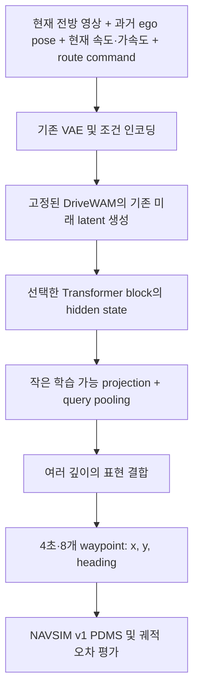

# DriveWAM Lightweight Action Readout 상세 실행 계획서

**대상 서버:** RTX A5000 24GB × 2, Intel Xeon Gold 6426Y 2 sockets / 실제 32 Core·64 Threads, RAM 503.6GiB  
**작성·외부 소스 확인일:** 2026-09-15  
**연구 검토 반영일:** 2026-09-30 — 비교군·가설 검증·실험 순서 보완, 설치 파일 존재 여부 정정. 소스·모델 revision은 유지한다.  
**원문:** `DriveWAM_Lightweight_Action_Readout_Research_Idea.md`  
**2026-10-04 갱신:** P0–P6를 마쳤다. 3–4차 보완 라운드와 navtest-final 1회 평가의 결과는 다음과 같다.
- head-train 92.6k로 학습한 SF3 first 회귀 head가 B10 대비 −0.42 / −0.17점, B\* 대비 0.449배 지연을 기록했다.
- seed 17의 DAC 조건만 한 장면 차이로 놓쳐 근소 미통과다.
- 남은 일은 P7(결과 정리)이다. 상세는 [README](README.md)와 [사전등록](사전등록_navtest-dev_2026-10-02.md)에 있다.

**2026-10-02 갱신:** navtrain head-val은 공개 백본의 학습 데이터 안에 있다. 그래서 B\* 선정과 pilot 판정의 기준을 사전등록한 navtest-dev(navtest의 로그 단위 25%)로 바꿨다([사전등록](사전등록_navtest-dev_2026-10-02.md)). navtest-dev 결과는 다음과 같다(상세는 [README](README.md#navtest-dev-결과--2026-10-02-사전등록-protocol)).
- B10 90.93점. B\*=B02-opt(−0.05 [−0.25, +0.14], p50 0.52배).
- 최고 head SF3-terminal 87.34 / 86.28점(seed 17/29)으로 품질 기준 미달.
- first ≈ terminal, current < first.
- §14.4의 "모든 direct head가 저비용 baseline에 뒤처짐"에 해당해 full 확대(P5)는 보류했다.
- 아래 §1.3의 "full head-val에서 B\* 선정"과 §13.5의 GT/teacher 진단은 이 사전등록으로 대체·취소되었다.

**작업 상태:** 2026-09-30 중계 SSH 접속, 모델·NAVSIM 분리 환경, 양쪽 GPU의 FA2·BF16 gradient 및 NCCL 검증, 29.85GB 고정 자산 해시 검증, 네 문장 prompt cache, 단일 A5000의 합성·실제 관측 B10 실행 검증 완료. NAVSIM 4k/1k 파일럿과 dev-val 256개 metric cache도 준비했다. 2026-10-01 B10/B05의 dev-val 256장면 공식 PDMS와 동일 A5000 온라인 지연 측정을 완료했다. head 학습·opt 후보·전체 head-val·navtest 평가는 남아 있다. 환경 기록은 `evidence/remote_environment_2026-09-30/ENVIRONMENT_LOCK.json`, 이후 데이터 기록은 `evidence/navsim_data_2026-09-30/DATA_LOCK.json`, 이번 기준 평가의 protocol·결과는 `evidence/baselines_devval256_2026-10-01/EVALUATION_LOCK.json`을 따른다.

## 문서를 읽는 순서

1. **1–4장:** 실현 가능성, 원문에서 보정할 사항, 자원 요구사항.
2. **5–13장:** 실제 구현 순서, 데이터·모델 계약, 학습 방법.
3. **14–18장:** 실험표, 평가 방법, 시간·비용, 실패 대응.
4. **19–21장:** 서버 인계와 최종 완료 조건.
5. 별첨 **`외부코드_검수보고서.md`**: 사용 저장소, 정확한 파일·함수·커밋, 발견한 문제와 수정 명세.
6. 별첨 **`SOURCE_LOCK.json`**: Git 커밋, 모델 revision, 공개된 파일 SHA-256, 검토 파일 해시.

> 중심 연구 질문은 **이미 학습된 주행 WAM의 backbone을 재학습하지 않고, 어느 시점·깊이의 표현으로 반복 action denoising을 대체할 수 있는가**이다. 공개 주행 checkpoint를 고정하고 관측에서 계산한 표현으로 작은 head만 학습한다. 미래 rollout의 필요성도 실험으로 판단한다. 모든 모델 실험은 중계 SSH를 통해 연결한 외부 GPU 서버에서 수행한다.

---

## 1. 실행 방향과 성공의 정의

### 1.1 최종적으로 만들 시스템



**보존할 것:** 주행용 backbone 가중치, VAE와 전처리, 경로·ego 조건, 미래 생성 스케줄, 관측/예측 구분, NAVSIM 평가 프로토콜.  
**바꿀 것:** 미래 표현에서 trajectory를 출력하는 경로. 반복 action denoising을 direct head로 교체한다.

### 1.2 최소 연구 결과물

동일한 데이터·체크포인트·관측 조건에서 다음 비교군을 사용한다. baseline 계열은 미래 생성 설정을 고정하고 action solver step 및 마지막 action cache pass의 실행 여부만 바꾼다.

| ID | 모델 | 학습 대상 | 목적 |
|---|---|---|---|
| B10 | 공개 DriveWAM, action 10 step | 없음 | 원본 기준 |
| B05 | 공개 DriveWAM, action 5 step | 없음 | 단순 step 감소보다 유리한지 확인 |
| B10-opt / B05-opt | 각각 10/5 step, 마지막 action cache pass 생략 | 없음 | 출력 보존 최적화를 적용한 기준 |
| B03-opt / B02-opt / B01-opt | 각각 3/2/1 step, 마지막 action cache pass 생략 | 없음 | 학습 없는 저비용 대안 |
| FMLP | 마지막 block 표현 + 평균 pooling + MLP | head | 미래 표현에 action 정보가 있는지 확인 |
| SF1 / SF1-wide | final-only query pooling, 기본/동급 parameter 폭 | projection·pooling·head | pooling과 parameter 수 효과 분리 |
| SF3-current | 현재 video primer의 3개 block 표현 | projection·pooling·head | 미래 경로 없는 동일 head 기준 |
| SF3-first | 첫 future forward의 3개 block 표현, latent 갱신 전 | projection·pooling·head | 미래 latent 반복 갱신의 추가 가치 |
| SF3-terminal (약칭 SF3) | 3번 latent 갱신 후 terminal pass의 3개 block 표현 | projection·pooling·head | 기존 미래 경로를 유지하는 주 방법 |

pilot에서 세 표현 시점과 동일 parameter 예산의 layer 비교를 먼저 수행한다. current+future, query 수와 6-layer 확대는 이 결과를 확인한 뒤 선택한다. 소규모 GT/teacher target 진단은 필수이며, 전체 KD 학습·DoT·LoRA는 조건부 확장이다.

### 1.3 연구 성공 기준 — 결과 보장이 아닌 사전 목표

**효율 비교의 기준 B\***를 navtest 실행 전에 full head-val에서 고정한다. B10-opt/B05-opt/B03-opt/B02-opt/B01-opt 중 B10 대비 PDMS 차이의 log-cluster paired 95% CI 하한이 −2.0 point 이상이고 NC/DAC 평균 악화가 각각 0.5 point 이내인 후보를 고른다. 그중 동일 서버 policy p50이 가장 낮은 모델이 B\*다. 동률이면 p95가 낮은 모델, 다시 동률이면 action step이 많은 모델을 선택한다. 정확한 출력 parity를 통과한 B10-opt가 기본 fallback이다. 유효 후보가 없으면 baseline 구현·평가부터 재점검한다.

- 전체 navtest에서 학생의 PDMS 차이에 대한 95% CI 하한이 **B10 대비와 B\* 대비 모두 −2.0 point 이상**인 것을 목표로 한다. B\*가 이미 허용한 손실에 학생 손실을 더해 총 4 point를 허용하지 않는다.
- 주 속도 목표는 `policy_p50_student ≤ 0.80 × policy_p50_B*`이고 p95도 B\*보다 악화하지 않는 것이다. **전체 지연 20% 감소는 이번 개정에서 둔 사전 목표이며 실측 결과가 아니다.** 변경이 필요하면 full training/navtest 전에 이유와 날짜를 기록한다.
- B10 대비 action 경로 50% 감소는 보조 지표로 남긴다. feature 추출·projection·pooling·전송비용을 포함하며, 이것만으로 연구 성공을 선언하지 않는다.
- NC/DAC의 평균 악화가 B10 및 B\* 각각 대비 0.5 point 이내인지 확인하고 사건 수·CI를 함께 검토한다.
- SF3-terminal은 같은 관측·noise seed에서 원본 future latent 보존을 확인한다. SF3-first/current는 경로를 단축하는 별도 비교군으로서 이 보존 조건을 적용하지 않는다.
- 최종 head 학습 seed 3개와 log 단위 paired bootstrap을 보고한다. 주 품질 판정은 각 학습 seed에서 충족하는지 확인하고, 평균만 통과하면 seed 간 일관성이 부족한 결과로 기록한다.

평균 차이만 기준을 만족하면 “비열등성 입증”이라고 쓰지 않는다. NC/DAC 기준은 연구 비교 기준이며 도로 주행 안전성 인증을 뜻하지 않는다. B\*는 navtest 결과로 다시 고르지 않는다.

**과학적 결과는 별도로 판단한다.** frozen 표현에서 action을 읽을 수 있는지, 첫 future pass 이후 갱신이 유용한지, parameter 수를 맞춰도 여러 깊이가 유리한지를 각각 보고한다. 표현 분석이 유의미해도 효율 목표 미달이면 효율 성공으로 합치지 않는다. 최초성이나 주행 WAM 전반의 보편성은 이 단일 checkpoint 실험으로 단정하지 않는다.

---

## 2. 원문 아이디어를 실행 코드에 맞게 보정할 사항

원문의 연구 가설은 유지한다. 아래 항목은 구현과 재현을 위해 구분해야 한다.

### 2.1 NAVSIM과 PhysicalAI의 guidance 경로가 다르다

공개 NAVSIM dataset은 command ID를 4개의 고정 문장 중 하나로 바꾼다. 평가기는 이 문장을 UMT5로 인코딩한다. Qwen3-VL의 scene-evolving guidance를 호출하지 않는다. 따라서 NAVSIM 본 실험에는 Qwen 서버와 VLM latency를 넣지 않는다. PhysicalAI의 guidance 실험은 18장 확장으로 둔다. [NAVSIM dataset](https://github.com/chenshi3/DriveWAM/blob/abbefb407c9c553f221522fc26077d307620adb4/src/dataset/navsim_dataset.py#L40)

### 2.2 “5B backbone”과 실제 적재하는 체크포인트 크기는 다르다

공개 NAVSIM safetensors의 **헤더만 HTTP Range로 조회**하여 확인한 결과, tensor 1,208개에 BF16 원소 **6,241,020,126개**, tensor payload **11.625GiB**가 있다. 이는 기반 모델의 관용적인 “5B” 이름과 별개의 실제 저장값이다. 학습 시 `sum(p.numel())`로 다시 확인하고 원소 수와 parameter/buffer 구분도 기록한다. 전체 가중치를 로컬에 다운로드하거나 실행하지 않았다. [체크포인트](https://huggingface.co/chenchenshi/DriveWAM/tree/c4fb6d2c5d26ee3018a9ee1507f36fd02b85b1ce/navsim)

### 2.3 3 step·10 step은 실제 Transformer 호출 횟수가 아니다

현재 공개 NAVSIM 경로는 다음 호출을 수행한다.

| 경로 | Transformer 호출 수 | 역할 |
|---|---:|---|
| 현재 video primer | 1 | 현재 영상 KV 생성 |
| zero-action primer | 1 | 기존 조건 구조 유지 |
| 미래 video, 3 solver step | 4 | 3번 상태 갱신 + 종료 지점 cache pass |
| action, 10 solver step | 11 | 10번 상태 갱신 + 종료 지점 cache pass |
| **B10 합계** | **17** | 기본 한 NAVSIM sample |
| **B05 합계** | **12** | action 부분만 6회로 감소 |
| **B10-opt / B05-opt 합계** | **16 / 11** | 마지막 action cache pass만 생략 |
| **B03-opt / B02-opt / B01-opt 합계** | **9 / 8 / 7** | 공통 6회 + action solver step 수 |
| **SF3-terminal 합계** | **6 + 작은 head 1회** | 두 primer와 기존 video 경로 유지 |
| **SF3-first 합계** | **3 + 작은 head 1회** | 두 primer + latent 갱신 전 첫 future pass |
| **SF3-current 합계** | **1 + 작은 head 1회** | current video primer 직후 출력, zero-action primer 생략 |

현재·미래 video latent의 token 수와 action token 수가 다르므로 호출 수 비율을 그대로 latency나 FLOPs 비율로 쓰지 않는다. NAVSIM의 `5개 영상 → 시간 압축 후 현재 1 + 미래 1 latent slice` 설정에 대한 정적 계산이며 서버 trace로 확인한다. [실제 loop](https://github.com/chenshi3/DriveWAM/blob/abbefb407c9c553f221522fc26077d307620adb4/src/navsim/eval.py#L268)

마지막 action pass는 `last_step`에서 action 값을 갱신하지 않고, `predict()` 종료 시 cache가 삭제된다. 따라서 **NAVSIM 단일 chunk에서만** 이 pass 생략을 적용하고 step별 출력 parity를 검증한다. 마지막 **video** pass는 baseline action의 조건을 만드는 데 필요하므로 함께 제거하지 않는다. 후속 chunk에서 action KV를 읽는 PhysicalAI에는 이 최적화를 그대로 적용하지 않는다.

### 2.4 최종 미래 표현도 완전히 denoise된 영상이라고 단정하면 안 된다

공개 CLI 기본값은 `video_denoise_fraction=0.6`, video SNR shift는 5다. 코드상 raw sigma는 `[1, 0.8, 0.6, 0.4]`, shift 후에는 약 `[1, 0.952381, 0.882353, 0.769231]`이다. 논문의 “τ=1→0.6” 설명과 동일한 값으로 취급할 수 없다. 첫 재현은 **공개 코드 기본 설정**을 따른다. sigma를 0까지 바꾸는 실험은 별도 ablation으로 분리한다. [스케줄 구현](https://github.com/chenshi3/DriveWAM/blob/abbefb407c9c553f221522fc26077d307620adb4/src/navsim/eval.py#L203), [논문](https://arxiv.org/html/2605.28544v1)

### 2.5 논문 수치를 본 서버의 목표값으로 복사하지 않는다

원문에 적힌 765ms·374ms와 ADE/FDE는 논문의 H20 실험 조건이다. A5000의 실측값으로 다시 표를 만든다. PDMS 90.1과 공개 README의 89.9 재학습 공지도 분리한다. 현재 HF 체크포인트가 어느 run에 대응하는지는 명확한 학습 provenance가 없어 확인이 필요하다. 재현값이 다르면 설정·coverage·scorer 차이를 조사하고, 논문 수치에 맞추기 위해 test 설정을 반복 탐색하지 않는다. [공식 공개 기록](https://github.com/chenshi3/DriveWAM/blob/abbefb407c9c553f221522fc26077d307620adb4/README.md#L104)

### 2.6 Light-WAM의 전체 설정을 그대로 가져오지 않는다

검토한 코드는 `LearnedQueryPooler`와 `StateFusionActionExpert`를 제공하지만 default trunk가 6,144 차원이고 adapter·LoRA 표현도 다룬다. 그대로 이식하면 본 연구의 작은 head 목표에서 벗어난다. 필요한 모듈만 가져와 projection 512, trunk 512부터 시작한다. frozen DriveWAM에는 `backbone` 표현만 전달한다. [head 구현](https://github.com/L1ziang/Light-WAM/blob/db7d05e724f3eac2d4f0c9c3ac727fe93a44d727/src/lightwam/models/wan22/state_fusion_action_expert.py#L230)

### 2.7 두 Faster-WAM을 구분하고 핵심 관련 연구로 비교한다

원문이 인용한 Ma 등의 논문은 **arXiv:2608.02365**, DoT 및 1-layer head 연구다. 검색되는 `hustvl/FasterWAM`은 **arXiv:2608.04404**, 다른 저자와 다른 방법이다. 이번 조사에서는 2608.02365에 대응하는 공식 구현을 확인하지 못했다. 따라서 DoT는 “검수된 코드 재사용”으로 기재하지 않고 논문 기반 선택 구현으로 둔다. [원문 DoT 논문](https://arxiv.org/abs/2608.02365), [동명 별도 연구](https://github.com/hustvl/FasterWAM)

2608.04404는 noisy future slots에서 한 번 얻은 여러 깊이의 표현을 action denoising에 재사용한다. 따라서 “미래 표현 유지 + 재사용” 자체를 새로운 기여로 주장하지 않는다. 주행 checkpoint를 고정한 상태에서 action 연산을 사후 대체할 수 있는지, 첫 pass와 terminal 표현 중 무엇이 충분한지를 검증하는 쪽으로 차별성을 좁힌다. [future-conditioning Faster-WAM](https://arxiv.org/html/2608.04404v1)

Light-WAM은 LoRA·adapter로 표현을 적응시키고, DoT Faster-WAM은 video backbone과 head를 공동 학습한다. 이 결과가 frozen DriveWAM의 direct readout 성공을 보장하지 않는다. 본 실험은 이 조건 차이를 검증하며, 실패 원인도 표현·head·학습 target의 적합성으로 나누어 분석한다. [Light-WAM](https://arxiv.org/html/2606.08242v1), [DoT Faster-WAM](https://arxiv.org/html/2608.02365v1)

---

## 3. 외부 코드 채택 목록

전체 커밋과 파일별 SHA-256은 `SOURCE_LOCK.json`, 실제 검토 결과는 `외부코드_검수보고서.md`를 기준으로 한다.

| 코드 | 고정 revision | 사용 범위 | 검수 판정 |
|---|---|---|---|
| chenshi3/DriveWAM | `abbefb407c9c553f221522fc26077d307620adb4` | 모델·scheduler·전처리·기준 inference | 필수. 설치·메모리·출력 기록 수정 후 사용 |
| L1ziang/Light-WAM | `db7d05e724f3eac2d4f0c9c3ac727fe93a44d727` | query pooler·작은 head 설계 참고 | 선택 파일만 이식. 전체 환경 설치 안 함 |
| autonomousvision/navsim v1.1 | `3e8291bfa89ff247231e0227778840cd0a036896` | 데이터 명세·official scorer·metric cache | 주 평가 버전. 최신 main과 혼용 금지 |
| robbyant/lingbot-va | `7c6ffa9bfc4b83582cafc860fab4c82cc7deeeeb` | 원천 의존성 버전 확인 | 전체 모델 재설치 불필요 |
| Dao-AILab/flash-attention v2.8.3 | `060c9188beec3a8b62b33a3bfa6d5d2d44975fab` | FA2 빌드 경로 | README·setup·라이선스 검토. CUDA kernel 전체 검수 아님 |
| motional/nuplan-devkit v1.2 | `ce3c323af01c0d7ec5672f7832ef53f9c679aab0` | NAVSIM 기반 타입·지도·simulation | 설치·라이선스 파일 검토. 전체 저장소 검수 아님 |

**별도 모델 자산**

- DriveWAM: `chenchenshi/DriveWAM@c4fb6d2c5d26ee3018a9ee1507f36fd02b85b1ce`.
- VAE·UMT5·tokenizer: `robbyant/lingbot-va-base@68b7bc1b35da6ddc67ea94c4ceb58d768fbb3f9c`.
- NAVSIM용 fine-tuned weight가 있으므로 LingBot의 기본 transformer와 일반 Wan transformer를 추가로 받을 필요는 없다.
- `navsim/` 아래 HF 모델 파일을 evaluator가 기대하는 `.../transformer/` 폴더로 연결해야 한다.
- DriveWAM 코드 라이선스는 Apache-2.0이다. HF weight card에는 별도 license 필드가 없으므로 code license만으로 weight 재배포 조건까지 확인되었다고 쓰지 않는다. 공개 배포 시 출처·조건을 추가 확인한다.

---

## 4. 외부 대여 서버의 자원 계획

### 4.1 서버 접속 후 확인할 항목

2026-09-30 `kiis-mvf-campus → kiis-mvf-gpu`의 기존 ProxyJump 설정으로 접속했다. 실제 2 × RTX A5000 24GB, 32 physical cores / 64 logical threads, RAM 503.6GiB, Ubuntu 22.04.4, driver 560.35.05, nvcc 12.4.131을 확인했다. CPU affinity는 64 threads이고 CPU/RAM cgroup 제한은 `max`다. 환경·자산 준비 후 free disk는 1,122,642,448,384 bytes였다. Home은 overlay filesystem이며 컨테이너 교체 이후 보존 정책은 아직 확인되지 않았다. 측정 원문은 `evidence/remote_environment_2026-09-30/reports/server-profile.json`에 보관한다.

| 항목 | 작업 가정 / 권장치 | 확인 방법 | 부족할 때 |
|---|---|---|---|
| GPU | A5000 24GB 2장, exclusive 사용 | `nvidia-smi`, process 목록 | 공유 GPU라면 latency 측정 시간 분리 |
| CPU | 실제 32 core·64 thread 확인 | `lscpu`, `nproc`, cgroup quota | worker 수 축소 |
| RAM | **128GB 권장**, 64GB는 축소 pilot | `free -h`, container limit | cache shard·worker·모델 적재 순서 조정 |
| 저장소 | **NVMe 2TB free 권장**, 전체 raw 중복 보존 시 3TB 이상 검토 | `df -h`, mount 확인 | 현재 전방 영상만 읽는 경로·선택 cache |
| OS | Ubuntu 22.04/24.04 계열 Linux 가정 | `/etc/os-release` | Linux 환경·wheel 지원부터 확인 |
| CUDA | torch cu126 wheel을 실행할 수 있는 driver | runtime tensor 연산 | 제공업체 driver 또는 환경 조정 |
| 빌드 도구 | FA2 빌드 시 CUDA toolkit/nvcc·C++ compiler | `nvcc --version`, `c++ --version` | matching 공식 wheel 또는 SDPA 검증 경로 |
| 네트워크 | GitHub·HF·PyPI·지도 endpoint 접근 | metadata/소파일 다운로드 | proxy·사전 업로드·offline cache |
| 디스크 수명 | 서버 종료 후 보존 범위 | 제공업체 mount 정책 | run 종료 시 외부 보관 위치로 동기화 |

RTX A5000 두 장이 하나의 48GB GPU처럼 자동 동작하지는 않는다. NVLink 연결 여부와 무관하게 프로그램의 분산 방식이 필요하다. 주 계획은 **한 GPU에 완전한 frozen world model**, 다른 GPU에 독립 작업을 둔다. [NVIDIA 사양 및 NVLink 조건](https://www.nvidia.com/content/dam/en-zz/Solutions/products/workstations/nvidia-rtx-a5000-datasheet.pdf)

### 4.2 GPU 메모리 예산

다음 표는 파일/헤더와 tensor shape에서 산출한 예산이다. 그 아래에 2026-09-30 합성 입력 실행의 실제 allocator 값을 구분해 기록한다.

| 항목 | 크기 또는 예산 | 대응 |
|---|---:|---|
| NAVSIM transformer BF16 | 11.625GiB | GPU당 1개 |
| UMT5 파일 payload 근사 | 10.582GiB | 4개 문장 임베딩 계산 후 unload |
| VAE 파일 / BF16 파라미터 | 파일 2.625GiB / GPU weight 약 1.313GiB | 파일의 FP32 weight가 loader에서 BF16으로 변환됨 |
| 원본 KV cache, batch 1 | 약 0.618GiB | 기본 1,800 slot × 30 layer |
| 3-layer dense future feature | 약 1.97MiB/sample | 필요한 시점만 추출 |
| head·activation·CUDA workspace | 초기 여유 3–6GiB | 실제 profile로 조정 |
| 안정 운영 peak 목표 | GPU당 21–22GiB 이하 | allocator reserved와 타 프로세스 포함 확인 |

파일 payload 합계 약 24.83GiB를 그대로 GPU 상주 메모리로 해석하지 않는다. BF16 변환 후 세 모델의 parameter 합계는 약 **23.52GiB**이며 원본 KV 예산 약 0.618GiB와 activation·CUDA context가 추가된다. A5000 한 장에 원본처럼 모두 상주시킬 여유가 없다. 단순히 `--num-gpus 2`로 실행하는 것만으로 해결되지 않으며 원본은 GPU마다 같은 모델을 복제한다.

**합성 입력 환경 검증 실측:** UMT5는 GPU1에서 네 문장을 계산한 뒤 해제했고, GPU0에 transformer 6,241,020,126 parameters와 VAE 704,688,668 parameters를 BF16으로 적재했다. 누락·예상 밖 checkpoint key가 없었다. 원본 `predict()`를 video 3 steps / denoise fraction 0.6 / action 10 steps로 실행해 17회 forward와 유한한 `[1,30,2,8,1]` action, `[1,48,2,16,28]` latent를 확인했다. PyTorch peak allocated는 **14,675,625,472 bytes / 약 13.67GiB**, peak reserved는 약 13.72GiB였다. 이는 constant RGB와 zero ego fixture의 한 번 실행이며 실제 데이터의 quality·latency benchmark와 구분한다. 원본 소스를 고치지 않은 검증 initializer를 사용했으므로 P01의 실제 cache-loading 옵션은 남아 있다. 이후 실제 NAVSIM 한 sample도 같은 방식으로 통과했으며 아래 데이터 준비 결과에 구분한다.

**적재 순서**

1. 임베딩 전용 짧은 프로세스에서 UMT5/tokenizer만 적재한다.
2. 원본 `_encode_prompt()`와 같은 정제·padding 규칙으로 4개 문장을 인코딩한다.
3. CPU tensor cache와 문장·tokenizer revision metadata를 저장하고 encoder를 해제한다. 현재 `caches/prompt/navsim-four-prompts.pt` 및 `.json`을 생성했고, 각 BF16 tensor는 `[512,4096]`이다.
4. 본 inference 프로세스에는 transformer·VAE·작은 prompt tensor만 적재한다.
5. head 학습은 offline feature cache를 이용하므로 world model을 아예 적재하지 않는다.
6. 두 GPU가 각각 원본 inference를 감당하면 feature 추출을 token shard 2개로 나눠 병렬화한다.

### 4.3 GPU와 CPU 역할 배치

| 작업 구간 | GPU0 | GPU1 | CPU |
|---|---|---|---|
| 환경 검증 | 작은 CUDA/FA2 검증 | 필요시 동일 검증 | 설치·파일 검증 |
| prompt cache | 비움 | UMT5 잠시 사용 | cache 저장 |
| 기준 추론 및 feature 추출 | token shard 0 | token shard 1 | worker 2–4개씩 |
| head 탐색 | seed/설정 A | seed/설정 B | shard reader |
| 최종 latency | 단일 policy만 실행 | 유휴 | 평가 CPU 작업 중지 |
| 전체 PDMS | 필요시 추론 | 필요시 추론 | scorer worker 4개부터, 최대 8개로 시험 |

CPU oversubscription을 피하기 위해 추론 worker는 2개/GPU부터, CPU scoring은 `OMP_NUM_THREADS=1`, `MKL_NUM_THREADS=1`로 시작한다. 최적값은 pilot 처리량으로 선택한다.

### 4.4 저장공간 계산

NAVSIM 문서의 전체 navtrain sensor는 약 445GB, test sensor는 약 217GB이고, 모든 trainval sensor는 2TB 이상이다. 실제 front-only 다운로드량은 archive 구조와 frame coverage 확인 후 결정한다. 100k 장면의 미래 RGB를 scene별 PKL로 반복 저장하면 데이터 중복이 매우 커진다. [v1.1 데이터 규모](https://github.com/autonomousvision/navsim/blob/3e8291bfa89ff247231e0227778840cd0a036896/docs/splits.md)

| cache 설계 | 100,000 sample 이론 용량, future 한 slice |
|---|---:|
| 6-layer 평균 feature만, BF16 | 3.43GiB |
| 3-layer dense feature, BF16 | 192.26GiB |
| 6-layer dense feature, BF16 | 384.52GiB |
| 3-layer current+future dense | 384.52GiB |
| 3-layer current+first+terminal dense | 576.78GiB |
| 30-layer dense | 약 1.88TiB |

계산식은 `sample 수 × layer 수 × token 수 × hidden_dim × 2 bytes`이다. 검토 설정의 예상 token 수는 `256/16/2 × 448/16/2 = 8×14 = 112`, hidden dim은 `24×128=3072`다. 실제 shape가 다르면 cache를 만들기 전에 다시 계산한다.

**기본 저장 전략:** pilot train 4k + val 1k에서는 6-layer의 current/first/terminal dense 표현을 같은 world run에서 수집한다. BF16 이론 용량은 합계 약 **57.68GiB**이며 metadata·teacher trajectory는 별도다. 본 실험은 선택된 3-layer terminal 및 current dense를 기본으로 하고, SF3-first를 최종 비교군으로 선정하면 first도 저장한다. 6-layer 평균 probe cache는 유지한다. 불필요한 전체 phase/layer 조합은 확대하지 않는다. shard는 256 sample 정도, 임시파일 완료 후 atomic rename, manifest에 token과 phase·shape·dtype·checksum을 기록한다.

---

## 5. 전체 일정과 단계 통과 조건

기간은 엔지니어 1명 기준의 계획 추정이며 서버 성능이나 데이터 다운로드를 측정한 값이 아니다. 선행 조건을 통과해야 다음 단계로 간다.

| 단계 | 예상 작업일 | 핵심 산출물 | 진행 조건 |
|---|---:|---|---|
| P0 자원·환경·수정 | 2–4일 | 환경 lock, 소스 patch, import 검증 | 24GB 단일 GPU에서 기준 추론 가능 |
| P1 데이터·기준 재현 | 2–4일 + 전송시간 | split, B10/B05 및 1/2/3/5/10-step opt 기준 | 좌표·coverage 및 terminal action pass 생략 parity |
| P2 세 시점 feature 경로 | 1–2일 | current/first/terminal cache | 미래 GT 의존 없음, phase 구분·원본 출력 보존 |
| P3 probe/MVP | 2–3일 | FMLP pilot | 32-sample overfit 및 validation 정상 |
| P4 핵심 가설 pilot | 3–5일 | 세 시점 SF3, 동급 parameter SF1, GT/teacher 진단 | 미래 갱신·multi-level·효율의 이득을 각각 판정 |
| P5 선별 확대·최종 학습 | 3–5일 | 선택 ablation, full train/val, seed 3개, B* | pilot 판정 근거·최종 설정·비교 기준 고정 |
| P6 전체 평가 | 2–4일 + 추론시간 | seed 3개, PDMS·latency·CI | 누락 없이 frozen navtest 평가 |
| P7 분석·정리 | 2–3일 | 표·그림·재현 bundle | 연구 주장과 증거 대응 |

**기본 목표:** 약 4–6주. 환경/데이터 문제가 적으면 단축하고, DoT·PhysicalAI는 추가 1–3주 단위로 따로 산정한다. 전체 GPU 임대 기간을 처음부터 이 기간으로 고정하지 않고 P0/P1 pilot 후 예측식을 갱신한다.

### 5.1 단계별로 무엇을 결정하는가

1. **P0 실행 가능성:** 환경·prompt cache·weight 경로를 준비하고 24GB GPU에서 B10 한 sample을 실행한다. 산출물은 환경 lock과 memory profile이다.
2. **P1 비교 기준:** log 단위 split과 official scorer를 연결하고 원본·opt·저-step baseline을 같은 dev-eval에서 비교한다. 통과 조건은 전체 token coverage와 출력 보존 검증이다. baseline 후보는 pilot에서 살피고 B*의 최종 선택은 full head-val에서 한다.
3. **P2 학습 자료:** 같은 관측과 future noise로 current/first/terminal 표현을 저장한다. phase/seed/token 오류, GT 누출, online/cache 차이가 없음을 확인한다.
4. **P3 가장 작은 학습:** 32개 overfit 뒤 4k/1k에서 ego-only·linear·FMLP를 비교한다. 학습과 평가가 정상인 것을 확인한 뒤 dense-token SF3 pilot으로 넘어간다. 단순 probe 실패만으로 world 표현 부족을 단정하지 않는다.
5. **P4 핵심 연구 판정:** 같은 SF3에서 세 표현 시점을 비교하고, SF1-wide와 multi-level을 비교한다. 작은 subset의 GT/teacher target 진단도 수행한다. 각 가설의 지지 여부와 확대할 모델을 결정한다.
6. **P5 필요한 모델만 확대:** 지지된 축에만 query/layer/current+future 실험을 추가한다. full head-val에서 B*·head 구조·학습 길이·generation protocol을 고정하고 최종 모델을 3개 학습 seed로 학습한다. test용 모델 수는 14장의 핵심 contrast를 보존한다.
7. **P6 잠근 test 평가:** 설정을 고정한 뒤 navtest 전체의 PDMS·하위 지표·CI를 계산한다. 온라인 추론으로 같은 서버의 p50/p95·VRAM을 측정한다. navtest로 모델을 다시 고르지 않는다.
8. **P7 주장 정리:** 각 가설에 표·실패 사례를 대응시키고 미지원 가설도 기록한다. 코드 diff, checkpoint, split/cache hash, 실행 명령과 결과를 묶는다.

P4에서 terminal의 추가 가치가 없으면 first/current 경로로 연구 질문을 조정할 수 있다. 정한 구조를 성공시키기 위해 full cache와 모든 조합을 먼저 생성하지 않는다. P0의 분리 환경·단일 sample 검증과 P1의 파일럿 데이터·B10/B05 dev-val 평가를 완료했다. opt·확대 평가·표현 추출·head 학습은 계획 상태다. 단계 전체 완료와 일부 검증 완료를 구분한다.

---

## 6. 데이터와 모델 사이의 계약

### 6.1 관측만 담는 inference 입력

```python
PolicyInput = {
    "scene_token": str,
    "current_image": uint8[3, H, W],
    "ego_velocity_acc": float32[4],
    "history_poses": float32[4, 3],
    "command_id": int64[],
}
# ground-truth future_poses는 별도 target 객체에만 존재
Target = {"future_poses": float32[8, 3], "valid_mask": bool[8]}
```

- 전방 현재 RGB 한 장을 사용한다. 과거 영상은 본 공개 NAVSIM 경로의 입력이 아니다.
- history pose는 현재 ego 좌표계에 있는 4×3 tensor이며 첫 차원 순서와 현재 frame 포함 여부는 공식 loader 그대로 유지한다.
- action은 steering/throttle이 아니라 **ego-local trajectory**다.
- 출력 8개 waypoint는 `t=0.5, 1.0, …, 4.0초`, `(x[m], y[m], heading[rad])`다.
- 지도·다른 agent의 미래 궤적·future image·future velocity·GT trajectory는 policy 입력에서 제외한다. scorer와 loss 계산에서만 사용한다.
- 기존 dataset은 future image와 GT action도 함께 반환하지만, 원본 `predict()`는 현재 image만 인코딩하고 GT action에서 shape만 사용한다. 새 adapter는 shape와 mask를 config에서 만들도록 하여 이 의존성을 제거한다.

### 6.2 action 표현

기존 label은 **현재 ego 좌표계의 연속 pose 차분**이다. 각 timestep마다 새 ego frame으로 회전하는 body-frame displacement로 바꾸면 안 된다.

```text
delta[t] = pose[t] − pose[t−1], pose[−1]=(0,0,0)
normalized_delta = 2 × (delta − q01)/(q99 − q01 + 1e−6) − 1
pred_pose = cumsum(denormalize(pred_delta))
```

reference q01/q99는 `src/configs/navsim_cfg.py`의 3개 채널값을 고정한다. 초기 head 출력은 `[B,8,3]` normalized delta로 정한다. teacher와 비교할 때만 기존 30-channel action tensor의 `[0,1,2]` 채널로 변환한다. 나머지 채널은 0이다. `tanh`로 출력 범위를 무조건 제한하지 않는다. 기존 quantile 정규화는 outlier를 clip하지 않는다.

heading loss는 wrap-aware하게 계산한다. reference 전처리의 단순 heading 차분이 ±π 경계를 만나는 경우를 검사하고, 보정이 필요하면 baseline label·학생 label·inverse transform을 함께 바꿔 변경 사실을 남긴다.

### 6.3 seed와 split identity

- scene마다 `SHA256(scene_token + generation_seed)`에서 안정적인 32-bit seed를 만든다. Python `hash()`는 사용하지 않는다.
- raw public evaluator의 고정 seed 방식도 재현 확인용으로 한 번 기록한다. 주 비교에서는 B10/B05/학생의 future noise가 같도록 통제한다.
- cache key에 source commit, checkpoint SHA, split hash, input 전처리 hash, seed, scheduler sigmas, attention backend, dtype, layer indices, feature 시점을 모두 넣는다.
- 내용이 바뀌면 새 cache version을 사용하고 기존 cache를 덮어쓰지 않는다.

---

## 7. P0 — 서버 준비, 환경 고정, 원본 코드 수정

### 7.1 작업 폴더

실제 `LITE_ROOT`는 `/home/yonghwi/DriveWAM_Lightweight_Action_Readout`이다. 새 작업 폴더에 환경·코드·모델을 설치했으며, home overlay의 보존 정책은 미확인이다. 중요한 lock·검증 JSON은 로컬 `evidence/remote_environment_2026-09-30/`에도 보관한다.

```text
/home/yonghwi/DriveWAM_Lightweight_Action_Readout/
├── .venvs/{drivewam-model,drivewam-scorer}/
├── tools/                       # uv, 프로젝트 전용 libGL runtime
├── scripts/                     # 설치·검증 스크립트와 환경 진입 파일
├── upstream/DriveWAM/             # 원본 고정 commit, 수정하지 않는 참조
├── upstream/navsim-v1.1/          # official scorer
├── upstream/nuplan-devkit/        # 고정 nuPlan v1.2
├── work/DriveWAM/                 # 수정 branch 또는 git worktree
├── checkpoints/
│   ├── drivewam/navsim/           # HF 원래 구조
│   ├── drivewam-navsim/transformer/  # 위 navsim 폴더의 symlink
│   └── lingbot-va-base/{vae,text_encoder,tokenizer}/
├── data/{maps,navsim_logs,sensor_blobs}/
├── splits/                       # token·log_name 기반 목록
├── processed/                    # 관측·label만 저장
├── caches/{prompt,features,metrics}/
├── runs/<experiment_id>/<seed>/
├── reports/                      # 결과표·그림·실패 분석
├── locks/                        # pip freeze, source/model/split hashes
└── logs/                         # 설치·검증·작업 로그
```

원본 `source_audit/` 폴더는 이번 검토 증거다. 서버에서 연구 코드를 실행할 폴더와 구분한다.

### 7.2 모델 환경과 평가 환경을 분리한다

| 환경 | Python / 핵심 패키지 | 담당 |
|---|---|---|
| `drivewam-model` | Python 3.10, torch 2.9.0 cu126, torchvision 0.24.0, diffusers 0.36.0, transformers 4.55.2, FA2 2.8.3 | 추론, feature 추출, head 학습 |
| `drivewam-scorer` | Python 3.9.25, NAVSIM v1.1, torch 2.0.1+cpu·numpy 1.23.4 | raw 데이터 변환, metric caching, CPU PDMS |
| `physicalai-prep` | 필요할 때만 별도 Python 3.11 이상 | PhysicalAI devkit |
| `vlm-guidance` | PhysicalAI 확장 때 별도 선정·고정 | Qwen/vLLM |

고정 DriveWAM commit에는 **`environment.yml`이 존재하며 `requirements-navsim.txt`는 없다.** 이전 검수의 “두 파일 모두 없음”을 정정한다. `environment.yml`에는 모델·NAVSIM 패키지 및 PyTorch/FA2 별도 설치 안내가 있으나 target 서버에서 resolver/import를 검증한 lock은 아니다. 모델 환경은 이 파일과 원천 LingBot 요구사항을 참고해 필요한 의존성만 구성하고, NAVSIM의 예전 torch/numpy 요구사항은 별도 scorer 환경으로 분리한다. [고정 environment.yml](https://github.com/chenshi3/DriveWAM/blob/abbefb407c9c553f221522fc26077d307620adb4/environment.yml), [원천 requirements](https://github.com/robbyant/lingbot-va/blob/7c6ffa9bfc4b83582cafc860fab4c82cc7deeeeb/requirements.txt), [공식 PyTorch 조합](https://pytorch.org/get-started/previous-versions/)

**환경 상태의 구분:** 별첨 `requirements-model.candidate.txt`는 설치 입력 목록이다. 2026-09-30 target Linux에서 실제 resolver, `pip check`, import, GPU·CPU 실행 검증을 통과한 패키지 목록을 `evidence/remote_environment_2026-09-30/locks/{model,scorer}-freeze.txt`에 보관했다. FA2 2.8.3은 torch 2.9용 사전 wheel이 없어 nvcc 12.4.131로 sm80 빌드했다. torch runtime은 cu126이며 minor version 차이는 실제 양쪽 A5000의 kernel 검증을 통과했지만 새 서버로 옮길 때 재검증한다.

실제 환경은 프로젝트 전용 uv 0.12.21과 venv로 만들었다. 설치 절차는 `remote_bootstrap.py`, `remote_prepare.py`, `remote_native_libs.py`에 보관한다. 기존 서버의 다른 프로젝트 환경과 shell profile은 수정하지 않았다. 접속·환경 진입:

```bash
ssh kiis-mvf-gpu
export LITE_ROOT=/home/yonghwi/DriveWAM_Lightweight_Action_Readout
source "$LITE_ROOT/scripts/remote_env.sh" model
# CPU 평가 작업 때는 별도 shell에서 다음 환경을 사용한다.
source "$LITE_ROOT/scripts/remote_env.sh" scorer
```

`locks/model-freeze.txt`, `locks/scorer-freeze.txt`를 실제 설치 목록으로 사용한다. shell tracing(`set -x`)을 전체 작업에 적용하지 않는다. 모델 download token은 서버의 인증 저장소에서만 다룬다.

서버에서 발생한 환경 문제와 조치:

- PyTorch CDN의 DNS 실패와 IPv6 연결 실패는 설치 프로세스 안에서 IPv4 및 해당 세션에 HTTPS 검증한 공개 CDN 주소를 사용해 우회했다. TLS 검증을 유지하며 `/etc/hosts`나 SSH 설정을 바꾸지 않는다. 주소 cache는 6시간 뒤 만료한다.
- NAVSIM의 공식 `opencv-python==4.9.0.80`을 유지하고, 누락된 libGL/libGLX/libGLdispatch를 Ubuntu package에서 프로젝트 전용 폴더로 추출했다.
- numpy 1.23.4의 OpenBLAS 0.3.20 기본 Cooperlake 경로에서 `pinv(I)` 최대 오차가 1.0, SPD 행렬의 PyTorch 참조 대비 최대 오차가 4.68이었다. `OPENBLAS_CORETYPE=Haswell`, `OPENBLAS_NUM_THREADS=1`로 고정하자 각각 0과 1.43e-15가 됐다. PDM의 5m/s 직선 4초 simulation도 20m로 복구됐다. 이 설정은 `remote_env.sh scorer`에 포함한다. [OpenBLAS 공식 runtime 설정](https://www.openmathlib.org/OpenBLAS/docs/runtime_variables/)

FA2가 설치되지 않으면:

1. torch ABI, Python ABI, CUDA toolkit, `nvcc`, compiler, FA2 wheel 출처를 확인한다.
2. 빌드 worker는 작은 서버에서는 4개로 시작한다. 현재 서버는 64 threads와 503.6GiB RAM이 확인되어 24개, nvcc 내부 2 threads로 빌드했다. RAM이 부족하면 줄인다.
3. A5000에는 FA2를 사용한다. Hopper 전용 `flash_attn_interface`를 우선 import하는 원본 로직은 정리한다.
4. 설치가 장기화하면 P03의 SDPA 경로로 correctness pilot을 진행한다.
5. FA2와 SDPA의 오차·latency 비교를 수행한 뒤 두 baseline과 학생 모두 동일 backend로 다시 측정한다.

### 7.3 다운로드할 실제 파일과 경로

서버에서 `huggingface_hub.snapshot_download()`를 사용한다. repo ID, revision, allow_patterns를 아래처럼 고정한다.

```python
from huggingface_hub import snapshot_download

snapshot_download(
    repo_id="chenchenshi/DriveWAM",
    revision="c4fb6d2c5d26ee3018a9ee1507f36fd02b85b1ce",
    allow_patterns=["navsim/*", "metric_cache_navtest.tar.gz", "train_4k.csv"],
    local_dir="checkpoints/drivewam",
)
snapshot_download(
    repo_id="robbyant/lingbot-va-base",
    revision="68b7bc1b35da6ddc67ea94c4ceb58d768fbb3f9c",
    allow_patterns=["vae/*", "text_encoder/*", "tokenizer/*"],
    local_dir="checkpoints/lingbot-va-base",
)
```

위 allow_patterns에 대응하는 모델·tokenizer·설정·metric cache·공개 CSV 15개 파일은 **29,853,521,507 bytes, 약 29.85GB / 27.80GiB**다. 2026-09-30 서버에서 다운로드·크기 검사와 공개 SHA-256 비교를 완료했다. 모든 파일의 실제 SHA-256을 `evidence/remote_environment_2026-09-30/reports/assets-manifest.json`에 보관한다. CSV는 공개 참고 파일이며 NAVSIM pilot split이나 실제 RGB 데이터가 아니다. 다운로드 임시 공간을 별도로 확보한다. PhysicalAI weight와 원래 LingBot transformer는 이 단계에서 받지 않는다.

파일 검증:

- NAVSIM weight SHA-256: `27e4846b0a25e22fc299f7aca90c01d802072d2b297741c85ed074b689ef26a9`.
- navtest metric archive SHA-256: `ff96c6dd388205573ee58700f4094c6ebcfe7259803d6ded45ff1c0f82df93e3`.
- 나머지 파일은 `SOURCE_LOCK.json`의 `publisher_sha256` 참조. 서버에서 공개 LFS hash와 실제 파일 SHA-256을 비교했다. 공개 hash가 없는 작은 설정 파일도 고정 revision·크기를 확인하고 실제 hash를 기록했다.
- weights 파일 크기, config, missing/unexpected keys를 검사한다. 주행용 모듈이 새로 random initialize되면 baseline 성공으로 간주하지 않는다.

실제 `checkpoints/drivewam-navsim/transformer`는 `checkpoints/drivewam/navsim`의 **절대 경로**로 연결한 symlink다. evaluator는 `--checkpoint` 아래에 `transformer/`를 추가하기 때문이다. `wan22_pretrained_model_name_or_path`는 실제 `checkpoints/lingbot-va-base` 절대 경로로 override한다. 공개 config의 `lingbot-va/lingbot-va-base` 문자열을 그대로 원격 모델 ID로 사용하지 않는다.

### 7.4 원본 재현에 먼저 필요한 수정 목록

아래는 **연구 runner에 반영할 서버 작업 명세**다. 독립 데이터 준비·검증 스크립트에서 일부 계약을 먼저 검증했으며, 원본의 통합 runner 수정은 남아 있다. 원본 소스와 수정본의 diff를 별도 저장하고 B10/B05/SF3가 공통으로 사용하게 한다.

| 수정 ID | 대상 | 구현할 내용 | 완료 확인 |
|---|---|---|---|
| P01 | `src/navsim/eval.py` init / prompt encoder | 미리 계산한 prompt cache를 읽고 UMT5를 적재하지 않는 옵션 | 원본 prompt embedding과 동일 |
| P02 | config/CLI | base path, transformer path, GPU 수, backend, output dir 명시 | `--help`, resolved config 기록 |
| P03 | `src/modules/model.py` | FA2 optional import, 명시적인 SDPA backend; FA3 자동 선택 제거 | 두 backend 동일 입력 비교 |
| P04 | evaluator 출력 | token별 prediction·GT·설정·실패 원인·호출 수·시간 저장 | NPZ/JSONL readback·누락 검사 |
| P05 | scoring wrapper | inference와 CPU official score 분리; 누락·PDM 비활성화는 오류 | requested=scored=unique tokens |
| P06 | observation adapter | 미래 RGB와 GT action을 prediction 입력에서 제거 | GT/future permutation invariance |
| P07 | metric cache loader | metadata에 박힌 이전 서버 절대 경로를 현재 root로 재색인 | 모든 token의 file exists |
| P08 | model block loop | 지정된 phase의 selected block outputs 반환 | 원본 prediction/future 보존 |
| P09 | action rollout / runner | 단일-chunk의 마지막 action cache pass만 생략하는 옵션 | 1/2/3/5/10 step 각각 원본과 trajectory parity |
| P10 | world adapter / runner | current 직후, 첫 future forward 직후 조기 종료 옵션 | full 수집 run의 대응 feature와 동일, 실제 호출 수 확인 |

2026-09-30 `navsim_current_dataset.py`에서 P06의 현재 관측 전용 loader를 구현했다. 미래 slots와 action shape/mask는 config로 만들고 target 파일은 열지 않는다. 실제 한 장면에서 future RGB/GT action이 있는 원본 reference와 예측이 비트 단위로 같았다. P01은 독립 검증 initializer에서 prompt cache를 사용해 확인했다. 이를 생산용 runner 옵션에 통합하고 feature hook을 추가하는 작업은 남아 있다.

`custom_sdpa()`는 현재 math kernel만 강제한다. 단순히 `attn_mode='torch'`라고 해서 고속 SDPA가 켜진 것으로 간주하지 않는다. backend 변경은 별도 patch이며 B10/B05/SF3 모두 같은 조건에서 성능을 비교한다.

**Git 버전 고정 명령 예시** — 실제 존재를 확인한 DriveWAM commit을 가져온다.

```bash
git init "$LITE_ROOT/upstream/DriveWAM"
git -C "$LITE_ROOT/upstream/DriveWAM" remote add origin https://github.com/chenshi3/DriveWAM.git
git -C "$LITE_ROOT/upstream/DriveWAM" fetch --depth 1 origin abbefb407c9c553f221522fc26077d307620adb4
git -C "$LITE_ROOT/upstream/DriveWAM" checkout --detach FETCH_HEAD
git -C "$LITE_ROOT/upstream/DriveWAM" worktree add -b research/lite-readout "$LITE_ROOT/work/DriveWAM"
```

나머지 repo도 `SOURCE_LOCK.json`의 full commit을 fetch한다. 매 실행의 commit과 diff를 기록하며 upstream 최신 main으로 자동 업데이트하지 않는다.

**평가 환경 생성:** pinned official NAVSIM root에서 `conda env create -n navsim-score -f environment.yml`을 출발점으로 사용하고, 실제 resolver가 성공한 뒤 `python -m pip install -e . --no-deps`로 로컬 scorer를 등록한다. Git URL로 적힌 nuPlan v1.2 tag는 `SOURCE_LOCK.json`의 실제 commit으로 바꿔 고정한다. 오래된 requirements의 unpinned dependency는 오늘의 최신 버전과 충돌할 수 있으므로 환경 생성 성공을 가정하지 않는다. 실패하면 해당 의존성만 호환 버전으로 고정해 `environment_navsim.lock.txt`와 수정 diff를 남긴다. 모델 환경에는 이 requirements를 설치하지 않는다.

### 7.5 P0 통과 기준

- GPU0에서 batch 1의 B10 샘플 1개가 OOM 없이 끝난다.
- prompt cache와 base path가 맞고 model load 시 주행용 필수 key 누락이 없다.
- `len(blocks)=30`, hidden width=3,072를 실측한다.
- 출력 shape가 `[8,3]`, finite 값이며 누적 좌표의 방향이 시각적으로 맞다.
- seed 고정 반복 결과와 feature hook 비활성/활성 결과 차이를 기록한다.
- 환경 lock·GPU driver·CUDA·source diff·weight hash를 저장한다.

### 7.6 서버에서 구현할 검증 항목과 판정값

수치는 연구 시작 전의 검증 규칙이다. backend를 바꾼 경우에만 별도 오차 허용 근거를 남긴다.

| 검증 | 방법 | 초기 판정 기준 |
|---|---|---|
| prompt 선계산 | 같은 backend·같은 one-prompt batch·같은 dtype로 원본 encoder 결과 비교 | 동일 tensor를 목표로, 불일치 시 원인 설명 전 진행 금지 |
| hook 비간섭 | 같은 sample/seed, collect off/on | future latent와 B10 trajectory 동일 |
| action pass 생략 | 1/2/3/5/10 step 각각 raw/opt 비교 | 같은 입력·noise·backend에서 반환 trajectory 동일 |
| 표현 경로 단축 | full run에서 수집한 current/first와 조기 종료 출력 비교 | 동일 feature·head 출력, 각각 1회/3회 backbone 호출 |
| 좌표 왕복 변환 | GT pose→delta→normalize→inverse→cumsum | float32 position max error <1e−4m, angle <1e−5rad 목표 |
| 미래 GT 누출 | future RGB/GT action value permutation | 관측 기반 prediction과 feature 동일 |
| cache 재사용 | online feature→head와 saved/reloaded feature→head | 같은 dtype에서 동일, serialization 차이는 max error 기록 |
| freeze | backward 후 parameter/gradient 검사 | backbone grad 없음, optimizer에 backbone parameter 없음 |
| query 학습 | 각 layer projection/query grad 검사 | 모든 사용 branch에 finite·nonzero gradient |
| shard identity | 두 GPU의 token set 대조 | 교집합 0, 합집합=예정 집합 |
| scorer coverage | expected/predicted/scored join | token 누락·중복 0 |
| 32개 overfit | FMLP train set 재평가 | ADE4<0.10m, FDE4<0.25m을 진단 목표로 사용 |
| resume | 중간 checkpoint에서 재개 | step·RNG·cache hash 유지, 손실의 비정상 점프 없음 |

overfit threshold에 못 미치면 loss 및 구조를 진단한다. 이는 전체 데이터 일반화 성능 기준이 아니다.

---

## 8. P1 — 데이터 확보, split 고정, 관측 데이터 생성

### 8.1 데이터 범위

주 연구는 NAVSIM v1의 **navtrain → internal validation → navtest**다. OpenScene `trainval/test`는 원본 데이터 구획이고 `navtrain/navtest`는 scene filter 이름이다. 원본 데이터 전체를 random split하여 이 이름을 붙이지 않는다.

**권장 순서**

1. nuPlan maps와 OpenScene trainval/test metadata를 받는다.
2. pinned v1.1의 `navtrain.yaml`, `navtest.yaml`을 적용해 token 목록을 만든다.
3. token별 `log_name`, route command, 현재 속도, 가용 전방 영상, label horizon을 manifest로 만든다.
4. pilot에 필요한 archive부터 받고 압축 목록에서 front camera 파일 경로를 확인한다.
5. 본 실험은 current front-camera와 ego labels 중심으로 저장한다.
6. original smoke 경로가 미래 RGB를 읽어야 하는 경우에만 소규모 완전 sample을 추가 확보한다.

NAVSIM 공식 download shell은 archive를 받은 뒤 삭제하는 동작과 camera/LiDAR 전체 다운로드가 있다. 본 연구용 wrapper에서는 checksum 확인과 파일 목록 확인 후 필요한 archive/전방 camera를 처리한다. `.tgz` 형식이면 일부 카메라만 추출해도 네트워크 전송량 전체가 줄지 않을 수 있다. 다운로드량과 최종 저장량을 구분한다.

**2026-09-30 실제 준비 결과:** OpenScene revision `a76f840b65e972bc45e56c2adced897498e9a026`에서 metadata와 camera archive를 고정했다. 지도 ZIP은 이름이 v1.1이어도 내부 지도 버전은 `nuplan-maps-v1.0`이다. 공식 navtrain의 1,192개 로그·103,288개 token을 모두 색인화했고, seed 17로 1,072개 train 로그 / 120개 val 로그를 나눴다. 장면 수는 각각 92,599 / 10,689다. 전체 로그·장면이 navtest와 겹치지 않음을 확인했다.

12개 camera archive 41.81GB를 받아 publisher SHA-256을 검사하고 필요한 CAM_F0 5,180장 / 약 1.03GB만 추출했다. 파일럿은 train 60개 로그·4,000장면, val 12개 로그·1,000장면이며 둘 사이 로그·token 중복이 없다. train에서 smoke32, val에서 devval256을 고정했고, devval256 공식 metric cache는 생성·전체 역직렬화·coverage 100%를 통과했다. 전체 navtrain RGB와 navtest 데이터는 이후 확대 단계에서 확보한다.

현재 RGB·history·ego/command 입력과 4초/8-pose 정답을 다른 NPZ 파일에 저장했다. 5,000장면 모두 공식 history 좌표·delta 누적 복원·finite 검사를 통과했다. 원본 processor의 한 reference와 현재 RGB가 정확히 같고, 실제 B10의 관측 전용 입력과 future RGB/GT action을 포함한 reference 입력에서 action·latent가 비트 단위로 같았다. token `2921b009ed4551bb`의 17 forward, finite `[8,3]` trajectory와 peak allocated 14,682,634,752 bytes / 약 13.67GiB를 확인했다. 이는 한 장면 smoke이며 PDMS·latency benchmark가 아니다.

원격 저장 위치는 `processed/navtrain-current-v1/{inputs,targets}`, `splits`, `caches/metrics/devval256`이다. 다운로드한 지도·metadata·camera archive 합계는 49.83GB이며 준비 후 free disk는 약 1.05TB다. 원본 LICENSE, 고정 목록·해시·split·분포·검증 결과는 [DATA_LOCK](../evidence/navsim_data_2026-09-30/DATA_LOCK.json)과 [파일럿 처리 보고서](../evidence/navsim_data_2026-09-30/reports/navsim-pilot-processing.json)에 보관했다. 파일럿 archive는 metadata coverage/전송량으로 선택해 val에 Pittsburgh가 없다. 최종 B* 선택 전에 전체 head-val 영상과 지역 coverage를 확보한다.

### 8.2 학습/검증 분리

NAVSIM scene들은 같은 주행 log에서 겹칠 수 있다. sample 단위 random split은 인접 장면 누출을 만들 수 있다.

- navtrain의 **log_name 단위**로 90% head-train, 10% head-val을 초기 분할한다.
- seed 17로 고정하고 각 split의 command/속도/지도 분포를 기록한다.
- pilot은 head-train 4,000개, head-val 1,000개를 목표로 한다. 가용 데이터가 부족하면 실제 수를 명시한다.
- smoke 32개와 dev-eval 256개도 head-train/head-val에서만 뽑는다.
- 최종 navtest는 전체를 잠그고 architecture·threshold 선택에 사용하지 않는다.
- 공개 backbone은 원래 navtrain으로 학습되었을 수 있으므로 head-val은 “backbone이 보지 못한 데이터”라고 주장하지 않는다. backbone까지 포함한 일반화 평가는 navtest에 한정한다.
- 최종 설정 결정 뒤 navtrain 전체로 재학습할 수 있다. 그 경우 epoch/step 수를 internal validation에서 미리 고정하고 navtest로 early stopping하지 않는다.

### 8.3 sample manifest

```text
scene_token, log_name, split, image_path, map_name,
command_id, timestamp_us, label_path, label_horizon_s,
input_available, target_available, metric_cache_available
```

파일 이름 `sample_000001.pkl`은 장면 identity가 아니다. 모든 join은 scene_token을 사용한다. train/val/test의 token 중복뿐 아니라 train/val의 log 중복도 assert한다.

### 8.4 전처리와 누출 방지

1. 원본 현재 영상 전처리는 `cv2.INTER_AREA`로 반 크기, 이후 모델의 bilinear resize로 256×448이다. 두 과정을 임의의 단일 resize로 바꾸지 않는다.
2. RGB order, uint8 범위, VAE 입력 −1~1, `latent_dist.mean`, VAE mean/std 정규화를 보존한다.
3. `PolicyInput`과 `Target`을 다른 객체·파일 필드로 분리한다.
4. `future_action_shape`, mask, 미래 latent 수는 config에서 만든다. GT tensor 값이나 future image 길이에서 추론하지 않는다.
5. current-only 데이터 loader는 필요한 현재 frame만 읽고 history pose·GT future pose는 metadata에서 얻는다.
6. 기존 processor가 생성하는 `bev_map`과 agent_boxes는 qualitative/scoring용이며 head feature에 넣지 않는다.
7. world representation은 **inference로 생성된 미래**에서 얻는다. 실제 future image를 VAE로 인코딩한 teacher-forced feature는 주 학습 cache로 쓰지 않는다.
8. 가능하면 oracle GT-future probe는 분석용으로만 따로 만들고 결과표에 privileged/oracle로 명시한다.

### 8.5 실제 존재하는 원본 전처리 명령

다음 명령은 검토한 원본 CLI에 존재한다. `navsim-score` 환경에서 실행하며, 앞서 maps·data 환경변수와 pinned code를 설정해야 한다.

```bash
python -m src.navsim.process_data \
  --navsim-log-path "$OPENSCENE_DATA_ROOT/navsim_logs/trainval" \
  --sensor-blobs-path "$OPENSCENE_DATA_ROOT/sensor_blobs/trainval" \
  --scene-filter-config navsim/planning/script/config/common/train_test_split/scene_filter/navtrain.yaml \
  --output-path "$LITE_ROOT/processed/reference_smoke" \
  --max-scenes 32 --num-workers 2
```

**이 명령의 용도는 소규모 reference parity다.** 내부 `--max-scenes`는 앞부분 절단일 뿐 균형 sampling이 아니므로 연구 split을 만드는 도구로 사용하지 않는다. 전체 학습용 current-only builder는 10장의 신규 구현 명세를 따른다.

### 8.6 metric cache

- 제공된 `metric_cache_navtest.tar.gz`는 3,168,096,463 bytes다. 다운로드 후 SHA 확인, 안전한 archive member 경로 확인, 지정 폴더 추출을 수행한다.
- 공식 `MetricCacheLoader`는 `metadata/*.csv`의 첫 파일에서 저장 경로를 읽는다. 디렉터리에 PKL만 있다고 충분하지 않다.
- 여러 metadata CSV가 있으면 모두 읽어 token별 실제 path를 재색인하고 중복·불일치를 fail 처리한다.
- 이전 서버 절대 경로를 그대로 사용할 수 없으므로 현 root 아래 경로로 mapping한다. token과 PKL 내부 identity도 확인한다.
- internal validation의 PDMS가 필요하므로 head-val용 metric cache도 생성한다. navtest cache를 validation 대신 사용하지 않는다.

official v1.1 code root에서:

```bash
python navsim/planning/script/run_metric_caching.py \
  train_test_split=navtest \
  cache.cache_path="$LITE_ROOT/caches/metrics/navtest" \
  worker.threads_per_node=4
```

train/val은 각각의 token filter를 기존 scene filter에 추가해 생성한다. map version은 `nuplan-maps-v1.0`을 기록한다. scorer용 지도/미래 agent 정보는 policy 학습 입력으로 사용하지 않는다.

---

## 9. P1 — 기준 모델 재현 및 계측

### 9.1 baseline 실행 범위

1. reference smoke 1개: model loading·좌표계·cache 정상 확인.
2. smoke 32개: inference 결과 저장과 scorer 연결 확인.
3. head-val의 고정 dev-eval 256개: B10/B05와 B10-opt/B05-opt/B03-opt/B02-opt/B01-opt의 VRAM·latency·PDMS pilot.
4. 전체 head-val: 모든 opt 후보의 결과를 저장하고 §1.3의 B* 선택에 사용한다. raw/opt parity는 각 step에서 smoke 32개로 검증하고 B10/B05 full head-val에서도 확인한다.
5. 모델 선택이 끝난 후 navtest 전체: B10/B05, 모든 opt 후보 및 최종 학생을 평가한다. B* 표시는 head-val에서 정한 모델로 유지하며 test에서 더 빠르거나 좋은 후보로 바꾸지 않는다.

원본의 실제 옵션명은 **`--checkpoint`**다. README의 `--checkpoint-path`는 이 commit에서 작동하지 않는다. GPU 기본값도 8이므로 반드시 지정한다.

```bash
# P01 메모리 수정, 경로 설정, 출력 저장 수정을 완료한 뒤 실행.
CUDA_VISIBLE_DEVICES=0 python -m src.navsim.eval \
  --checkpoint "$LITE_ROOT/checkpoints/drivewam_navsim" \
  --config-name navsim_cfg \
  --dataset-path "$LITE_ROOT/processed/reference_smoke" \
  --num-gpus 1 \
  --num-eval-samples 32 \
  --num-video-steps 3 \
  --num-action-steps 10 \
  --video-denoise-fraction 0.6 \
  --seed 0
```

별도 환경 scoring을 사용하므로 위 명령에는 metric cache 옵션을 넣지 않았다. 원본 CLI의 인자 정확성을 보여주는 명령이며, 장기 실험은 token list와 output 경로를 지원하는 신규 runner로 수행한다. `--num-action-steps 5`로 B05를 실행한다.

opt 계열은 **P09 구현 후 신규 runner**에서 실행한다. 아직 존재하지 않는 opt CLI를 위 원본 명령에 붙이지 않는다. 1/2/3 step도 원본 scheduler의 공식 `num_steps` 입력을 사용하며 실제 sigma 배열을 기록한다. step 수를 줄일 때 history·future latent·초기 action noise가 바뀌지 않는지 확인한다. 마지막 action pass의 생략 여부는 solver step 수와 별도 필드로 남긴다.

### 9.2 남길 값

```text
experiment_id, scene_token, checkpoint_hash, sample_seed,
num_video_solver_steps, num_action_solver_steps, actual_sigmas,
skip_terminal_action_cache, feature_phase, completed_video_updates,
current_video_calls, current_action_calls, future_video_calls, future_action_calls,
preprocess_ms, vae_encode_ms, prompt_ms, primer_ms,
world_ms, feature_tap_ms, transfer_ms, head_or_action_ms, policy_ms,
gpu_peak_allocated_bytes, gpu_peak_reserved_bytes,
prediction_path, pdm_valid, failure_reason
```

### 9.3 이번 B10/B05 실행 결과 · 2026-10-01

고정 dev-val **256장면 / 12개 로그**, generation seed 0에서 아래 결과를 얻었습니다. 두 모델 모두 coverage 100%, 실패 0입니다. 원본 마지막 action cache pass를 포함해 B10은 17회, B05는 12회 backbone forward를 수행했습니다.

| 모델 | 공식 PDMS | ADE4 / FDE4 m | Policy p50 / p95 ms | Action CUDA p50 ms | Peak allocated GiB |
|---|---:|---:|---:|---:|---:|
| B10 | 93.115 | 0.0760 / 0.1380 | 792.70 / 794.20 | 460.38 | 13.674 |
| B05 | 93.111 | 0.0748 / 0.1357 | 583.79 / 585.07 | 251.53 | 13.674 |

B05는 policy p50을 **26.35%** 줄였습니다. B05−B10 PDMS는 **-0.0045 point**, 로그 단위 paired bootstrap 2,000회의 95% CI는 **[-0.0163, +0.0029]**입니다. 이 subset에서 품질 차이는 작습니다. NC/DAC/TTC/comfort 평균은 두 모델 모두 100 / 99.609 / 99.609 / 100점이고, at-fault collision 0건, DAC 위반 1장면, TTC 위반 1장면입니다. EP는 84.414 / 84.404점입니다.

동일 물리 GPU0, batch 1, BF16·FA2, 모델별 warmup 20회 후 **256장면 × 3회 = 모델별 768회**를 측정했습니다. 네 route 문장의 text embedding을 미리 계산한 정상 실행 상태에서, CPU 관측으로 batch를 만드는 시점부터 resize·H2D·VAE·primer·world·action과 사용 가능한 CPU trajectory까지 포함합니다. 파일 읽기·CPU scoring은 제외했고 scoring은 GPU 측정이 끝난 뒤 실행했습니다. Phase CUDA event 및 forward hook의 공통 계측 overhead는 포함됩니다. Action CUDA 값은 해당 phase의 GPU 시간이며 전체 action 경로 wall time과 구분합니다. Peak는 PyTorch allocator 기준이며 reserved peak는 두 모델 모두 13.734GiB입니다.

세 반복에서 같은 seed의 action·world latent·trajectory가 비트 단위로 일치했고, 모든 B10/B05 pair의 world latent도 일치했습니다. 계측 on/off parity를 통과했습니다. token별 seed는 `SHA256(scene_token:generation_seed)` 첫 4바이트의 big-endian 정수입니다. 별도로 사전에 고정한 32장면에서 seed 0/1/2를 확인했습니다. 공식/vendored scorer가 동일한 640개 예측·target·metric cache를 평가했으며 PDMS 최대 차이는 6.74e-11 point였습니다.

지역 분포는 Singapore 92, Las Vegas 138, Boston 26장면이고 Pittsburgh는 없습니다. head-val은 navtrain에서 분할했으므로 공개 backbone의 미학습 데이터라고 보장하지 않습니다. 이 결과로 공개 논문의 navtest 점수 재현이나 최종 B* 선정을 주장하지 않습니다. B*는 opt 출력 parity와 전체 head-val 평가 후 정합니다. 세부 CI·phase 분포·지역/command/속도 subgroup·생성 seed 변동은 [summary.json](../evidence/baselines_devval256_2026-10-01/summary.json)과 [subgroups.csv](../evidence/baselines_devval256_2026-10-01/subgroups.csv)에 있습니다.

상세 증거와 그림은 [결과 README](README.md#b10b05-기준-평가-결과--2026-10-01)를 따른다. 원본 코드 tree는 수정하지 않고 별도 runner의 bound-method 계측으로 실행했다. 생산용 통합 runner·feature hook·opt 구현 완료를 뜻하지 않는다.

### 9.4 baseline 재현 판정

- **구현 재현:** source/weight/config가 고정되고 모든 token에서 finite trajectory를 출력한다.
- **평가 재현:** official v1.1 scorer와 metric coverage가 확인되고 점수가 계산된다.
- **논문 수치 재현:** benchmark·checkpoint provenance가 대응하고 보고값의 차이를 설명할 수 있다.

세 단계를 혼동하지 않는다. checkpoint provenance가 부족하면 “공개 코드·공개 weight baseline”이라고 보고하고 90.1의 완전 재현으로 쓰지 않는다.

DriveWAM vendored scorer에는 `np.linalg.pinv` 대신 `torch.linalg.pinv`를 사용하는 수정이 있다. **주 결과는 official v1.1 scorer**로 산출한다. 이번에는 두 모델의 주 비교 512개와 추가 시드 128개, 총 640개 동일 prediction을 양쪽 scorer에 넣어 차이를 기록했다. 원본-repo 점수는 보조 결과로 남긴다. 다른 데이터에서는 작은 수치 차이도 collision/comfort 임계값 부근에서 점수 차이를 만들 수 있다.

---

## 10. P2 — 미래 표현 추출과 cache 구현

### 10.1 새로 구현할 파일

**다음 경로는 구현 예정인 파일이다. 현재 source_audit에 이미 존재하는 실행 도구가 아니다.** 실제 구현 시 work/DriveWAM 안에서 별도 package `litedrivewam`을 만든다.

| 예정 파일 | 책임 / 입력 → 출력 | 최소 검증 |
|---|---|---|
| `litedrivewam/data/build_observations.py` | NAVSIM scene → 관측·label manifest | reference 32개 전처리 parity |
| `litedrivewam/data/splits.py` | log 목록 → 고정 split JSONL | log/token 교집합 0 |
| `litedrivewam/world/adapter.py` | PolicyInput → current/first/terminal feature, 선택적 조기 종료 | GT 없이 실행, 대응 phase parity |
| `litedrivewam/world/feature_tap.py` | phase/layer/step 선택 | action pass 오수집 0 |
| `litedrivewam/data/feature_cache.py` | feature shard·index 읽기/쓰기 | dtype·shape·checksum·resume |
| `litedrivewam/heads/final_mlp.py` | final 평균 표현 → normalized delta | shape·gradient·overfit |
| `litedrivewam/heads/state_fusion.py` | multi-level token → normalized delta | 모든 pooler query에 gradient |
| `litedrivewam/losses.py` | 예측·GT → 위치·yaw·delta loss | wrap/cumsum 단위 검증 |
| `litedrivewam/train_head.py` | cache·config → head checkpoint | backbone 0 gradient, resume |
| `litedrivewam/predict.py` | 관측·world·head → token별 NPZ | raw/opt·학생 공통 output, pass 생략 parity |
| `litedrivewam/score_navsim.py` | prediction·metric cache → PDMS rows | 전체 token coverage |
| `litedrivewam/benchmark.py` | policy → latency·VRAM rows | CUDA sync·batch 1·warmup |
| `litedrivewam/analyze.py` | rows → CI·표·그림 | paired token join |

### 10.2 feature를 어느 시점에 읽을 것인가

**주 방법:** `_rollout_video_frame()`의 마지막 `update_cache=1`, `action_mode=False` 호출에서 block 출력의 residual hidden state를 수집한다. 이는 최종 생성 latent로 이미 수행하는 cache pass다. 추가 6.24B forward를 요구하지 않는다.

- 추출 지점: `WanTransformer3DNavSimModel.forward()`의 block 실행 직후.
- 마지막 `norm_out`/`proj_out` 전의 `[B,N,3072]`를 사용한다.
- current-only: `_prime_rollout_cache()`에서 current video forward의 동일 block outputs를 저장한다.
- first: `_rollout_video_frame()`의 `step_id=0`, `update_cache=0`, `action_mode=False`에서 수집한다. sigma=1의 Gaussian future slots를 처리한 출력이며 **solver update는 아직 0회**다. 이미 생성한 미래 영상이라고 부르지 않는다.
- history zero-action primer에서는 feature를 수집하지 않는다.
- action denoising의 feature를 수집하면 제거하려는 비싼 연산에 의존하게 되므로 주 방법에서 금지한다.
- prediction과 feature return을 분리하고 collect 옵션이 없을 때 원본 return type을 유지한다.

pilot cache는 full world run 하나에서 세 시점을 모두 수집한다. SF3-first 온라인 경로는 첫 future forward의 feature를 받은 뒤 **Euler update 전에** 종료하고, SF3-current는 current video primer 직후 종료해 zero-action primer도 실행하지 않는다. 두 경로는 full run에서 수집한 대응 feature와의 parity를 확인한 뒤 latency를 잰다. 다른 phase를 추가로 수집하려고 RNG를 소비하거나 재추론하지 않는다.

권장 layer는 **논문 표기 1-based `[10,20,30]` = Python index `[9,19,29]`**다. 탐색 후보 `[5,10,15,20,25,30]`는 Python `[4,9,14,19,24,29]`다. Light-WAM config의 `[8,16,24]`를 1-based 깊이로 자동 해석하지 않는다.

```python
# 설계 의사코드: upstream 함수의 실제 API가 아니라 수정 방향이다.
for block_index, block in enumerate(self.blocks):
    h = block(h, text, ego, temb, rope, ...)
    if collect_phase in requested_phases and block_index in selected_layers:
        collected[collect_phase][block_index] = h.detach()
# head는 frozen-world의 no_grad 영역 밖에서 호출한다.
```

`collect_phase`는 runner가 현재 실행 호출에 붙이는 값이다. 허용값은 `current_primer`, `future_first_preupdate`, `future_cache_terminal`이고 phase별 입력 sigma·완료 update 수도 함께 저장한다. 같은 block의 여러 호출을 하나의 dict key로 덮어쓰지 않는다.

### 10.3 shape 확인표

| tensor | 예상 shape, batch 1 | 확인할 의미 |
|---|---|---|
| current RGB | `[1,3,256,448]` | 정규화 전후 범위 |
| current latent | `[1,48,1,16,28]` | VAE 공간·시간 압축 |
| future latent | `[1,48,1,16,28]` | 4개 미래 영상 프레임에 대응하는 latent slice |
| block hidden | `[1,112,3072]` | 8×14 spatial tokens |
| selected features | layer별 위 tensor 3개 | 미래/current 구분 |
| teacher normalized action | `[1,30,2,8,1]` | chunk0 zero, chunk1 미래 |
| student normalized action | `[1,8,3]` | 사용 채널만 |
| scored trajectory | `[8,3]` | 0.5초 간격 누적 pose |

예상 shape는 checkpoint/VAE config에서 계산한 값이며 실측 후 `tensor_contract.json`을 확정한다. 미래 4초를 `4×112`개의 token이라고 가정해 cache 용량을 부풀리거나 time embedding을 잘못 넣지 않는다.

### 10.4 cache 종류

**A. probe cache**

- 6개 layer 각각에서 token mean을 저장한다.
- 학습 가능한 연산을 적용하지 않은 고정 평균이다.
- linear/MLP probe 및 layer 선택에 사용한다.
- current/first/terminal을 phase별로 저장해 값싼 탐색이 가능하다.

**B. StateFusion cache**

- 선택한 3개 layer의 **pooling 전 dense token**을 저장한다.
- pilot은 후보 6개 layer와 세 phase를 저장하고, full cache는 최종 선택에 따라 줄인다.
- learned projection과 query pooling을 매 iteration 학습할 수 있다.
- 평균 feature를 query pooling 입력처럼 사용하는 것은 원래 방법과 다른 실험이다.
- 저장 공간을 줄이려고 고정 spatial pooling을 추가한다면 `pooled-token`이라는 별도 ablation으로 표기한다.

**C. teacher trajectory cache**

- baseline run의 B10/B05 trajectory, seed와 품질 metadata를 저장한다.
- §13.5의 필수 소규모 target 진단에 B10 cache를 사용한다. 전체 train용 KD cache는 필요할 때만 확장한다. feature-only extraction마다 teacher action denoising을 반복하지 않는다.

### 10.5 cache schema

```json
{
  "cache_version": "world_features_v1",
  "scene_token": "...",
  "split": "head_train",
  "checkpoint_revision": "c4fb6d2c5d26ee3018a9ee1507f36fd02b85b1ce",
  "source_commit": "abbefb407c9c553f221522fc26077d307620adb4",
  "layer_indices_zero_based": [9, 19, 29],
  "phase": "future_cache_terminal",
  "input_sigma": 0.7692307692307692,
  "completed_video_updates": 3,
  "sigma_terminal": 0.7692307692307692,
  "generation_seed": 0,
  "shape_per_layer": [112, 3072],
  "dtype": "bfloat16",
  "preprocess_hash": "...",
  "split_hash": "...",
  "feature_shard": "...",
  "row_index": 0
}
```

generation_seed에는 실제 scene별 안정적인 seed를 기록한다. 예시의 0은 형식을 보여주는 값이다. metadata와 tensor 파일을 별도로 두고 torch pickle 기반 모델 객체 저장은 사용하지 않는다.

first record는 `phase=future_first_preupdate`, `input_sigma=1.0`, `completed_video_updates=0`으로 저장한다. current record는 `phase=current_primer`, `input_sigma=0.0`, `completed_video_updates=0`이다. `sigma_terminal`은 설정된 전체 world schedule의 종료값이며 **해당 feature의 noise 수준은 `input_sigma`**로 읽는다. cache identity에 phase를 포함한다.

### 10.6 오류 방지 검증

1. 동일 seed로 collect 꺼짐/켜짐의 final future latent와 B10 trajectory를 비교한다.
2. GT action을 무작위로 바꾸고 future RGB를 0/무작위로 바꿔도 관측 기반 생성 feature가 같아야 한다.
3. 한 장면의 feature를 다른 장면의 label과 연결하지 않도록 token join을 검증한다.
4. 2 GPU shard가 교집합 없이 전체 token 집합을 덮는지 검사한다.
5. 중간 종료 후 완료 shard를 건너뛰고 남은 token만 재개한다.
6. 모델은 `.eval()`과 `requires_grad_(False)`를 사용한다. cached feature는 detached tensor다.
7. head를 `@torch.no_grad()`가 걸린 원본 `predict()` 내부에서 학습시키지 않는다.
8. `torch.inference_mode()`로 만든 tensor를 head backward에 직접 넣는 제약을 피한다. offline cache를 다시 로드하거나 inference-mode 밖에서 normal tensor로 복사한다.
9. phase별 feature를 조기 종료 경로와 대조한다. 한 phase만 요청해도 같은 seed의 초기 future noise와 반환 feature가 유지되어야 한다.

---

## 11. P3 — 가장 작은 probe와 FMLP

### 11.1 먼저 비교할 값싼 기준

| 모델 | 입력 | 왜 필요한가 |
|---|---|---|
| Constant velocity | 현재 속도·방향 | label/좌표계 오류 및 trivial task 점검 |
| Ego-only MLP | 속도·가속도·history·command | 영상 없이 해결 가능한 비중 측정 |
| Current linear | current final 평균 + 같은 ego 조건 | 미래가 없는 가장 작은 visual 기준 |
| First linear | 첫 future pass의 final 평균 + 같은 ego 조건 | latent 갱신 전 표현의 최소 probe |
| Future linear | future final 평균 + 같은 ego 조건 | H1의 최소 검증 |
| Future FMLP | future final 평균 + 같은 ego 조건 | 비선형 readout 효과 |

linear는 backbone feature에 대한 linear readout으로 정의한다. ego condition branch를 비선형으로 두면 “전체 모델 linear”라고 부르지 않는다. 각 baseline의 입력과 parameter 수를 기록한다.

### 11.2 FMLP 초기 구조

```text
H_final [B,112,3072]
  → mean over token → LayerNorm → Linear(3072,512) → GELU

ego velocity/acc(4) + history poses(12) + command one-hot(4)
  → Linear(20,128) → GELU → Linear(128,128)

concat(world512, ego128)
  → Linear(640,512) → GELU → Linear(512,512)
  → 각 8개 timestep의 position embedding 더하기
  → LayerNorm → Linear(512,256) → GELU → Linear(256,3)
  → normalized delta [B,8,3]
```

초기 trainable parameter 목표는 수백만 수준이다. 정확한 수는 구현 후 코드로 기록한다. dropout=0에서 overfit를 먼저 확인하고 full training은 0.1을 후보로 둔다.

### 11.3 단계별 학습

1. **32-sample overfit:** train/val 분리를 평가하려는 실험이 아니라 label·gradient sanity check다. 2,000 optimizer step 이내에서 train loss가 충분히 내려가는지 본다.
2. overfit 실패 시 hidden/label pairing, normalization/inverse, gradient, head no_grad, optimizer parameter 목록을 검사한다.
3. **4k/1k pilot:** ego-only, current/first/terminal linear, FMLP를 같은 budget으로 학습한다.
4. 모델 선택은 head-val의 ADE/FDE와 PDMS를 함께 사용한다. 직진 평균에 가까운 궤적이 displacement loss만 낮출 수 있다.
5. constant velocity 또는 ego-only를 이기지 못하면 전체 100k 학습으로 확대하지 않는다. 먼저 dense-token SF3 pilot과 §13.5의 target 진단으로 평균 pooling·표현·supervision 문제를 구분한다.

통과 기준은 “유의한 미래 정보가 있을 가능성”이다. 학습 loss가 내려간다는 사실만으로 H1을 입증했다고 해석하지 않는다.

---

## 12. P4 — 작은 Multi-Level StateFusion과 핵심 가설 pilot

### 12.1 기본 SF3 구조

각 layer에 대해:

```text
H_l [B,112,3072]
 → LayerNorm(3072)
 → 학습 가능한 Linear(3072,512)
 → Q_l [16,512]와 8-head cross-attention
 → query output [B,16,512]
 → mean merge 또는 학습 가능한 softmax merge
 → LayerNorm(512)
```

세 layer의 compact state와 FMLP와 같은 ego embedding을 concatenate한다.

```text
concat(s_10, s_20, s_30, ego_embedding)
 → Linear(1664,512) → GELU
 → residual MLP(512→1024→512), 1 block
 → 8개의 learned timestep embedding
 → LN → Linear(512,256) → GELU → Linear(256,3)
```

**초기 목표:** trainable parameter 10–15M 이내. 하드 제한이 아니라 경량성 설계 목표이며 실제 계산값으로 확인한다.

3072 차원에서 attention을 수행한 다음에만 폭을 줄이면 pooler 비용이 크다. 본 연구는 **query attention 전에 512로 projection**한다. 이는 Light-WAM 원본 구조와의 의도적인 차이다. learned projection을 포함해 `SF3-proj512`로 실험표에 정의한다.

### 12.2 Light-WAM에서 가져올 코드

- `LearnedQueryPooler`: input validation, query parameter, MultiheadAttention, weighted merge 아이디어와 구현.
- `LayerFusionCompressor`, `ResidualMLPBlock`, `StateFusionActionExpert`: fusion·timestep decoding 흐름 참고.
- import된 `sinusoidal_embedding_1d`가 큰 Wan 모듈을 끌고 오지 않도록 필요한 작은 함수만 분리하거나 timestep embedding으로 대체한다.
- `feature_sources=["backbone"]`만 사용한다. 존재하지 않는 adapted/delta를 가짜 복제본으로 넣지 않는다.
- code를 복사한 경우 MIT copyright/notice를 보존하고 수정 파일에 출처 commit 및 변경 내용을 남긴다.
- simulator·robot dataset·LoRA·전체 Light-WAM runtime은 가져오지 않는다.

### 12.3 head 학습 중 GPU 사용

- world model은 필요 없다. dense cache의 batch만 읽는다.
- 기본 `batch_size=32`, AMP BF16, head parameter/optimizer는 FP32.
- dense input이 CPU/GPU 전송 병목이면 `pin_memory=True`, worker=4부터 시험하고 256-sample shard 읽기를 유지한다.
- 두 GPU DDP는 head가 작아 통신 이득이 낮을 수 있다. 초기에는 GPU마다 다른 seed/설정을 실행한다.
- `batch_size=64`로 늘리는 것은 throughput과 validation 품질이 유지될 때만 한다.

### 12.4 표현 시점의 필수 비교

pilot 4k/1k에서 동일한 layer `[10,20,30]`, projection 512, query 16, ego branch, 출력·loss·학습 budget으로 SF3-current/first/terminal을 **각각 학습**한다. terminal로 학습한 head에 first feature만 넣어 생기는 분포 변화를 시점 간 우열로 해석하지 않는다.

1. **current primer:** 관측 표현만 사용한다.
2. **first future pass:** sigma=1, solver update 0회. 미래 위치의 noisy slots를 한 번 처리한 표현이다.
3. **terminal cache pass:** 기존 schedule의 3회 update 후 sigma≈0.769231에서 얻은 표현이다.

세 시점의 품질·실제 policy latency를 함께 비교한다. first가 terminal과 비슷하면 기존 3회 latent 갱신의 추가 가치를 입증하지 못한 것이다. 이것만으로 모든 종류의 미래 conditioning이 무가치하다고 해석하지 않는다. current와 first 사이에도 입력 slot·조건·계산량 차이가 있으므로 §14.2의 control과 함께 해석한다.

last update pass, final latent-only, 추가 sigma=0 forward는 후순위다. 잔여 noise가 있는 latent에 timestep=0만 붙인 추가 pass는 깨끗한 미래를 복원한 것과 다르다. 완전 denoising과 추가 forward를 사용하는 변형은 경로와 실제 sigma를 명시하고 전체 비용을 포함한다.

---

## 13. 학습 목적함수·초기 hyperparameter·checkpoint 관리

### 13.1 주 loss

학생 출력은 normalized delta이며 unnormalize/cumsum 후 실제 pose로 변환한다. 다음 loss를 초기안으로 사용한다.

\[
L = L_{pos} + 0.2L_{yaw} + 0.1L_{delta}
\]

\[
L_{pos}=\frac1K\sum_t w_t\,\mathrm{Huber}_{\delta=1m}(\hat p_t-p_t)
\]

\[
L_{yaw}=\frac1K\sum_t[1-\cos(\hat\theta_t-\theta_t)]
\]

\[
L_{delta}=\mathrm{Huber}_{\delta=1}(\hat a_{norm}-a_{norm})
\]

- 초기 `w_t=1`이다. 후반 waypoint 가중치는 주 결과 전 fixed ablation에서만 변경한다.
- 0.2/0.1은 논문에서 가져온 확정값이 아니라 본 연구의 시작값이다. loss 단위가 다르므로 실제 gradient 규모를 확인한다.
- position loss를 포함해 delta의 작은 오차가 누적되는 문제를 제어한다.
- padding·missing target은 valid_mask로 제외한다. invalid sample 자체가 많은 경우 데이터 단계로 되돌아간다.
- yaw ±π 근방, stationary, 좌/우회전, 큰 displacement 사례로 unit 검증한다.
- 초기에는 collision surrogate·복잡한 smoothness loss를 추가하지 않는다. comfort가 명확한 실패 원인일 때만 원래 방법과 구분된 개선안을 만든다.

### 13.2 초기 학습 설정

| 항목 | overfit | pilot | 최종 |
|---|---|---|---|
| 데이터 | 32개 | train 4k / val 1k | 고정 head-train/val, 필요시 navtrain 전체 재학습 |
| seed | 17 | 17 | 17, 29, 43 |
| optimizer | AdamW | AdamW | 동일 |
| learning rate | 1e−3 | 3e−4 | validation에서 고정 |
| weight decay | 0 | 0.01 | 0.01 시작 |
| betas | (0.9,0.999) | 동일 | 동일 |
| batch size | 32 | 32 | 32, throughput 검증 후 64 |
| gradient accumulation | 1 | 1 | OOM일 때 effective batch 유지 |
| gradient clip norm | 1.0 | 1.0 | 1.0 |
| scheduler | constant | warmup 5% + cosine | 같은 정의 |
| 학습 budget | 최대 2,000 step | 최대 30 epoch | 최대 20 epoch 초기안 |
| validation | 100 step마다 train 확인 | epoch마다 ADE/FDE, 5 epoch마다 PDMS | 동일, 고정 full val |
| early stopping | 없음 | 5회 validation 개선 없음 | 선택 metric 사전 고정 |

최종 epoch 수는 pilot의 best-step 분포와 처리시간으로 확정한다. 모든 비교군에 “같은 데이터·optimizer step 또는 같은 합리적인 튜닝 budget”을 부여하고, 일부 모델만 추가 수십 배 학습하지 않는다.

### 13.3 checkpoint 선택

1. 모든 epoch의 ADE/FDE와 기본 궤적 유효성 검사 결과를 저장한다.
2. 사전에 정한 checkpoint 최대 3개만 full head-val PDMS로 비교한다.
3. 주 선택 기준은 head-val PDMS, 동률이면 ADE, 다시 동률이면 빠른 head다.
4. 선택 규칙과 epoch를 고정한 후 navtest를 실행한다.
5. navtest 결과가 나쁘더라도 그 결과에 맞춰 architecture를 조정하면 새로운 연구 반복으로 기록한다. 같은 test를 “사용하지 않은 검증”으로 다시 부르지 않는다.

### 13.4 저장·재개

매 checkpoint에 head state, optimizer, scheduler, AMP 상태, epoch·step, Python/NumPy/Torch RNG, cache manifest hash, resolved config, Git diff hash를 저장한다. 가중치 배포용 safetensors와 재개용 내부 checkpoint를 구분한다. best와 last를 모두 보관하며 재개 시 split/cache mismatch는 중단한다.

### 13.5 필수 소규모 target 진단과 선택적 전체 distillation

**P4의 필수 진단:** 생성된 미래가 기록된 GT 행동과 다른 가능한 전개를 반영할 수 있다. 관측 기반 생성으로 GT 누출을 막는 것과, generated future/action target의 의미가 맞는지는 별개의 문제다. 같은 seed로 추출·평가하는 것만으로 이 불일치가 해소되지는 않는다.

- head-train 512개/head-val 256개를 token으로 고정하고 command·속도 분포를 기록한다. 이 subset에서 generation seed 3개로 terminal feature와 같은 미래에 조건화한 B10 trajectory를 pair한다. split 간 log 분리는 유지한다.
- **D-GT**와 **D-Teacher** 두 head를 같은 SF3 구조·초기화 seed·학습 step으로 학습한다. D-GT의 target은 기록된 trajectory, D-Teacher의 target은 해당 future seed의 B10 trajectory다. §13.1 loss와 정규화를 동일하게 적용하고 target만 바꾼다. 각 run의 minibatch 순서도 맞춘다.
- training의 세 generation seed를 독립 장면 3배로 세지 않는다. validation은 같은 scene별 seed 변동을 보고하며, 비용이 허용하면 학습에 쓰지 않은 generation seed 1개를 사전 고정해 추가 확인한다.
- **두 head 모두 동일한 validation의 GT ADE/FDE·PDMS와 B10 imitation error를 평가**한다. 자기 target에 대한 train loss만 비교하지 않는다. generation seed 변화에 대한 B10/학생 trajectory 변화도 기록한다.
- D-Teacher만 잘 되는 경우 target 불일치 또는 teacher target의 단순성·smoothness를 원인 후보로 둔다. 그 차이만으로 불일치가 증명되었다고 쓰지 않는다. 둘 다 약한 경우도 head·최적화·표현 한계 중 무엇인지 추가 진단한다. 실패를 곧바로 “깊은 action 연산이 필수”라고 해석하지 않는다.
- B10은 noisy generated future에 대한 **참조 teacher**이며 물리적으로 올바른 행동의 oracle이 아니다. 이 진단은 최종 성능 개선을 보장하지 않는다.

**조건부 전체 KD:** 위 진단 뒤 SF3의 품질 보완에 타당한 근거가 있을 때만 full train으로 확대한다.

\[
L_{total}=L_{GT}+\lambda_{KD}\mathrm{Huber}(\hat p_{student}-p_{B10})
\]

- `λ_KD∈{0.1,0.3}`를 pilot val에서 비교한다.
- teacher와 학생이 **같은 generated future seed**를 사용한 sample을 pair한다.
- teacher가 GT와 크게 어긋나거나 낮은 평가를 받은 sample의 weight는 사전 규칙으로 줄이는 방안을 별도 비교한다.
- main SF3와 SF3+KD를 다른 행으로 보고한다.
- teacher inference 비용은 inference speedup에 넣지 않지만 **학습 전체 비용**에 포함한다.

---

## 14. P3–P5 — 실험 우선순위와 확대 조건

### 14.1 전체 조합을 한 번에 돌리지 않는다

layer·query·width·loss·seed를 모두 곱하면 작은 head 연구도 실험 수가 크게 늘어난다. 아래 순서를 고정해 탐색을 줄인다.

| 순서 | 실험 | scope | seed | 고정/변경 |
|---|---|---|---|---|
| E00 | B10/B05, 1/2/3/5/10-step opt, constant velocity | dev-eval 256 → full head-val | generation 0 | parity 및 baseline frontier, full val에서 B* 고정 |
| E01 | Ego-only, current/first/terminal linear, FMLP | pilot 4k/1k | train 17 | 가장 작은 head의 학습·표현 가치 |
| E02 | SF1-final, SF1-wide, SF3-terminal | pilot | 17 | 동일 phase·budget, pooling/parameter/depth 효과 |
| E03 | SF3-current, SF3-first, SF3-terminal | pilot | 17 | 동일 head로 latent 갱신의 추가 가치 |
| E04 | D-GT / D-Teacher 및 feature control | train 512 / val 256, control은 val | train 17, generation 3개 | target·조건 사용 진단 |
| E05 | pilot 판정 및 필요 시 seed 재확인 | 고정 head-val | 근소한 차이는 train 29 추가 | §14.4에 따라 확대/수정/종료 |
| E06 | 선정 축의 query 4/8/16/32, 6-layer, current+future | pilot, 필요한 조합만 | 17 | 핵심 이득 확인 뒤 세부 탐색 |
| E07 | 세 시점 SF3 및 SF1-wide, FMLP·추가 모델 선별 | full head-train/val | 17 | B*·설정·학습 길이 고정 |
| E08 | 주장의 핵심 contrast에 포함된 학생 모델 | 고정 full training | 17/29/43 | 기본 4개: current/first/terminal/SF1-wide |
| E09 | B10/B05, 모든 opt 및 최종 학생 | navtest 전체 | 고정 generation protocol | 잠근 설정으로 최종 결과 |

query 실험은 Q만 바꿔 parameter·연산량 변화를 기록한다. layer 수 비교에서 multi-layer의 parameter 수가 더 커지는 효과를 확인하기 위해 **동일 parameter 예산의 widened final-only**를 추가한다. current+future도 입력량이 2배이므로 memory/latency와 parameter 차이를 함께 보고한다.

SF1-wide는 SF3-terminal과 trainable parameter 차이 5% 이내를 목표로 head 폭을 정하고 실측값을 공개한다. 같은 pooling 방식·target·튜닝 budget을 유지한다. E08 기본 4개는 미래 시점과 multi-level 주장을 함께 할 때 필요한 최소 contrast다. 예산 때문에 일부를 pilot에만 남기면 해당 주장은 예비 분석으로 제한하고, 최종 반복 실험에서 확인한 주장만 본문 핵심 결론으로 둔다. FMLP는 full 학습 seed 17의 단순 기준으로 남길 수 있으나 seed 반복한 모델처럼 표기하지 않는다.

### 14.2 future의 기여를 검증하는 방법

current보다 future가 좋다는 결과만으로 “미래 영상의 물리적 의미 때문”이라고 단정하지 않는다. future 경로에는 추가 backbone 계산과 다른 noise conditioning도 있다.

**주 비교**

- 같은 backbone checkpoint, 같은 선택 layer, 같은 ego/command, 같은 head 출력 형식.
- current-only는 current primer feature에서 action을 출력하고 world rollout을 생략한다. 실제 빠른 baseline이다.
- first는 sigma=1의 첫 future forward 직후 action을 출력하며 latent update를 생략한다.
- future-aware는 기존 미래 생성 후 terminal feature를 사용한다.
- 위 세 경우는 같은 SF3를 각각 학습한다. current+future 결합은 조건부 보완 실험이다.

**pilot 필수 control 및 해석 범위**

- 미래 feature를 command·속도 구간이 비슷한 다른 scene feature로 바꿔 품질 변화를 본다. label이나 GT로 정렬하지 않는다.
- pairing은 seed와 input metadata만으로 고정하고 자기 scene·같은 log의 인접 scene을 제외한다. 원래 feature와 교체 feature를 같은 학습된 head에 넣어 비교하며 작은 표본 수를 공개한다.
- feature 교체는 장면 정보 의존성을 보는 진단이다. scene 간 feature 교체 자체가 분포 밖 입력일 수 있으므로 품질 하락을 미래의 물리적 의미에 대한 인과 증거로 단정하지 않는다.
- current/first/terminal의 native phase 비교와 parameter-matched head 비교는 필수다. first/terminal 비교도 noise 수준과 계산량이 함께 바뀌므로 미래 dynamics 효과를 완전히 분리하지 못한다.

**더 강한 인과적 주장을 할 때 추가할 control:** 현재 latent 반복 처리 등 계산량 유사 control을 명세·검증하고 결과를 제시한다. 완전히 같은 조건을 구성하지 못하면 근사 control이라고 기록하고 주장을 제한한다. terminal latent-only head와 oracle GT-future는 후순위 분석이다. GT-future는 privileged input이며 배포 가능한 policy 표에 넣지 않는다.

같은 표현을 여러 번 처리해도 실제 미래 정보와 계산 깊이를 완전히 분리하지 못할 수 있다. 이 한계는 discussion에 남긴다.

### 14.3 필수/선택 항목

**필수:** raw/opt·1/2/3-step baseline, B*, FMLP/SF3, current/first/terminal, 동급 parameter final-only, 소규모 GT/teacher 진단, full latency·memory·seed 반복.  
**후순위:** query 전체 탐색, 6-layer full run, 중간 layer 추가 탐색, last-update/latent-only, current+future.  
**조건부:** 전체 KD, 1-layer generative head, LoRA, PhysicalAI.

pilot에서 SF3가 FMLP보다 나쁘면 query 수를 무한정 늘리지 않는다. cache/gradient/labels 검증 → layer 선택 → pooling 방식 → KD 순서로 원인을 좁힌다.

### 14.4 pilot 뒤 확대 여부 판정

| 관찰 | 해석과 다음 단계 |
|---|---|
| terminal이 current/first보다 우수하고 SF1-wide보다도 우수 | 기존 future 경로 및 multi-level 가설을 full 규모로 확인 |
| first가 terminal과 비슷하고 더 빠름 | terminal 고수 대신 first를 주 후보로 선정; latent 반복 갱신의 필요성 주장은 보류 |
| current가 first/terminal과 비슷하고 더 빠름 | inference-time 미래 경로의 추가 가치가 미지원됨을 기록; current readout 분석으로 범위 수정 |
| SF3 이득이 parameter 수를 맞추면 사라짐 | multi-level 자체의 우수성 주장 보류; 작은 단일-layer head 선택 가능 |
| D-Teacher는 잘 되고 D-GT가 약함 | target 적합성·smoothness 가설을 추가 검토한 뒤 KD 여부 결정 |
| 모든 direct head가 저비용 baseline에 뒤처짐 | 오류 진단 후 한정된 shallow-flow 보완 또는 부정 결과 정리; 자동 full 확대 금지 |

pilot의 “비슷함”은 유의차 부재만으로 동등성을 입증했다는 뜻이 아니다. 품질 차이·CI·추가 학습 seed와 latency를 함께 보고 예비 선택으로 기록한다. 최종 성공은 §1.3의 full test 기준으로 판단한다.

---

## 15. P6 — 정확한 평가 프로토콜

### 15.1 PDMS

- pinned **NAVSIM v1.1**의 scorer를 사용한다. NAVSIM v2의 EPDMS와 비교하지 않는다.
- trajectory는 `[8,3]`, 4초 horizon, 0.5초 간격이다.
- official scoring simulation은 0.1초 간격 40 poses를 사용한다. 8→40 interpolation·simulation은 scorer의 기존 구현에 맡기고 자체 metric으로 바꾸지 않는다.
- record field는 `no_at_fault_collisions`, `drivable_area_compliance`, `ego_progress`, `time_to_collision_within_bound`, `comfort`, `driving_direction_compliance`, `score`를 보존한다.
- 본문 표는 NC/DAC/TTC/Comfort/EP/PDMS를 0–100 단위로 보고한다. driving-direction 항목은 raw 결과에도 보관한다.
- raw 결과 평균의 척도가 0–1인지 확인한 뒤 ×100을 적용한다. 이미 percentage인 값에 두 번 곱하지 않는다.
- `requested_tokens`, `predicted_tokens`, `scored_tokens`, `missing_tokens`, `duplicate_tokens`, `error_tokens`를 함께 기록한다.
- scoring 실패를 제외하고 평균만 내는 결과는 주 표로 사용하지 않는다. 데이터 결함이면 모든 모델 공통 제외 목록을 사전에 고정하고 full count 대비 coverage를 보고한다.

NAVSIM v1은 기록된 주변 교통을 활용한 비반응 평가다. 임의의 장시간 reactive closed-loop 주행을 검증한 것처럼 표현하지 않는다. [공식 NAVSIM 연구](https://arxiv.org/abs/2406.15349)

### 15.2 ADE/FDE

\[
ADE@4s = \frac18\sum_{t=1}^{8}\|\hat p_t-p_t\|_2,
\quad FDE@4s=\|\hat p_8-p_8\|_2
\]

3초는 첫 6개 waypoint를 사용한다. position의 x/y만 displacement에 넣고 heading을 m 단위 벡터에 섞지 않는다. heading MAE(rad)를 별도로 보고한다.

이 NAVSIM ADE/FDE를 원문의 PhysicalAI 10Hz 지표와 같은 데이터 결과로 취급하지 않는다. dataset과 sampling rate를 표 제목에 적는다.

### 15.3 latency 측정

**세 종류를 별도 보고한다.**

1. **Action 경로:** feature tap/필요한 복사·projection·pooling·fusion·trajectory decoding. raw/opt baseline은 각각 실제 실행하는 action sampling 전체를 센다. 공통 world 연산을 누락/중복하지 않도록 phase event를 둔다.
2. **Policy end-to-end:** 이미 읽힌 관측을 입력받아 trajectory가 CPU에서 사용 가능해질 때까지. resize, H2D, VAE, 조건/primer, world, head, D2H 포함.
3. **Pipeline throughput:** 실제 disk loader·prediction 저장까지 포함한 token/s. CPU PDMS 처리량은 또 분리한다.

공통 측정 조건:

- 같은 물리 GPU, batch 1, 같은 dtype/backend, 동일 해상도·scheduler·관측 집합.
- 20개 warmup을 시작값으로 두고 안정화 여부를 확인한다.
- 최소 200개 고정 sample을 3회 반복한다. median/p90/p95 및 평균을 함께 기록한다.
- CPU wall time은 전후 `torch.cuda.synchronize()`로 비동기 작업 완료를 기다린다.
- GPU phase는 CUDA event로 잰다. 여러 device를 쓰는 구성은 device별 event와 wall time 둘 다 필요하다.
- latency 측정 중 다른 head 학습, feature cache I/O, scoring job을 중지한다.
- 파일에 미리 저장된 feature로 head만 실행한 시간을 **policy 전체 latency로 표기하지 않는다**.
- `torch.compile`은 처음에는 끈다. 나중에 쓸 경우 compile/warmup 시간을 따로 기록하고 전체 비교군에 같은 기회를 제공한다.
- VAE decode로 영상을 시각화하는 비용은 디버그/visualization 비용이다. 원래 planning 경로에 없으면 모든 모델의 policy 지연시간에서 제외하고 따로 기록한다.
- NAVSIM의 고정 4문장 text embedding은 정상 운영 cache를 쓰는 steady-state로 비교한다. UMT5 적재/최초 encoding 시간은 cold start에 따로 표시한다.
- current/first/terminal은 실제로 각각 1/3/6회 backbone 호출에서 종료하는 온라인 경로를 잰다. full world run에서 feature만 골라 읽은 시간을 조기 종료 경로의 latency로 사용하지 않는다.

`policy_hz = 1000 / policy_latency_ms`는 **추론 빈도**다. 4초 trajectory를 예측한다고 4초마다만 계산해도 모든 control 요구를 충족한다는 뜻은 아니다.

### 15.4 memory와 FLOPs

- warmup 뒤 peak counter를 reset하고 sample 실행 후 allocated/reserved를 기록한다.
- `nvidia-smi` process memory와 함께 기록해 CUDA context·외부 allocation 차이를 본다.
- model-only resident weight, peak runtime, feature-cache disk bytes를 별도 표로 만든다.
- 실제 저장/배포되는 전체 parameter와 학습 parameter를 구분한다. shared backbone이 남아 있으므로 action 반복 제거가 전체 모델 parameter 제거와 같지는 않다.
- FLOPs는 공식 계측 가능한 operator만 세고 FA2/사용자 정의 op 누락을 표시한다. layer 수에 비례해 계산한 값은 theoretical MAC/FLOP estimate로 라벨한다.
- 최종 주장은 실측 latency를 우선 근거로 한다.

### 15.5 통계와 실패 유형

- 모든 모델을 **같은 scene_token 순서**로 join한다.
- 독립 sample bootstrap 대신 같은 log의 겹치는 장면 상관관계를 고려한 **log-cluster paired bootstrap 2,000회**를 사용한다.
- 각 resample의 집계 방식은 공식 sample-weighted 평균을 유지한다. log 길이가 다른 점을 반영한다.
- training seed별 평균/표준편차와 scene/log uncertainty를 구분한다. 둘을 하나의 CI라고 혼합하지 않는다.
- B* 선택은 head-val에서 끝내고 선택 결과·기준·시점을 `baseline_selection.json`에 저장한다. test에서는 B10/B* 각각에 대한 차이·CI와 policy p50 비율을 계산한다. 품질 통과와 속도 목표 달성을 분리해 표시한다.
- 사전에 정한 3개 generation seed를 head-val 일부에서 비교해 stochastic future 민감도를 확인한다. full test는 비용과 protocol에 맞춰 고정 seed 또는 사전 선언한 다중 seed로 실행한다.
- 좌/우회전, 직진, 저속/정지, 혼잡, 교차로, 큰 곡률, 야간 등 이용 가능한 metadata로 subgroup을 분석한다. 작은 subgroup은 실제 n을 명시한다.
- NC는 연속/부분 점수를 포함할 수 있으므로 평균 point 변화와 실제 충돌 유형·건수의 변화는 별도로 확인한다.

### 15.6 주요 결과표

B10/B05는 2026-10-01 **dev-val 256장면** 실측이다. 다른 행은 계획된 비교군이며 아직 실행하지 않았다. 이 표는 전체 head-val/navtest 결과표가 아니다. Action은 CUDA phase p50이고 policy는 CPU trajectory 반환까지의 wall time이다.

| Model | Trainable M | PDMS | NC | DAC | TTC | C | EP | ADE4 m | FDE4 m | Action p50 ms | Policy p50/p95 ms | Peak GiB |
|---|---:|---:|---:|---:|---:|---:|---:|---:|---:|---:|---:|---:|
| B10 | 0 | 93.115 | 100.000 | 99.609 | 99.609 | 100.000 | 84.414 | 0.0760 | 0.1380 | 460.38 | 792.70 / 794.20 | 13.674 |
| B05 | 0 | 93.111 | 100.000 | 99.609 | 99.609 | 100.000 | 84.404 | 0.0748 | 0.1357 | 251.53 | 583.79 / 585.07 | 13.674 |
| B10-opt | 0 | 미측정 | | | | | | | | | | |
| B05-opt | 0 | 미측정 | | | | | | | | | | |
| B03-opt | 0 | 미측정 | | | | | | | | | | |
| B02-opt | 0 | 미측정 | | | | | | | | | | |
| B01-opt | 0 | 미측정 | | | | | | | | | | |
| FMLP | 측정 | 미측정 | | | | | | | | | | |
| SF1-wide | 측정 | 미측정 | | | | | | | | | | |
| SF3-terminal | 측정 | 미측정 | | | | | | | | | | |
| SF3-first | 측정 | 미측정 | | | | | | | | | | |
| SF3-current | 측정 | 미측정 | | | | | | | | | | |

opt 행 중 head-val에서 선정한 모델에 B* 표시를 붙인다. 별도 표에는 B10/B* 대비 PDMS 차이와 CI, policy speedup, 학습 seed 수, backend, generation seed, coverage, actual forward 수를 적는다. 아직 측정하지 않은 숫자는 빈칸 또는 “미측정”으로 남긴다.

### 15.7 필요한 그림

1. **Architecture:** raw/opt baseline 및 current/first/terminal의 실제 종료 위치와 공통 primer 표시.
2. **PDMS–policy latency Pareto:** 동일 서버의 실측만 사용, seed error bar 표시.
3. **Layer probe:** layer별 ADE/PDMS 및 parameter budget.
4. **Current/first/terminal/control 비교:** frozen readout과 latent 갱신의 추가 가치에 대한 증거.
5. **Failure cases:** 동일 scene의 GT·B10·B05·SF3 trajectory를 겹쳐 표시.
6. **Time breakdown:** VAE/primer/world/readout 비중으로 이후 병목 설명.

feature fusion weight나 attention map만으로 인과적 중요도를 주장하지 않는다. layer 제거·feature 교체 실험 결과와 함께 해석한다.

---

## 16. 시간·비용 예산과 실행 관리

### 16.1 실제 측정 범위와 확대 시간 추정

dev-val steady-state policy 평균은 B10 0.79252초, B05 0.58372초다. 같은 비용으로 100k inference를 수행하면 단일 GPU에서 각각 약 22.01 / 16.21시간이며, 두 GPU의 이상적 병렬 실행은 약 11.01 / 8.11시간이다. 이는 파일 I/O·모델 적재·scoring·학습을 제외한 단순 외삽이며 2-GPU 처리 효율은 아직 측정하지 않았다.

확대 단계에서 sample당 실측 wall time `t`, parallel GPU 수 `G`, 실효 병렬 효율 `η`, sample 수 `N`을 측정한다.

\[
hours_{extract}=\frac{N\times t_{extract}}{3600\times G\times\eta}
\]

아래는 **A5000 실측이 아닌 민감도 표**다. `N=100,000, G=2, η=1`을 가정한다.

| 한 GPU의 feature 추출 시간/sample | 두 GPU 전체 추출시간 |
|---:|---:|
| 0.5초 | 6.94시간 |
| 1초 | 13.89시간 |
| 2초 | 27.78시간 |
| 5초 | 69.44시간 |

η=0.8이면 표의 시간을 0.8로 나눈다. 실제 데이터 수·I/O·VAE·cache 저장을 포함해 다시 계산한다.

### 16.2 전체 비용 계산

```text
총 server-hour = 환경/다운로드 대기 + raw 전처리 + prompt cache
                 + phase별 world feature 추출 + raw/opt baseline inference
                 + 소규모 3-generation-seed target 진단
                 + head 탐색/최종 학습 + 최종 prediction + CPU score + 분석

총 금액 = server-hour × 서버 시간당 요금
          + persistent storage 요금 + 필요한 데이터 전송 요금
```

GPU 두 장이 묶여 과금되면 한 장만 써도 server-hour 비용이 발생한다. GPU-hour와 server-hour를 구분한다. 대여 요금은 아직 제공되지 않았으므로 임의의 금액을 넣지 않는다.

### 16.3 비용을 줄이는 실행 규칙

- 추출한 world feature는 모든 head architecture에 재사용한다.
- test 품질 평가는 같은 frozen world/seed cache를 사용해 여러 head를 비교할 수 있다. 먼저 online vs cached prediction parity를 32개에서 확인한다.
- **latency는 반드시 online world generation으로 측정**한다.
- 본 backbone을 처음부터 재학습하지 않는다.
- 초기에는 all-layer dense cache를 만들지 않는다.
- final model 3 seed를 돌리기 전에 pilot 실패 원인을 해결한다.
- preprocessing/scoring 동안 가능한 다른 GPU 작업을 배치하되 latency 측정 시간은 독점한다.
- download만 필요한 긴 구간은 제공업체가 허용하면 저비용 storage/CPU 작업 단계로 분리한다.

### 16.4 실패/재시작 관리

- `tmux` 또는 서버 job manager로 실행하고 job ID·PID·작업 command·log path를 기록한다.
- 매 256-sample shard 완료 시 manifest를 갱신한다. partial shard는 재개 시 검증하거나 다시 생성한다.
- 일일 종료 시 config·split·source diff·결과표·head checkpoint를 persistent 저장소로 보관한다.
- 큰 raw/feature cache를 삭제하기 전 재생성 시간과 보관 정책을 기록한다.
- 실험 이름은 `sf3_fut_l9-19-29_q16_d512_seed17`처럼 설정을 알 수 있게 하되 hash가 최종 identity다.

---

## 17. 실패 시 의사결정과 중단 기준

| 관찰 | 먼저 확인 | 다음 행동 | 피할 행동 |
|---|---|---|---|
| 원본 GPU OOM | UMT5 동시 적재, 다른 process, dtype, KV | prompt 선계산 → VAE 단계 분리 → offload 검토 | 즉시 해상도·world step 변경 |
| PDM 안 나옴 | `_PDM_AVAILABLE`, map, metadata CSV, token path | 별도 scorer smoke 및 path 재색인 | 유효 일부만 평균내기 |
| ADE 값이 비정상 | frame, 단위, delta/cumsum, heading | 32개 GT 왕복 변환·그림 | 큰 데이터 학습으로 해결 시도 |
| overfit 실패 | no_grad, optimizer parameter, token pairing | head gradient·label 검사 | backbone fine-tune부터 시작 |
| train 좋고 val 나쁨 | log overlap, head 크기, label imbalance | regularization·width256·data 증가 | test로 early stopping |
| FMLP 약하고 SF3 강함 | parameter budget 효과 | 동급 parameter final-only 비교 | multi-level 효과 단정 |
| 모든 direct head가 약함 | representation, pooling, target 적합성 | 소규모 GT/teacher 진단 → 제한된 current+future/KD/shallow flow | 실패를 깊은 action 연산의 필요성으로 단정 |
| teacher보다 smooth하지만 progress 낮음 | 회귀의 평균 경로 | 다중모드 head 또는 shallow flow 선택 | comfort만 보고 성공 선언 |
| action은 빠르고 total 개선 작음 | 공통 VAE/world/primer 비중 | Amdahl 분석·한계 보고 | action speedup을 total speedup으로 표기 |
| current와 future 차이 없음 | 같은 입력/parameter/control | H4 미지지 결과로 보고 | 가설에 맞는 subgroup만 선택 |
| first와 terminal 차이 작음 | CI·학습 seed·실제 호출 수 | first의 효율 및 반복 갱신의 추가 가치 분석 | 무조건 terminal 유지 |
| B10은 이기지만 B* 대비 개선 없음 | 품질·전체 latency·p95 | 효율 목표 미달로 보고, 표현 분석과 분리 | 느린 기준만 골라 speedup 강조 |
| 실측 추출시간이 budget 초과 | I/O, GPU utilization, cache량 | 4k→20k 단계 확대, 선택 layer | 무조건 full 100k 실행 |

**재현 실패 중단점:** P0/P1에서 2–3일 집중 점검 후에도 공개 checkpoint를 올바르게 로드할 수 없으면 head 실험을 진행하지 않는다. 원인과 최소 재현 로그를 정리한다. 일반 Wan weight를 대체 적재하고 이를 DriveWAM 재현이라고 부르지 않는다.

**과학적 중단점:** 관측·feature·학습·target 진단 뒤에도 future direct head가 ego/current 기준보다 일관되게 이득이 없으면 가설을 수정한다. first가 terminal보다 효율적이면 미래 latent 반복 갱신을 필수로 유지하지 않는다. 특정 head의 실패가 모든 readout의 불가능성을 뜻하지는 않는다. 부정 결과는 표현 분석으로 정리하고 효율 성공과 구분한다.

---

## 18. 선택적 확장: DoT, LoRA, PhysicalAI

### 18.1 DoT-style 1-layer action module

**시작 조건:** SF3/KD까지의 결과로 direct deterministic readout이 충분하지 않다는 근거가 있고, 기본 논문 결과를 정리할 수 있는 상태.

- 2608.02365의 공식 코드가 확인되지 않았으므로 **논문에서 설명한 구조를 재구현한 변형**으로 기록한다.
- selected-layer pre-RoPE K/V를 우선 수집해 positional basis를 명확히 한다.
- 이미 회전된 K를 쓰는 경우에만 역회전을 적용한다. V는 보통 RoPE를 적용하지 않으므로 무조건 undo/redo하지 않는다.
- Q/K의 정규화 순서, head_dim, video time/space와 action time index를 명시한다.
- video token을 action 1D 시간축으로 매핑하는 방법을 구현 명세로 정한다. 같은 tensor를 임의의 1D RoPE에 넣지 않는다.
- 처음에는 3-layer KV, action hidden 512, transformer 1 block, action flow 1/2/4 step을 비교한다.
- selected-layer 구현을 all-layer Faster-WAM의 정확한 재현으로 쓰지 않는다.
- 3D rotate→inverse 회전 복원, attention shape, FP32 기준 오차, token ordering을 검증한다.
- full KV 저장은 dense H의 약 2배이고 all-layer는 수TB 규모가 될 수 있다. 처음부터 전체 cache를 생성하지 않는다.

### 18.2 LoRA / adapter

**시작 조건:** 모든 head가 표현 부족으로 제한된다는 분석이 있고 추가 연산 예산이 확보됨.

- frozen-cache 실험과 별도 연구 축으로 분리한다.
- backbone weight가 바뀌면 기존 feature cache는 사용할 수 없다.
- 24GB에서 선택 block adapter 또는 제한된 LoRA, batch 1, gradient checkpointing부터 pilot한다.
- 2 GPU DDP는 model weight를 복제하므로 메모리 합산 해결책이 아니다. 필요하면 FSDP/offload를 별도 검증해야 한다.
- 원본 full fine-tuning training script를 그대로 2 GPU로 줄여 실행하는 계획은 채택하지 않는다.

### 18.3 PhysicalAI 확장

NAVSIM single-chunk 결과가 성공한 뒤, 원문에서 강조한 scene-evolving guidance와 장기 memory의 영향을 검증하는 후속 단계다.

1. dataset 권한/라이선스와 `physical_ai_av` devkit version을 새로 고정한다. 이번 검수에서 devkit 전체 실행은 확인하지 않았다.
2. 공개된 4k train clip 목록과 공식 1k test 목록부터 시작한다. test는 모델 선택에 쓰지 않는다.
3. NAVSIM weight를 그대로 쓰지 않고 공개 PhysicalAI checkpoint를 별도 적재한다.
4. 출력은 4초 10Hz, 40-step action으로 바꾸고 PhysicalAI의 정규화·좌표 변환을 따른다.
5. Qwen guidance는 처음에 제공된 prompt를 사용한 “cached-guidance” 결과와 실제 online VLM 결과를 분리한다.
6. Qwen8B와 UMT5를 GPU1에 동시에 항상 올리는 설계를 가정하지 않는다. guidance 생성 → text encode → cache 후 적재를 정리한다.
7. PhysicalAI의 guidance 입력과 route 생성이 test 시점에 허용되는 정보만 쓰는지 별도 검증한다. dataset에서 future 방향으로 파생한 route는 알려진 navigation command로 제공되는 조건이라는 점을 보고한다.
8. 각 chunk 뒤 실제 관측과 실행 action을 cache에 넣는 정책을 정의한다. 단순히 action MLP 출력만 바꾸고 기존 action KV를 갱신하지 않으면 다음 chunk의 입력 분포가 달라진다.
9. 기존 action KV를 갱신하려면 **학생 action을 넣는 대형 backbone cache pass 1회가 남을 수 있다.** 이 비용을 latency에 포함하고 “action-side 대형 연산 완전 제거”라고 주장하지 않는다.
10. teacher action history로 만든 offline feature와 student rollout history 사이의 차이를 측정한다. 다중 chunk에서는 student-generated history cache를 다시 만들거나 online feature 학습을 검토한다.
11. selective KV memory·scene reset·clip boundary가 제대로 동작하는지 검증한다.

이 확장은 A5000 두 장에서 일단 작은 subset으로 profile한 뒤 범위를 결정한다. NAVSIM 성과만으로 장기 memory와 VLM을 모두 보존·검증했다고 쓰지 않는다.

---

## 19. 최종 연구 산출물과 완료 체크리스트

### 19.1 실험 완료 시 넘겨야 할 파일

```text
source_manifest.json              # upstream commit 및 수정 diff hash
model_manifest.json               # weight revision, 실제 SHA-256
environment_model.lock.txt        # 서버에서 해결·검증된 버전
environment_navsim.lock.txt
server_profile.json              # GPU, driver, CPU quota, RAM, storage
split_manifest.jsonl              # scene/log identity
baseline_selection.json           # full head-val에서 고른 B* 및 사전 기준
pilot_decision.json               # 시점/depth/target 진단과 확대 근거
tensor_contract.json             # 실제 shape와 단위
feature_cache_manifest.jsonl
configs/*.yaml
checkpoints/*/head.safetensors
predictions/*.npz + token index
metrics/*.jsonl
tables/main_results.csv
tables/ablations.csv
tables/latency.csv
figures/*.png 또는 *.pdf
reports/reproduction.md
reports/failure_analysis.md
reports/research_summary.md
```

위 CSV는 **실험 결과 생성 예정 형식**이며 지금 숫자를 미리 채운 파일은 만들지 않는다.

### 19.2 완료 체크리스트

**원본 재현**

- [ ] 실제 서버 자원 및 24GB memory gate 통과
- [ ] 고정 source/weight에 필수 주행 key 누락 없음
- [ ] raw/opt 및 1/2/3/5/10 step의 solver step·sigma·실제 call 수 기록
- [ ] 마지막 action cache pass 생략의 출력 parity 및 NAVSIM 단일-chunk 적용 범위 확인
- [ ] official v1 scorer 적용 및 full token coverage

**제안 구현**

- [ ] current/first/terminal/action phase와 완료 latent update 수 구분
- [ ] selected block index 0-based/1-based 일치
- [ ] 미래 GT/RGB permutation 시 prediction 불변
- [ ] backbone frozen 및 head gradient 검증
- [ ] original future latent 보존
- [ ] current/first 조기 종료 feature와 full 수집 run의 대응 feature parity
- [ ] dense-cache learned pooling과 mean-cache probe 구분

**평가**

- [ ] FMLP, 동급 parameter SF1, SF3-current/first/terminal 및 raw/opt baseline 비교
- [ ] 소규모 GT/teacher target 진단과 feature 교체 control 완료
- [ ] full head-val에서 B*·최종 학습·generation protocol 고정
- [ ] B10 및 B* 대비 품질 기준과 B* 대비 전체 지연 목표를 별도 판정
- [ ] seed 3개 및 log-cluster paired CI
- [ ] 같은 서버·backend·precision의 end-to-end latency
- [ ] action 속도와 total 속도 구분
- [ ] OOM/invalid/scoring 실패·누락 수 공개
- [ ] test를 architecture 선택에 사용하지 않음
- [ ] performance–latency Pareto와 실패 사례 정리

**재현성**

- [ ] 환경 lock, source patch, data split, 모델 SHA 보관
- [ ] 학습/추론 command 및 output 경로 저장
- [ ] 깨끗한 서버 프로세스에서 best head 재적재 및 소규모 재현
- [ ] 외부 코드 notice와 모델 provenance 기록

---

## 20. 서버 접근 정보를 받은 뒤의 첫 실행 순서

기존 ProxyJump 경로로 접속하여 2026-09-30 환경·파일럿 데이터·단일 sample 검증을 완료했고, 2026-10-01 B10/B05 dev-val 256장면 품질·지연을 측정했다. 아래 순서는 최초 준비와 후속 연구 작업의 인계 목록이며, 완료 여부는 문서 첫머리와 §9.3을 따른다.

1. SSH/접속 환경과 persistent 작업 경로를 확인한다.
2. 실제 GPU·RAM·CPU quota·디스크·driver·CUDA·network를 읽고 P0 표를 채운다.
3. pinned source와 계획 파일을 서버에 배치한다.
4. 모델/평가 환경을 각각 만들고 resolver·import 결과를 저장한다.
5. P01–P07의 재현 수정부터 구현한다.
6. prompt cache와 필요한 모델 파일만 받고 SHA-256을 검증한다.
7. raw metadata 및 32개 sample을 준비한다.
8. B10 한 sample → 32개 → 256개를 실행한다.
9. memory/latency/throughput 실측으로 전체 budget을 갱신한다.
10. P09를 구현해 terminal action pass parity와 저-step baseline을 확인한다.
11. P08/P10의 세 시점 feature 수집·조기 종료 경로와 head를 구현한다.
12. 4k/1k pilot에서 시점·parameter·target 진단을 마친 뒤 확대 여부를 기록한다.

접속 방법과 함께 추후 확인할 정보는 **RAM, usable SSD 용량, persistent mount, OS/컨테이너, sudo·conda 가능 여부, 네트워크 제약, 서버 단가·이용 가능 기간, 데이터 계정 접근 가능 여부**다. 비밀번호나 token을 계획서·소스·log에 적지 않는다.

---

## 21. 결론과 검토 범위

이 연구는 제시된 서버에서 **실현 가능한 방향으로 설계할 수 있다.** 근거는 공개된 주행 checkpoint를 활용하고, 단일-chunk inference에서 이미 계산하는 미래 feature를 재사용하며, 반복 학습을 작은 head와 offline cache로 제한할 수 있다는 점이다.

가장 먼저 해결해야 할 항목은 **UMT5 동시 적재에 따른 memory 초과, README/CLI 불일치, NAVSIM 버전·cache 경로·평가 누락, feature 추출 시점, 데이터 누출 방지**다. 이 항목을 건너뛰면 빠른 head를 만들어도 재현 가능한 연구 결과가 되기 어렵다.

원문 해석·고정 소스 검토·실행 설계에 더해, 2026-09-30 중계 서버 접속과 분리 환경 설치·검증, 모델 파일 해시, prompt cache, A5000 합성·실제 관측 B10 실행 및 allocator peak 확인을 완료했다. 실제 4k/1k 데이터와 devval256 metric cache도 준비했다. 2026-10-01 B10/B05의 dev-val 공식 PDMS·온라인 latency·phase·VRAM 및 반복 재현성을 실측했다. opt·전체 head-val·navtest와 head 학습 시간은 아직 측정하지 않았다. 다음 opt 비교와 표현 추출 결과를 기준으로 최종 실행 설정을 확정한다.

### 주요 외부 근거

- 연구의 출발점과 원문 수치: [DriveWAM 논문](https://arxiv.org/html/2605.28544v1).
- query/state fusion 참고: [Light-WAM 논문](https://arxiv.org/html/2606.08242v1), [고정 head 소스](https://github.com/L1ziang/Light-WAM/blob/db7d05e724f3eac2d4f0c9c3ac727fe93a44d727/src/lightwam/models/wan22/state_fusion_action_expert.py).
- 선택적 shallow generative head의 근거: [DoT Faster-WAM 논문](https://arxiv.org/html/2608.02365v1).
- one-pass 미래 표현 재사용과의 차별성: [future-conditioning Faster-WAM 논문](https://arxiv.org/html/2608.04404v1).
- 실제 재현 경로: [고정 DriveWAM repository](https://github.com/chenshi3/DriveWAM/tree/abbefb407c9c553f221522fc26077d307620adb4).
- 데이터·평가 버전: [NAVSIM v1.1](https://github.com/autonomousvision/navsim/tree/3e8291bfa89ff247231e0227778840cd0a036896).
- 하드웨어 제약: [NVIDIA RTX A5000 사양](https://www.nvidia.com/content/dam/en-zz/Solutions/products/workstations/nvidia-rtx-a5000-datasheet.pdf).
